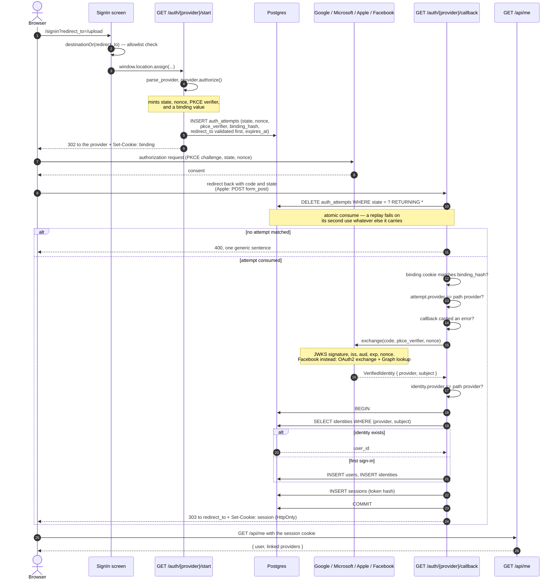
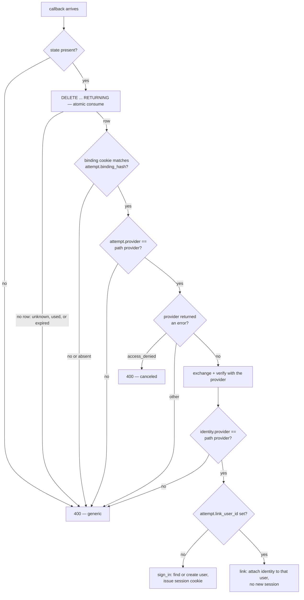
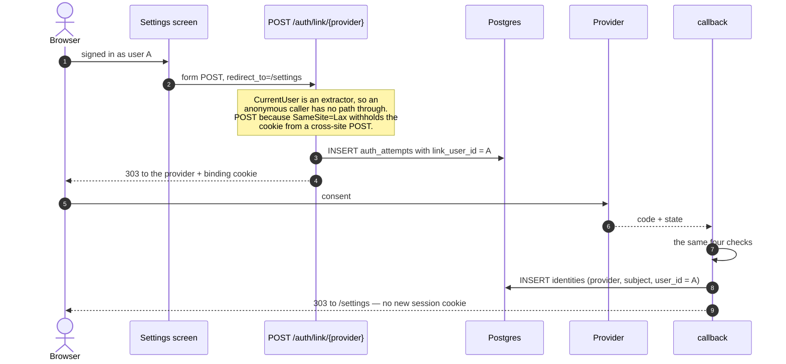
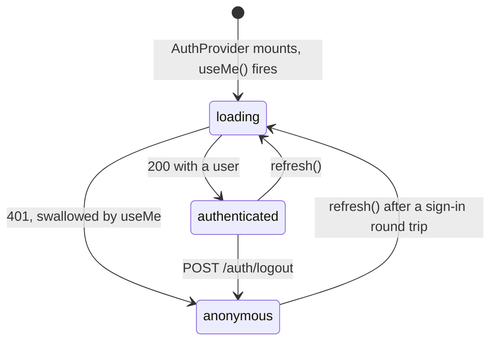

# Authentication flow

No credentials of any kind are stored — no passwords, no hashes, no long-lived
provider tokens. The provider's ID token is verified on receipt and discarded.
What persists is the fact of the identity: which provider, and that provider's
stable subject.

Two tables carry it: `users` (the account, owns voyages) and `identities` (one
row per linked provider, unique on `(provider, subject)`).

## Sign-in, end to end

### The four checks before the code is exchanged

Order matters. The attempt is consumed before anything else is looked at, so no
branch below can be reached without a `state` this service issued
(`crates/api/src/http/auth.rs:401-448`).

The binding cookie is what closes link CSRF. An attacker can hand a victim a URL
carrying the attacker's `state`, but cannot put the matching cookie in the
victim's browser. Only the hash is stored, so a database reader cannot complete
someone's in-flight authorization.

`sign_in` looks up `(provider, subject)` and nothing else. There is no email
branch and no email column to write one with. Two providers can return the same
address for the same human while not every provider verifies ownership, so
matching on email is an account-takeover vector.

## Linking a second provider

Started from `/settings`, which posts a form to `/auth/link/{provider}`.

The account is the one that *started* the flow, read back from
`attempt.link_user_id`. Using the account implied by the returned identity would
let anyone who can complete a provider round trip attach it to whichever account
they liked. No session is issued: the caller is already signed in as A, and that
session stays exactly as it was.

## Session state in the browser

The 401 is swallowed on purpose (`web/src/api/hooks.ts:135`). Most of this
application is readable without an account, so "not signed in" is an ordinary
state of the shell. A `useMe` that surfaced a 401 as `isError` would put an
error boundary in front of the discovery feed for every signed-out visitor.

`AuthProvider` sits outside the router (`web/src/App.tsx:64`) so one read of
`/api/me` serves the whole session rather than one per route.
