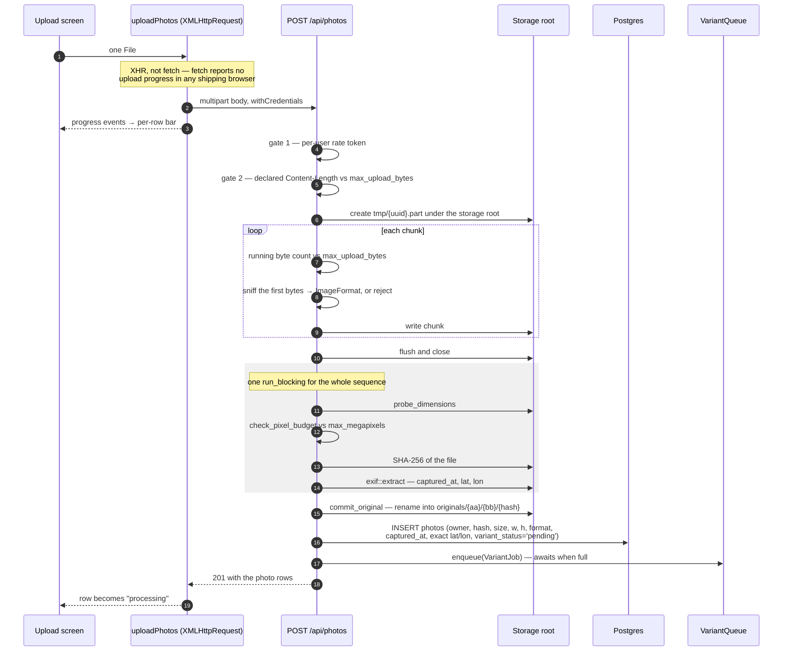
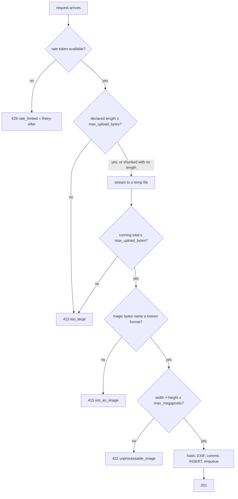
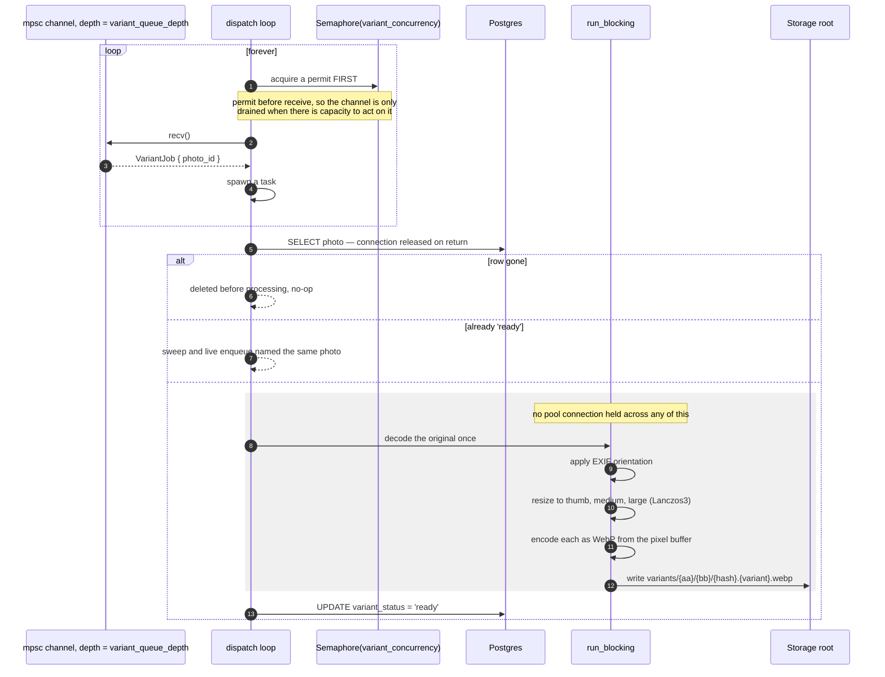
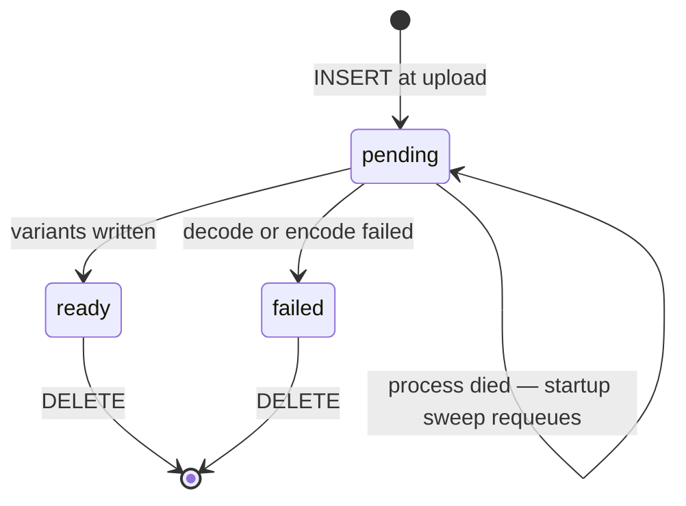
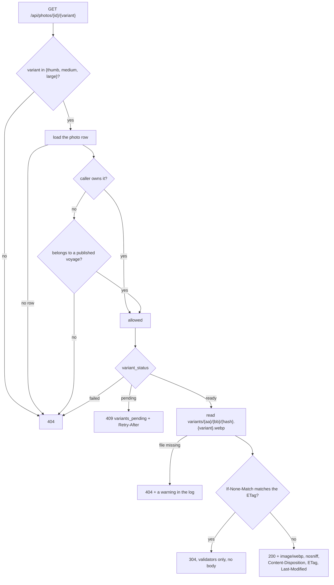
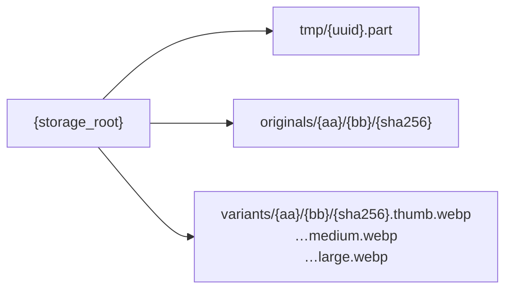

# Photo pipeline

Upload → validate → store → extract EXIF → derive variants → serve.

Three rules govern all of it:

- **Variants carry no metadata.** Every voyage is public, so a served image is a
  public artifact. If a user picks coarse granularity and the served file still
  carries its original GPS EXIF, the setting is decorative.
- **Nothing is served from disk directly.** Every read goes through a handler
  that sets a server-determined `Content-Type`, `nosniff`, and a restrictive
  `Content-Disposition`. The failure being avoided is a stored XSS.
- **Image work never runs on a runtime worker thread.** Decode, resize, encode
  and hashing are CPU-bound and go through `crate::blocking::run_blocking`.

## Upload, one file

`POST /api/photos` is multipart and may carry many files, but the Upload screen
sends one per request so each file gets its own outcome.

The temporary file lives under the storage root rather than in the system temp
directory, so committing an upload is a rename within one filesystem. A rename
across filesystems is a copy, which would double the write cost of every upload
and stop being atomic.

Coordinates are stored **exact**. Rounding at upload would discard the precision
irreversibly and make the granularity setting unchangeable afterwards.

Identical bytes deduplicate: `commit_original` is idempotent, so two rows can
share one file on disk.

## The validation gates, in order

Each gate is placed where it costs least. The rate check is first because it
costs nothing — a limiter that fires halfway through a body has already paid for
the transfer. The declared-length check gives a truthful client its 413
immediately; the running total catches a lying client and a chunked body, which
declares no length at all.

The format sniff runs the moment enough bytes exist to identify the file, before
the rest of the body is written and long before any decoder sees it. A `.jpg`
full of HTML lands there — that is the stored-XSS defense.

The pixel budget is the only check that catches a decompression bomb. A
50,000 × 50,000 PNG is a few hundred kilobytes on disk and about 10 GB decoded,
so a byte-size limit never will.

## Variant generation, off the request path

On failure the row is marked `failed` in a separate statement, not a
transaction: the work that failed is on the filesystem, so there is nothing to
roll back. If *that* write also fails — plausible, since a database outage is a
likely cause of the failure above — the row stays `pending` and the next startup
sweep retries it. A transient outage should not permanently poison a photo, and
a genuinely undecodable file fails again immediately.

The strip is structural rather than a step someone can forget: encoding from a
decoded `DynamicImage` means there is no metadata attached to carry forward. The
tests assert it with `exiftool` anyway, because "we re-encoded it" and "we
stripped it" are different claims and an encoder upgrade can quietly change
which one is true.

### Photo lifecycle

Without the startup sweep a process that died mid-batch would strand photos
forever: the row exists, the library shows it, and nothing would ever generate
its variants because the only thing that enqueued it was the request that has
long since returned. The sweep is capped at 1,000 rows and logs when it hits the
cap.

## Serving a variant

The closed set of three variant names is the path-traversal answer: `../` is not
one of them, so it 404s before any path is built. Nothing user-supplied ever
reaches the filesystem — paths are derived from a 64-character hex SHA-256,
sharded two levels, which cannot contain a separator, a dot-dot, or a null byte
no matter what the uploader called their file.

A pending variant answers 409, not 500. It does not exist *yet*, which is not a
server error.

`variant_body` buffers the whole file rather than streaming it. The code says so
(`crates/api/src/http/photos.rs:584-596`): streaming needs a nameable `Stream`
type this crate does not have. The buffering is bounded — a variant is a WebP
whose longest edge is at most 2560 px — and the original, which can be 25 MB, is
never served at all.

## Storage layout

`originals` and `variants` are siblings rather than nested so a variant sweep
never has to walk past an original. Two shard levels of two hex characters give
65,536 leaf directories, which keeps any one of them small well past any volume
this service will see.
