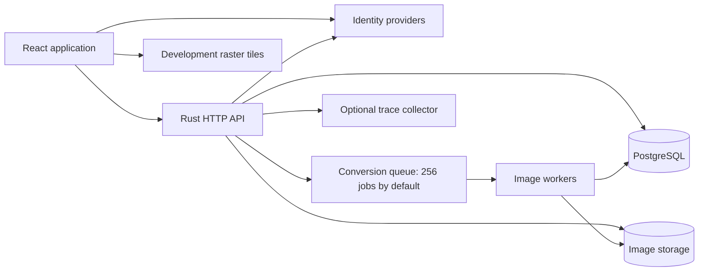

# Architecture

PinVoyager places uploaded photographs on voyage maps. A voyage starts as an owner-only
draft. Publication makes its re-encoded images and rounded locations public. PostgreSQL
stores identities, sessions, voyages, and photo metadata; files named by content hash
store original uploads and WebP variants.

## Modules and ownership

| Location | Responsibility |
| --- | --- |
| `crates/api/src/main.rs`, `state.rs` | Startup/shutdown and shared pool, configuration, providers, upload limiter, and worker handle. |
| `crates/api/src/http/` | Routes, authorization, validation, response types, and database transactions. `voyages/discovery.rs` owns public map queries. |
| `crates/api/src/auth/` | Provider exchange, browser-bound authorization attempts, shared sign-in policy, opaque sessions, and request extractors. |
| `crates/api/src/db/repo/` | Database row types and SQL operations accepting pool or transaction executors. |
| `crates/api/src/photos/` | Validation, EXIF, decoding, content-addressed storage, rate limiting, conversion, and retryable cleanup. |
| `crates/api/src/voyages/granularity.rs` | Rounds coordinates for public responses. |
| `crates/api/src/blocking.rs`, `telemetry.rs` | Blocking-work isolation and trace propagation/export. |
| `web/src/api/` | Fetch/XHR transport, response types, React Query hooks, keys, invalidation, and fixture contracts. |
| `web/src/auth/`, `web/src/shell/` | Session state, display-name requirement, authentication flows, navigation, and route protection. |
| `web/src/screens/` | Page composition. `upload/` owns batch state and `voyage/` separates desktop/mobile layouts, shared controls, and presentation helpers. |
| `web/src/components/` | Shared controls, cards, dialogs, and presentation utilities. |
| `web/src/map/` | MapLibre lifecycle, geometry, clustering, markers, and four lazy map entry points. |
| `design/` | Runtime tokens and component CSS imported by `web/src/styles/index.css`. |

## Startup, request handling, and shutdown

`main::run` loads configuration, initializes telemetry, and calls `run_service`.
The separate `pinvoyager-admin UUID` operator binary grants administrator roles;
see [site administration](site-administration.md).
The service connects to PostgreSQL, runs embedded migrations, initializes
providers, starts image workers, and serves HTTP. A failed provider is logged
and disabled independently. Configuration uses defaults, optional `config.toml`,
and `PINVOYAGER__...` overrides; `Config::from_figment` also accepts explicit
sources for deterministic tests.

`http::router` merges route modules. Middleware supplies request IDs, tracing, response
trace headers, a 30-second default request timeout, and a 32 MiB global request body
limit. Uploads enforce a lower configured limit. `AppError` returns safe application
errors; extractor and middleware failures can have other response shapes, which the
client handles.

When the server receives SIGINT or SIGTERM, it stops accepting new HTTP requests and
lets requests already being processed finish. After `server.shutdown_timeout_secs` (30
seconds by default), `serve_router` aborts and joins remaining HTTP/1 connection
tasks, canceling their handlers and response streams before worker shutdown. It owns
those tasks through a `JoinSet`; the reverse proxy handles public TLS. `VariantQueue::shutdown` then stops maintenance, closes the queue to
new jobs, and waits for accepted jobs to finish. This step has a separate timeout
of the same duration; if it expires, the worker task is
aborted. Maintenance retries interrupted pending rows after restart. Telemetry flushes
last. CPU-intensive work runs without a database connection. Final file writes and
removals retain their content lock until blocking work finishes, including when the
calling future is canceled.

Sources: `run_service` in [`main.rs`](../crates/api/src/main.rs), `serve_router` in
[`http/mod.rs`](../crates/api/src/http/mod.rs), `VariantQueue::shutdown` in
[`worker.rs`](../crates/api/src/photos/worker.rs), and [running locally](running.md).

## Authentication and accounts

Google and Microsoft use OIDC. Microsoft supports personal and organizational
accounts through the common v2 authority with tenant and signing-key issuer
validation (see the authentication flow reference). Apple adds signed client secrets and a form-POST
callback. Accounts match provider and
subject, never email. Provider-supplied names are not account display names.

Authorization starts by saving state, nonce, PKCE material, and a hash of a
browser-binding cookie. The callback consumes and verifies that attempt before signing
in or linking an identity. A session uses a random cookie token whose hash is stored in
PostgreSQL. The server rejects a session after 14 days without activity or 90 days since
creation by default. Activity extends only the idle deadline. The cookie lifetime uses
the absolute session limit. Periodic maintenance removes expired sessions and
authorization attempts.

After provider verification, `auth/sign_in.rs::sign_in` resolves the account,
checks suspension, updates identity activity, and
creates the opaque session in one transaction. Account mutations also recheck
suspension inside their write transactions, locking the account before voyage and
content locks. The debug-only forging endpoint
calls the same function with an explicitly marked development identity after
checking configuration and request inputs. Release builds omit both that endpoint
and the development identity variant, including its optional administrator grant. See the
[shared sign-in pipeline](architecture/auth-flow.md#shared-sign-in-pipeline).

Accounts choose unique lowercase display names. `profile_names` stores current
names, aliases, and reservations. `/u/:identifier` accepts an account ID or display
name. The signed-in owner sees drafts and published voyages; anonymous visitors
and other accounts see only that account's published voyages. Root-level display-name
routing is removed, so names cannot conflict with top-level system routes. Settings supports display-name changes and
provider linking; it offers only implemented account operations.

Sources: [authentication flow](architecture/auth-flow.md),
[display names](display-names.md), `http/auth.rs::complete`,
`auth/session.rs::lookup_and_touch`, and `http/profiles.rs`.

## Persistent data

Migrations in `crates/api/migrations/` are the schema source of truth.

| Relation | Purpose |
| --- | --- |
| `users` | Account, display name, avatar, administrator/suspension flags, and timestamps. |
| `identities` | Unique provider/subject pairs belonging to accounts. |
| `sessions` | Token hashes, user ownership, activity, and absolute expiry. |
| `auth_attempts` | Short-lived provider state, PKCE, nonce, browser binding, and optional linking user. |
| `voyages` | Owner, title, description, granularity, and publication state/time. |
| `photos` | One owning voyage, matching account, order, content hash, format/dimensions, exact EXIF, processing status, and optional retry key. |
| `profile_names` | Current/historical account names and reserved names. |
| `photo_cleanup` | Durable content hashes awaiting safe filesystem cleanup. |
| `voyage_photos` | Compatibility view over photos; no independent membership. |

Most IDs are UUIDv7. Public feeds and profiles paginate by descending
`(published_at, id)` using an opaque `timestamp|uuid` cursor; ties cannot skip
voyages. Owner lists use IDs. Photo order uses position and ID. Checked SQL
queries use committed `.sqlx/` metadata; dynamic SQL has database integration
tests.

## API routes

| Method and path | Purpose/access |
| --- | --- |
| `GET /health`, `GET /ready` | Liveness and database readiness. |
| `GET /auth/{provider}/start` | Begin provider sign-in. |
| `GET/POST /auth/{provider}/callback` | Complete provider authentication. |
| `POST /auth/link/{provider}` | Begin linking for an authenticated account. |
| `POST /auth/logout` | Revoke the presented session and clear its cookie. |
| `POST /auth/dev/login` | Debug builds only, also controlled by configuration. |
| `GET/PATCH /api/me` | Session/account state, signed-in administrator flag, and display-name changes. |
| `GET /api/admin/users`, `GET /api/admin/users/{id}` | Administrator-only account summaries and voyage names/descriptions, paged. |
| `POST /api/admin/users/{id}/actions` | Administrator-only suspension, enabling, promotion, deletion, and unpublishing. |
| `GET /api/profiles/{identifier}` | Public profile by ID, name, or alias; published voyages only, including for owner requests. |
| `GET/POST /api/voyages` | Public feed or authenticated owner feed; create a private draft. |
| `GET/PATCH/DELETE /api/voyages/{id}` | Read visible voyages; owner-only edits, publication, and deletion. |
| `GET/POST /api/voyages/{id}/photos` | Owner metadata and multipart upload. |
| `PATCH /api/voyages/{id}/photos/order` | Owner-only reordering. |
| `DELETE /api/voyages/{id}/photos/{photo}` | Delete a photo from its owned voyage. |
| `GET/DELETE /api/photos/{id}` | Exact owner-only metadata or deletion. |
| `GET /api/photos/{id}/{variant}` | Authorized `thumb`, `display`, or `full` WebP. |
| `GET /api/voyages/{id}/map` | Rounded voyage map payload. |
| `GET /api/map` | Public discovery clusters for a viewport and zoom. |

Registered by `http::{auth,admin,photos,voyages,profiles}::routes`. Missing and foreign
drafts return 404. The separate administration endpoint exposes draft voyage names
and descriptions without granting private photo access. There is no unscoped upload
library, self-service account deletion, or provider-unlink endpoint. See
[site administration](site-administration.md) for account moderation, storage totals,
first-administrator setup, and deletion cleanup.

## Image lifecycle and consistency

The creation form requires name and description and preselects approximately 1 km
precision. The owner can choose another precision before continuing. It creates
a draft and records its ID in the upload URL. `useUploadBatch` uploads one file
per request, preserves a UUID retry key per file, reports each outcome, and
cancels active and not-yet-started work on unmount. Draft creation and mutations
invalidate the relevant voyage, discovery, and public-profile queries.

The API streams native axum multipart fields into temporary files, validates
magic bytes and dimensions, hashes content, and reads EXIF. It reserves queue
capacity before opening the photo transaction. The transaction checks the active
account and locks the voyage and content, recognizes retry keys, commits the
original, and inserts a pending row. Sending the reserved job after commit is
synchronous. A 201 acknowledges
acceptance, not completed conversion.

Workers decode/orient once and encode three WebP sizes without copied metadata.
They recheck the row under the content lock before final writes and marking it
ready. Recovery and cleanup have independent minute timers, so queue backpressure
does not block cleanup. Periodic recovery walks all pending rows in pages of 1,000;
a failed conversion changes a still-pending row to failed. A late failure from a duplicate
job cannot overwrite ready status. Multiple processes can perform duplicate encoding,
but final writes/deletion serialize by content hash.

Account, voyage, and photo deletion record cleanup in the same database transaction
and return 204 after commit. Worker maintenance removes files in the background;
HTTP handlers do not wait for storage removal. Cleanup reacquires the content lock and rechecks references,
so another upload can adopt shared bytes safely. Failed removal stays queued
for retry. Maintenance selects at most 1,000 due cleanup records per pass and defers
failed attempts for 60 seconds, allowing newer records to progress. Uploads write
original bytes before inserting the photo row. A failed insert,
cancellation, or crash can leave unreferenced files. After queued deletions,
`photos/orphans.rs::sweep` scans canonical original and variant paths and removes
unreferenced regular files more than 24 hours old. It rechecks references and each
file's modification time under the content lock; recent files and shared bytes
survive. Temporary upload leases arrange removal when canceled; maintenance also
removes unlocked UUID-named `.part` files older
than 24 hours. Active uploads retain a filesystem lock, including during blocking
probes, so the sweep skips them across API processes.

Image delivery authorizes before opening a variant, evaluates validators, and
streams successful bodies. Responses use `private, no-cache, must-revalidate`;
a 304 still requires authorization. Originals are never served. See
[the image pipeline](photo-pipeline.md) for limits, state transitions, and tests.

## Maps and location privacy

Exact coordinates remain in owner metadata. `Granularity::apply` produces public
cell centers for exact, approximately 1 km, 10 km, or 50 km precision.
`precision_m` is a per-axis half-width. The frontend uses the cell diagonal for
its approximate circle and camera limit.

Voyage maps use the already-loaded detail JSON and group nearby pins in a
spatial grid. Longitude distance wraps across the antimeridian; camera bounds
choose the shortest arc. Geometry and server clustering use MapLibre's 512-pixel
zoom-zero camera scale.

Discovery scans candidates in pages of 1,000, rounds each location, and checks whether
the rounded position falls inside the viewport. It groups at most 20,000 matching photos
and reports whether it truncated the results. The UI offers retry after query errors, a
notice for truncated results, and voyage choices for clusters at maximum zoom. Paging
limits memory use, but sparse viewport queries can scan many pages as the published
photo collection grows.

See [map data flow](architecture/map-data-flow.md), [location gallery](location-gallery.md),
and [development tile policy](osm-tile-policy.md).

## Frontend and verification

React Query holds server data. Discriminated session/upload state prevents combinations
such as an authenticated session without a user or an uploaded row without a photo.
`useModalDialog` in `web/src/components/useModalDialog.ts` opens and closes native
dialogs and handles clicks outside them. Each dialog supplies its content and keyboard
actions.

[Navigation](architecture/navigation.md) documents routes. [Testing](testing.md)
documents unit, database, native-image, trace, API-contract, and frontend checks.
Map component tests use a substitute, while a separate test compares geometry
with the installed MapLibre implementation. CI runs formatting, types, lint,
coverage, and the frontend build.

The API container mounts upload storage at `/data`. Local Compose also runs
PostgreSQL and development tracing. Production uses separate non-root API and
frontend images, private PostgreSQL, shared Caddy TLS, and Watchtower updates
from GHCR. See [production deployment](deployment.md). Scheduled backups and
release tile hosting remain external configuration requirements. [Documentation inventory](documentation-inventory.md)
lists every maintained document and its purpose.
