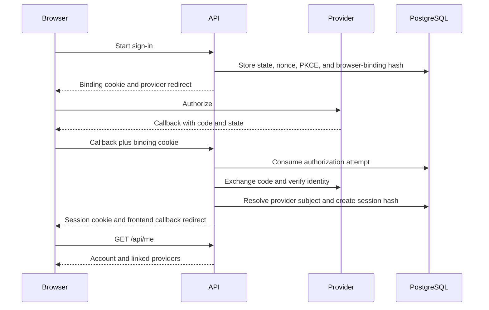
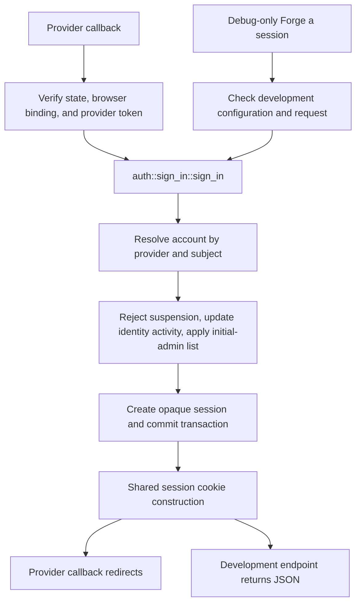

# Authentication flow

[`http/auth.rs::routes`](../../crates/api/src/http/auth.rs) registers provider start,
GET/POST callback, provider-link start, logout, and current-user endpoints.
Google and Microsoft use OpenID Connect; Apple uses an OIDC form callback and
signed client secret. These are the three supported authentication providers.

The browser-binding cookie is HttpOnly, Secure, and SameSite=None so the provider
form callback can carry it. Session cookies are HttpOnly and SameSite=Lax, with
Secure controlled by configuration. Identity matching never merges by email.
Provider linking starts with an authenticated account and refuses an identity
already linked to another account.

Known defect: the conflict message in `http/auth.rs::ALREADY_LINKED` and
`web/src/auth/AuthCallback.tsx::AuthCallback` tells the user to unlink the identity
from the other account. No unlink endpoint or UI is implemented. The message
needs to describe the supported option of signing in to the existing account.

[`session::lookup_and_touch`](../../crates/api/src/auth/session.rs) enforces idle and
absolute expiration. Defaults are 14 days idle and 90 days absolute. Database activity
extends idle expiry. The browser cookie's Max-Age uses the absolute session limit; the
server still rejects sessions whose idle deadline has passed. Periodic maintenance
removes expired sessions and authorization attempts. Logout revokes the presented
session and clears the cookie; it accepts missing or expired sessions.

Known defect: `web/src/auth/AuthProvider.tsx::signOut` suppresses request failures,
and `web/src/shell/AccountMenu.tsx::onSignOut` then navigates to Discover. If logout
fails before reaching the server, the session remains active and the UI gives no
failure message. The failure path also does not explicitly refresh `/api/me`.

Provider callback failures redirect to the frontend result screen. Client-side
[`AuthCallback`](../../web/src/auth/AuthCallback.tsx) presents the status and a
validated local destination. [`AuthProvider`](../../web/src/auth/AuthProvider.tsx)
loads current-user data and requires a unique name when it is absent. See
[display names](../display-names.md).

Debug builds can expose `/auth/dev/login` when enabled in configuration. The route
is absent from release builds. See [local sign-in](../running.md#signing-in-without-provider-credentials).

## Shared sign-in pipeline

Provider callbacks verify state, browser binding, provider identity, and token claims
before calling `auth/sign_in.rs::sign_in` with `SignInIdentity::Verified`.
`auth/dev.rs::login` validates the development request and calls that same function
with `SignInIdentity::Development`. The development module, HTTP route, and input
variant all use `#[cfg(debug_assertions)]`; they are absent in release builds.
Debug builds additionally require `auth.dev_login = true` before accepting a forged
identity. A forged identity is never labelled `VerifiedIdentity`.

The shared function resolves an existing account or creates one. Returning sign-ins
lock the account before checking suspension and updating `identities.last_seen_at`.
Both paths preserve an existing account's display name and avatar. A provider's
avatar is used only when creating an account; development identities supply none.
The initial-admin comparison uses an eligible verified email for provider sign-in
and the supplied subject for development sign-in. Email never selects an account.

Account creation, identity activity, administrator promotion, and opaque session
creation commit in one database transaction. A failure rolls back all of those
writes. A concurrent first-sign-in identity collision returns a generic 400 asking
the caller to start again; the next attempt can find the winning account. Other
database failures propagate through the normal error handling. After commit, a
promotion log records account ID, provider, and whether the source was `provider`
or `development`. Both entry points use `http/auth.rs::session_cookie`; only their
HTTP response formats differ. Provider linking remains a separate operation and
neither creates a session nor grants administrator access.

`auth_flow.rs::provider_and_development_signins_apply_the_same_account_policy`
alternates signed provider callbacks and forged sessions on one account, checking
identity activity and immediate administrator access. `auth/dev_tests.rs` checks
rollback when session insertion fails. `http/auth_tests.rs` checks both entry
points' handling of first-sign-in collisions. Run
`cargo test --release --test auth_build_mode` to verify that the forging endpoint
returns 404 even with `auth.dev_login = true` and an initial-admin list configured.
CI runs that release check in addition to the debug-build coverage suite.

## Microsoft personal and organizational accounts

With the `https://login.microsoftonline.com/common/v2.0` authority and an app
registration supporting organizational and personal Microsoft accounts, sign-in
and account linking accept personal accounts and work or school accounts from any
Microsoft Entra tenant. See [deployment configuration](../deployment.md#microsoft).
Existing tenant-specific configurations continue to use exact issuer matching.

`crates/api/src/auth/providers/oidc.rs::microsoft_common` enables this behavior
only for the Microsoft provider at the exact HTTPS common v2 authority.
`discover_microsoft_metadata` fetches discovery and JWKS at startup, requires the
published `https://login.microsoftonline.com/{tenantid}/v2.0` issuer template,
and caches signing keys with their Microsoft `issuer` restrictions preserved.
Authorization and code exchange use the discovered common endpoints.

`microsoft_token_issuer` reads the unverified token's `tid` only to construct
verification inputs. It requires a canonical UUID and substitutes it into the
fixed Microsoft issuer template; the token cannot supply a metadata URL or host.
`OidcCore::verification_client` includes only signing keys whose issuer is that
exact tenant issuer or Microsoft's tenant-independent issuer template.
`openidconnect::IdToken::claims` then checks the signature, exact token issuer,
audience, expiry, and stored nonce before the subject becomes an identity.
The provider/subject identity key stays unchanged, so existing Microsoft identities
continue to resolve to their accounts. No email matching or additional provider
credentials are stored.

An unknown signing key triggers the existing JWKS refresh, at most once every
five minutes, and one verification retry. Refresh preserves key issuer restrictions.
Provider HTTP requests retain the ten-second timeout and do not follow redirects.

`crates/api/src/auth/providers/oidc_tests.rs::microsoft_accepts_personal_and_business_accounts`
exchanges signed tokens for the personal-account tenant and an organizational
tenant. The companion `microsoft_rejects_invalid_tenants_issuers_and_security_claims`,
`microsoft_requires_a_signing_key_scoped_to_the_token_issuer`,
`microsoft_discovery_rejects_an_unexpected_issuer`, and
`microsoft_key_refresh_preserves_key_issuer_restrictions` tests cover tenant,
issuer, signature, audience, expiry, nonce, discovery, and key refresh validation.
These tests use the local signed-token provider in `crates/api/tests/support/mod.rs`;
they do not establish that a live Entra registration has been configured correctly.

## Removing the retired provider

Facebook sign-in and account linking are removed. Only Google, Microsoft, and
Apple appear in the sign-in screen, Settings, API provider types, and provider
registry. `crates/api/src/auth/provider.rs::ProviderKind::parse` rejects the
retired provider, so its start and callback requests return 404; authenticated
link requests also return 404. The frontend callback parser no longer recognizes
it or offers a retry for it.

`crates/api/migrations/20261011000001_remove_facebook_auth.sql` deletes retired
provider identity links and pending authorization attempts and restricts both
provider columns to the three supported values. API startup applies the migration
through `crates/api/src/db/mod.rs::migrate`. Previously applied migrations retain
their original contents to preserve sqlx checksums. No users, voyages, photos,
or sessions are deleted. Existing sessions continue to work until revoked or
expired; users can link a supported provider in Settings while signed in.
Accounts that had only the retired identity cannot sign in again without a
supported identity linked to that same account. Matching accounts by email remains prohibited.

Regression tests live in
`crates/api/src/auth/provider_tests.rs::removed_provider_is_not_recognized`,
`crates/api/tests/provider_removal.rs::removing_a_provider_preserves_users_sessions_and_other_identities`,
`crates/api/tests/auth_flow.rs::retired_provider_start_callback_and_link_requests_return_not_found`,
`web/src/auth/__tests__/SignIn.test.tsx`, `web/src/auth/__tests__/AuthCallback.test.tsx`, and
`web/src/screens/__tests__/Settings.test.tsx`. The migration test starts with the
old auth schema, verifies that retained rows survive, and checks that the database
rejects the retired provider while accepting each supported provider.

## Administrator roles and suspension

`users.is_site_admin` authorizes `/api/admin/*` on every request and is returned only
in the signed-in `/api/me` user. `users.suspended` blocks session resolution and
provider sign-in/link completion. Suspension revokes sessions and pending linking
attempts. Sign-in/link transactions lock the account through commit so they cannot
issue a session after suspension has completed. Enabling requires a fresh sign-in.
See [site administration](../site-administration.md) for bootstrap and moderation.

Startup `--initial-admin-email` arguments enable automatic role grants on eligible
verified Google/Apple sign-ins. Google requires Gmail or Workspace ownership;
Microsoft email claims cannot grant roles. Emails are transient grant inputs and
do not change provider/subject account matching. The allowlist persists for the
process lifetime, grants persist in PostgreSQL, and suspended accounts remain
blocked. Provider email scopes are requested only while bootstrap is configured.
The debug-only `auth/dev.rs::login` passes its supplied subject to the shared
`auth/sign_in.rs::sign_in` policy without provider or email verification. It requires
`auth.dev_login`; the shared function checks suspension and commits promotion with
the forged session. The route does not exist in release builds.
See [bootstrap security](../site-administration.md#security-assessment).
