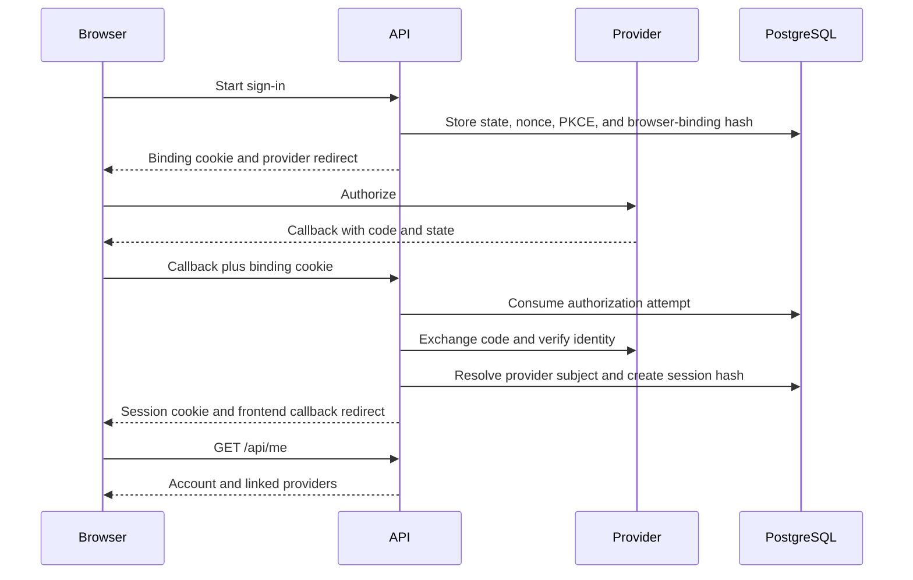

# Authentication flow

[`http/auth.rs::routes`](../../crates/api/src/http/auth.rs) registers provider start,
GET/POST callback, provider-link start, logout, and current-user endpoints.
Google and Microsoft use OpenID Connect; Apple uses an OIDC form callback and
signed client secret; Facebook uses OAuth code exchange and provider identity lookup.

The browser-binding cookie is HttpOnly, Secure, and SameSite=None so the provider
form callback can carry it. Session cookies are HttpOnly and SameSite=Lax, with
Secure controlled by configuration. Identity matching never merges by email.
Provider linking starts with an authenticated account and refuses an identity
already linked to another account.

[`session::lookup_and_touch`](../../crates/api/src/auth/session.rs) enforces idle and
absolute expiration. Defaults are 14 days idle and 90 days absolute. Database activity
extends idle expiry. The browser cookie's Max-Age uses the absolute session limit; the
server still rejects sessions whose idle deadline has passed. Periodic maintenance
removes expired sessions and authorization attempts. Logout revokes the presented
session and clears the cookie; it accepts missing or expired sessions.

Provider callback failures redirect to the frontend result screen. Client-side
[`AuthCallback`](../../web/src/auth/AuthCallback.tsx) presents the status and a
validated local destination. [`AuthProvider`](../../web/src/auth/AuthProvider.tsx)
loads current-user data and requires a unique name when it is absent. See
[display names](../display-names.md).

Debug builds can expose `/auth/dev/login` when enabled in configuration. The route
is absent from release builds. See [local sign-in](../running.md#signing-in-without-provider-credentials).
