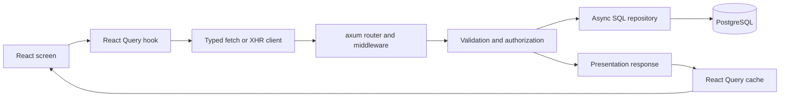

# Request and application data flow

[`api/client.ts`](../../web/src/api/client.ts) sends JSON requests and throws
`ApiRequestError` for API failures. Uploads use XHR for transfer progress.
[`api/types.ts`](../../web/src/api/types.ts) contains handwritten response types;
backend-produced fixtures and frontend contract tests check representative shapes.
There is no OpenAPI generation step.

[`api/hooks.ts`](../../web/src/api/hooks.ts) owns query keys and ordinary mutations.
Voyage reads include photo presentation data. Detail and list/profile queries poll
every second while their returned data reports pending photos. Worker completion
does not push directly to the browser. Successful logout clears cached account data;
see the [authentication reference](auth-flow.md) for the unresolved failure path.

Voyage mutations update cached detail data and invalidate affected lists, discovery, and
public-profile queries. Upload uses the shared creation hook, keeps the draft ID in the
URL, and retains per-file retry keys in its batch hook. Files and progress remain in
browser memory. Reloading resumes the draft, but the user must select files again. The
query client and individual hooks share `retryOnlyTransient`.

Known defect: `web/src/screens/Upload.tsx::Upload` initializes its destination from
the URL only when it mounts. Navigating between upload URLs while React keeps that
screen mounted changes the address bar but retains the previous voyage and batch.
`upload/useUploadBatch.ts::uploadOne` then sends files to the retained voyage. The
destination and batch must reset together when navigation selects another voyage
or starts a new creation flow.

On the server, [`http::router`](../../crates/api/src/http/mod.rs) composes routes and
middleware for request IDs, tracing, timeouts, and body limits. Handlers enforce
ownership/publication and construct responses. SQL operations live in `db/repo`, with
transaction-specific queries also in handlers. After reserving queue capacity, the
upload handler writes the original file and commits the photo row. The filesystem write
and database commit are separate operations. See the [image
pipeline](../photo-pipeline.md).

Exact photo coordinates are stored in the database. Owner photo metadata exposes them;
public voyage responses round coordinates to the chosen granularity. Named-profile
queries filter the owner and published state before pagination. See
[architecture](../architecture.md) for the route table and data model.
