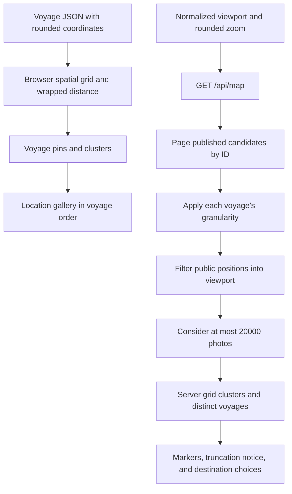

# Map data flow

`web/src/map/MapCanvas.tsx` owns the MapLibre instance, camera, marker portals, request
options, and attribution. Four lazy entry points serve voyage detail, discovery,
precision selection, and upload review. Map component and geometry symbols below are in
`web/src/map/`; server discovery symbols are in
`crates/api/src/http/voyages/discovery.rs`.

The voyage screen uses `useVoyage` data, without a second map-endpoint request.
`geo.ts::clusterPins` searches neighboring grid cells and removes consumed pins.
Groups retain voyage order and use distance from the seed, so a chain of nearby
photos cannot stretch one group across a continent. Wrapped longitude distance
and shortest-arc bounds support voyages across the antimeridian. Photo-list
selection moves the camera; marker activation opens the [gallery](../location-gallery.md).

`http/voyages/discovery.rs::discover_map` scans candidates in pages of 1,000. The
handler rounds coordinates before checking whether a photo falls inside the viewport and
before applying the 20,000-photo response limit. Changing an exact location within the
same public cell therefore cannot change whether it falls inside the viewport or counts
toward truncation. Scanning can require many queries for a sparse viewport.
`cluster_for_discovery` groups public positions in fixed 44-pixel cells and selects the
lowest photo ID as representative. Neighboring server cells can still produce
overlapping markers.

Single-photo markers navigate to their voyage. Multi-photo markers zoom until the map
reaches its maximum zoom, then offer the cluster's distinct voyage titles as links.
Errors have a visible retry action; truncated results have a visible notice. Viewports
normalize repeated-world longitudes and preserve a full-world rectangle.

Both frontend geometry and server projection use a 512-pixel world at zoom zero,
matching MapLibre's camera. Raster source tiles remain 256 pixels; source tile size is a
different setting. `web/src/map/__tests__/projectionBoundary.test.ts` checks the
installed MapLibre transform and Mercator projection directly without WebGL.

Coarse public positions are cell centers. `precision_m` is half the cell width
on each axis. A corner is approximately `sqrt(2) * precision_m` from the center;
`areaDiameterPx` and `zoomForPrecision` use that diagonal extent. Circles indicate
approximate rounding, not an exact geodetic guarantee.

`crates/api/src/voyages/granularity.rs::longitude_cell_scale` caps longitude
widening at ±85°. Beyond that latitude, cells become narrower east-west on the
ground: a nominal 50 km cell is about 10 km wide at 89°. Latitude rounding keeps
the selected size, so the kilometer labels do not guarantee that width on both
axes near the poles.

`PrecisionPreview` uses St. Louis as its example and waits for an explicit
precision choice. `UploadReviewMap` uses exact owner coordinates from accepted
uploads, with a maximum fitted zoom of 16. Neither requires variants to be ready.
See [photo ownership](../voyage-owned-photos.md) and [tile requests](../osm-tile-policy.md).
