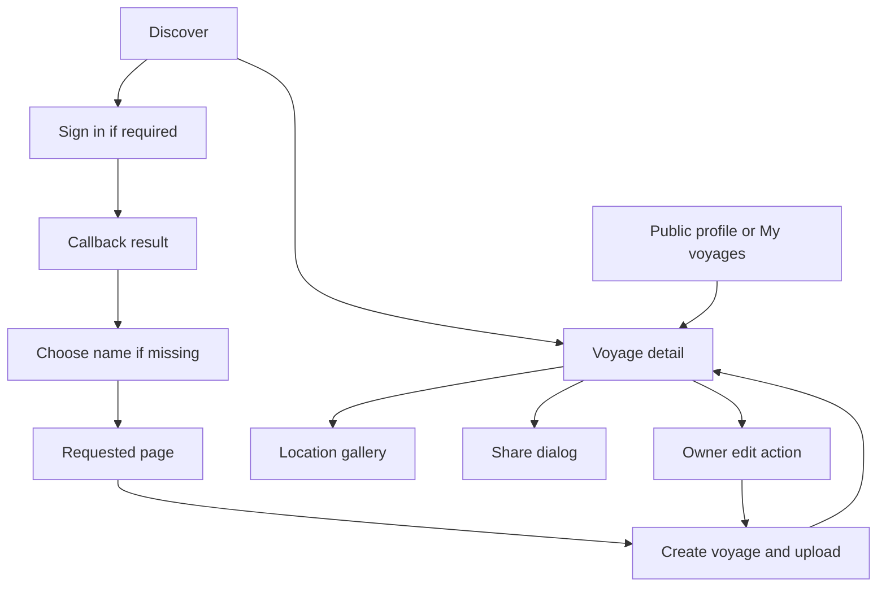

# Application navigation

[`App`](../../web/src/App.tsx) registers the routes. `main.tsx` wraps it in
`QueryClientProvider` and `BrowserRouter`; `AuthProvider` wraps session-dependent routes.
Legal routes render outside `AuthProvider`, using `AuthShell`; see [legal policies](../legal-policies.md). Both shells include footer links to the two documents.
For other routes, an authenticated user with no display name sees `ChooseDisplayName` before the
requested page. Saving the name resumes that page.

| Path | Screen and access |
| --- | --- |
| `/` | Public discovery feed and map. |
| `/voyages/:id` | Voyage detail; published voyages are public, drafts are owner-only at the API. |
| `/voyages/:id/edit` | Owner editor; both the screen and API enforce ownership. |
| `/upload` | Signed-in creation: name, description, precision → files → processing → review. |
| `/upload?voyage=:id` | Add photos directly to an existing owned voyage. |
| `/u/:identifier` | Accepts account ID or display name. The signed-in owner sees drafts and creation controls; everyone else sees published voyages only. Old aliases resolve to `/u/:currentName`. |
| `/admin` | Site-administrator account list with photo/voyage counts and file storage totals. |
| `/admin/users/:id` | Site-administrator user detail, voyage metadata, and modal-confirmed account/voyage actions. |
| `/settings` | Signed-in display-name settings and provider linking. |
| `/terms`, `/privacy` | Public legal drafts; render without session lookup or display-name setup. |
| `/signin` | Provider selection. |
| `/auth/callback` | Authentication result and redirect to the requested destination. |
| Other paths | Not-found screen. |

Root-level `/:displayName` profiles are removed; those former URLs show the not-found
screen. Profile links and name previews use `/u/:displayName`.

`AppShell` provides ordinary navigation; `AuthShell` surrounds sign-in and callback.
`RequireAuth` preserves a validated local return path during sign-in. Shell
navigation lives in [`shell/destinations.ts`](../../web/src/shell/destinations.ts).

The editor's Discard/back actions return without saving. Save keeps the current
publication state. Publish submits the edited fields and `published: true` in one
request. A draft's Share dialog requires successful publication before exposing its
public URL. See [photo ownership](../voyage-owned-photos.md),
[sharing](../voyage-sharing.md), and [gallery behavior](../location-gallery.md).

The account menu links site administrators to `/admin` on desktop and mobile.
`Admin` checks the signed-in role; API handlers enforce it independently. Both admin
routes are accepted sign-in return destinations. See [site administration](../site-administration.md).

## Site identity

Every page shows the Horizon Pin logo from `design/logos/horizon-pin.svg` beside
PinVoyager, linking to `/`. `Brand` in `web/src/components/Brand.tsx` supplies this
shared link. `TopNav` uses it on ordinary routes; `AuthShell` uses it on sign-in,
callback, and legal routes at desktop and mobile widths. `ChooseDisplayName` also
shows it while profile setup replaces the requested route. The image has empty
alternative text because the adjacent site name labels the link.

`web/index.html` declares `/favicon.svg` for every route. The favicon in
`web/public/favicon.svg` copies the Horizon Pin SVG, preserving its teal color
and transparent background. When changing the artwork, update that copy too.
`web/src/components/__tests__/branding.test.ts` checks that it matches the source
and is declared in the HTML. `web/src/shell/__tests__/Shells.test.tsx` checks both
shells at both widths; `web/src/auth/__tests__/AuthProvider.test.tsx` checks the
logo during display-name setup.

## Native iOS navigation

`ios/PinVoyager/App/RootView.swift` owns one `SceneRouter` per window. Each tab has
its own typed `NavigationStack` path; iPad uses a sidebar around the same destinations.
SceneStorage preserves these paths and intended authentication routes. Local voyage
routes use local IDs before a remote ID exists. Account changes clear private paths.
`PinVoyagerApp` shares `AppModel` and synchronization across windows, so a background
completion updates durable state without navigating a window.

Universal links use the trusted configured website origin. `SceneRouter.handle` saves
an open editor's working copy before navigating and keeps a failed link for retry.
Owner edit/import links verify ownership before opening local screens. Sign-in and
initial-name setup resume only the invoking window's intended route; explicit cancel
clears that route. See `SceneRouterTests` and the native implementation reference.
