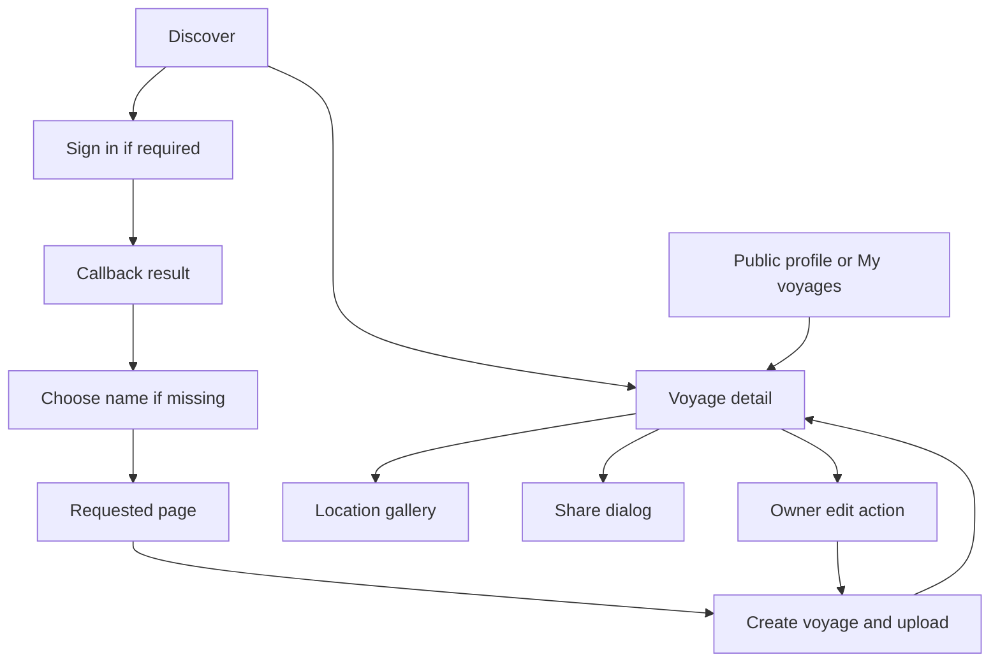

# Application navigation

[`App`](../../web/src/App.tsx) registers the routes. `main.tsx` wraps it in
`QueryClientProvider` and `BrowserRouter`; `AuthProvider` wraps the route tree.
An authenticated user with no display name sees `ChooseDisplayName` before the
requested page. Saving the name resumes that page.

| Path | Screen and access |
| --- | --- |
| `/` | Public discovery feed and map. |
| `/voyages/:id` | Voyage detail; published voyages are public, drafts are owner-only at the API. |
| `/voyages/:id/edit` | Owner editor; both the screen and API enforce ownership. |
| `/upload` | Signed-in creation: name, description, precision → files → processing → review. |
| `/upload?voyage=:id` | Add photos directly to an existing owned voyage. |
| `/u/:identifier` | Accepts account ID or display name. The signed-in owner sees drafts and creation controls; everyone else sees published voyages only. Old aliases resolve to `/u/:currentName`. |
| `/settings` | Signed-in display-name settings and provider linking. |
| `/signin` | Provider selection. |
| `/auth/callback` | Authentication result and redirect to the requested destination. |
| Other paths | Not-found screen. |

Root-level `/:displayName` profiles are removed; those former URLs show the not-found
screen. Profile links and name previews use `/u/:displayName`.

`AppShell` provides ordinary navigation; `AuthShell` surrounds sign-in and callback.
`RequireAuth` preserves a validated local return path during sign-in. Shell
navigation lives in [`shell/destinations.ts`](../../web/src/shell/destinations.ts).

The editor's Discard/back actions return without saving. Save keeps the current
publication state. Publish submits the edited fields and `published: true` in one
request. A draft's Share dialog requires successful publication before exposing its
public URL. See [photo ownership](../voyage-owned-photos.md),
[sharing](../voyage-sharing.md), and [gallery behavior](../location-gallery.md).
