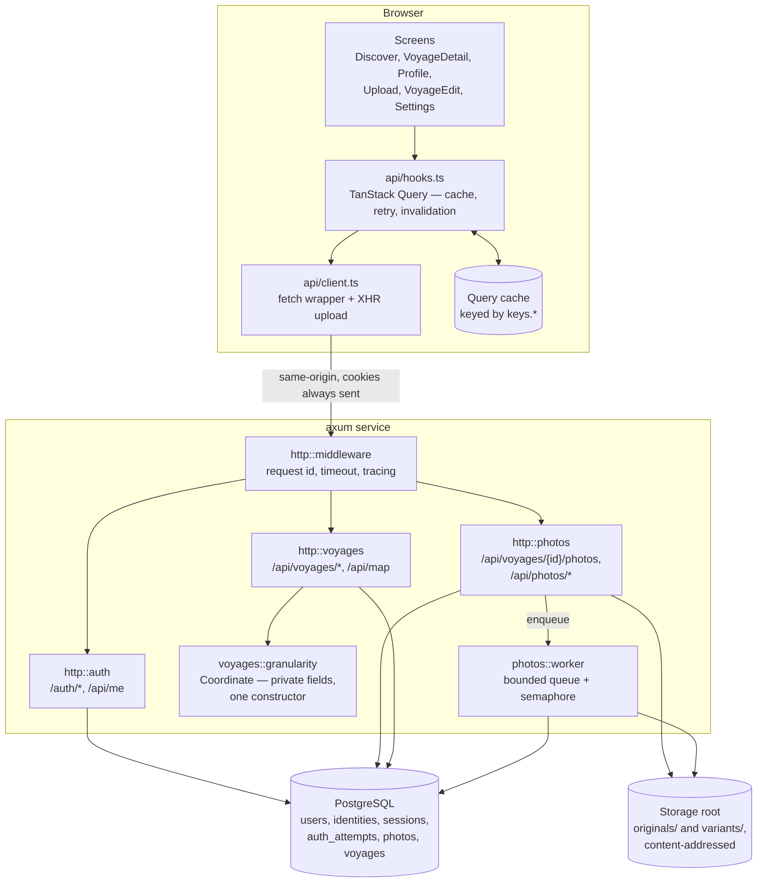
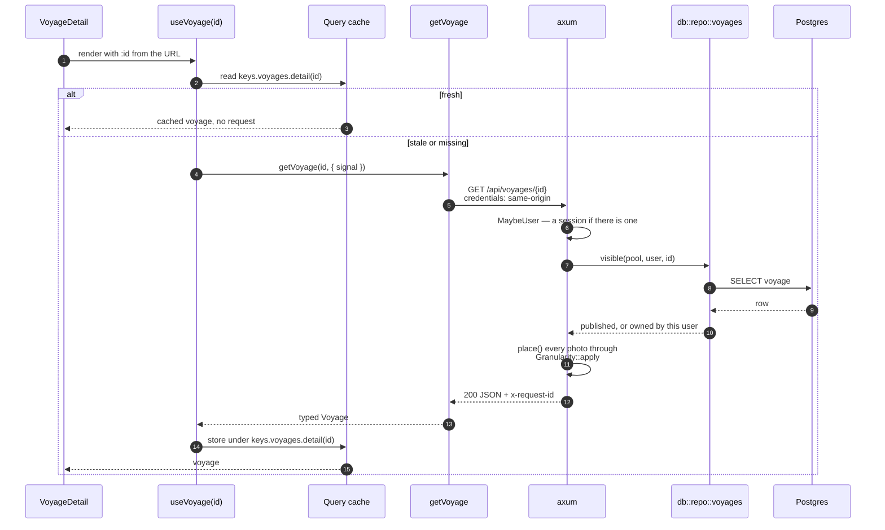
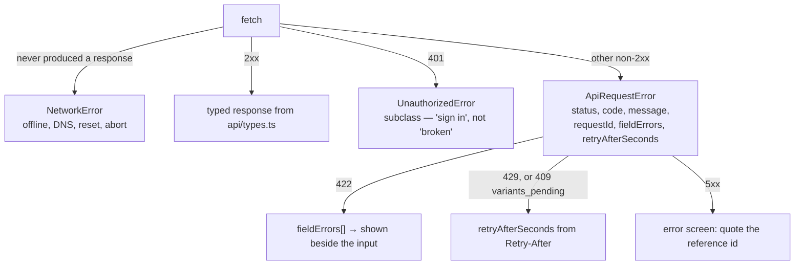
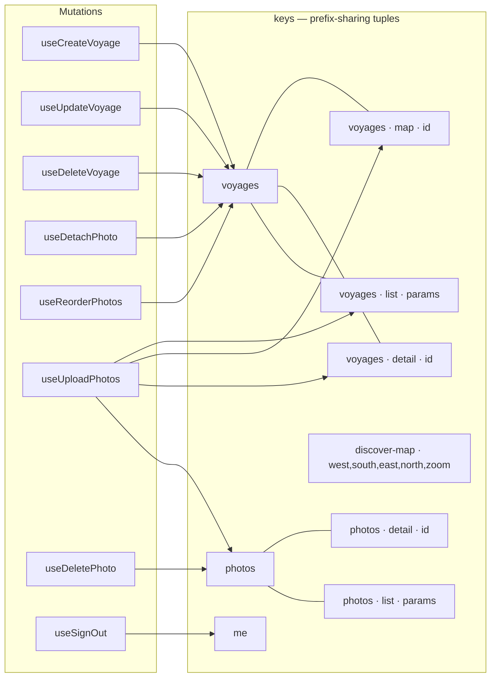
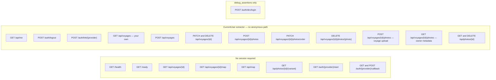
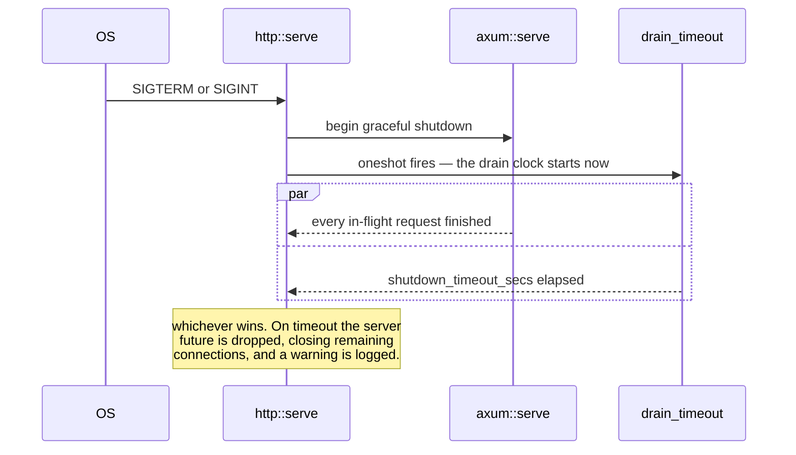

# Data flow

## The layers

In development the Vite dev server proxies `/api` and `/auth` to the service, so
both halves share one origin and the session cookie works. That is why `BASE` in
`web/src/api/client.ts:146` is the empty string.

## One read, end to end

Every response carries `x-request-id`, a UUID v7, set by the outermost layer so
even a 404 gets one. The client keeps it on every error object, because for a
5xx the body says nothing useful on purpose and the real cause is findable in
the server log only by that header.

## Errors as they reach a screen

`code` is typed as `string`, not a union, because the handler-local `Rejection`
types add codes beyond the seven `AppError` produces — `validation_failed`,
`too_large`, `not_an_image`, `unprocessable_image`, `rate_limited`,
`variants_pending`. A client that threw on an unknown code would turn a new
server-side rejection into a blank screen.

Retry policy (`web/src/api/hooks.ts:115`): anything below 500 is not retried. A
404 does not become a 200 on the third attempt, and retrying costs the user the
latency of every attempt before the designed empty state appears.

## Cache keys and what invalidates what

Keys are tuples rather than strings so that
`invalidateQueries({ queryKey: keys.voyages.all })` reaches the feed, every
detail read and every map at once. A flat `"voyage-detail-<id>"` scheme cannot
express that, and the invalidation lists then drift from the routes.

`discoverMap` sits deliberately outside `voyages`, even though it draws
voyages. Publishing one voyage invalidates `['voyages']`, and every rectangle of
the world map a user had panned across would be thrown away with it — while the
answer they are looking at changed by at most one marker.

## The endpoint surface

`GET /api/photos/{id}/{variant}` takes an optional session: the owner sees their
own drafts, everyone else sees it only if it belongs to a published voyage. A
photo that is neither answers 404, not 403 — telling a caller that a photo
exists but is not theirs is an enumeration oracle.

`/auth/dev/login` is compiled out of a release binary. `debug_assertions` is off
in the release profile and the container builds `--release`, so the route is
absent rather than disabled, and the handler additionally refuses unless
`auth.dev_login` is set.

## Shutdown

The clock starts at the signal, never at startup — `drain_timeout` waits on the
oneshot first. Without that, a long-running server would shoot itself after
`shutdown_timeout_secs` of uptime. If the sender is dropped without signaling
(the server stopped for its own reasons) the clock never resolves, so it cannot
race and swallow the server's own result.
