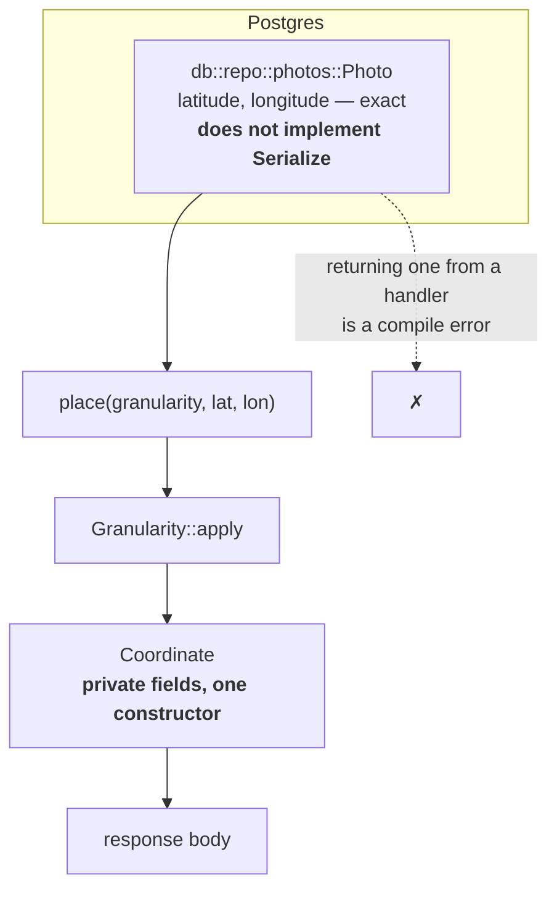
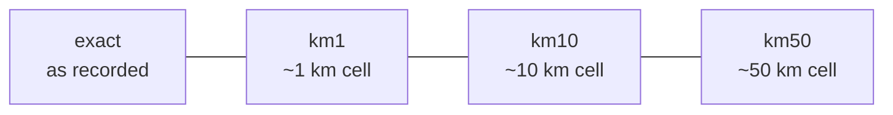
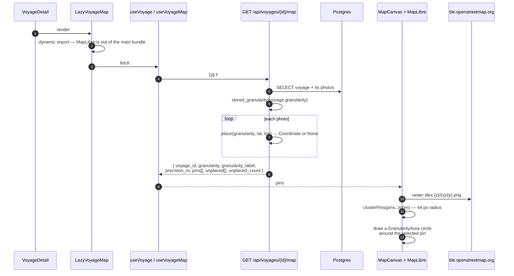
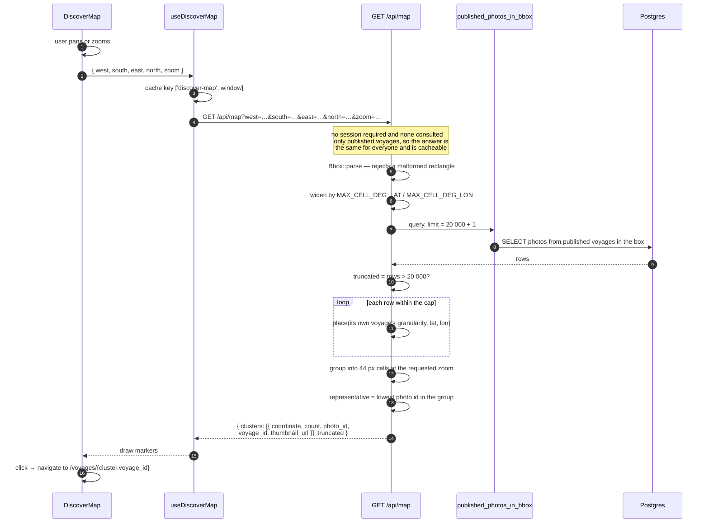
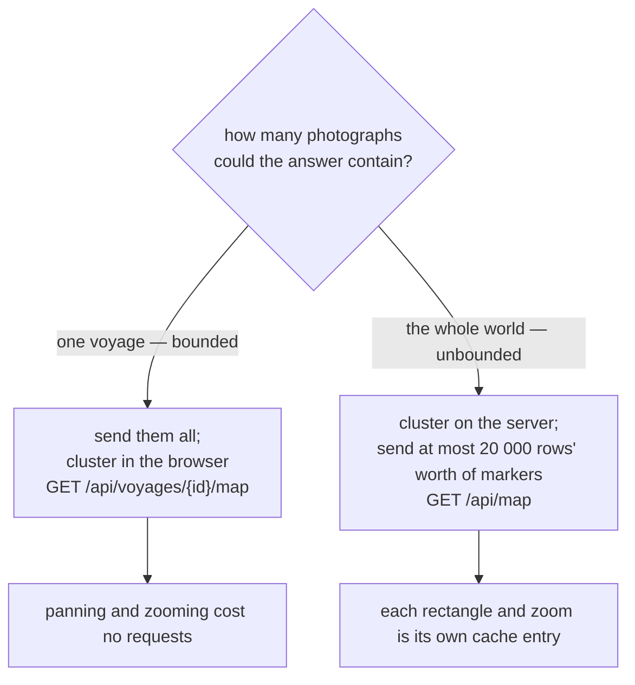

# Maps and the granularity boundary

There are two maps and they work differently on purpose.

- **One voyage** (`GET /api/voyages/{id}/map`) fits in a single response and is
  sent whole. The browser clusters it, so panning and zooming cost no requests.
- **Discovery** (`GET /api/map`) covers every published photograph there is. The
  server clusters it, because no client can be sent them all to group for
  itself.

## The granularity boundary

Published voyages are public, and the database stores exact coordinates so a user can loosen or
tighten precision later. This code is the only thing standing between an EXIF
coordinate and the world.

Enforcing this per endpoint would guarantee that the one endpoint somebody adds
on a Friday afternoon becomes the leak. So it is enforced by the type system
instead: `Coordinate` has private fields and exactly one constructor, which
requires a `Granularity`. There is no way to put a latitude into a response
without having stated a precision, and Rust's module privacy makes that
unforgeable rather than conventional.

The row type that carries raw coordinates deliberately does not implement
`Serialize`.

### The four settings

Rounding is to the **center** of a grid cell, which buys three things:

- **Stable.** The same input always yields the same output. Re-sampling per
  request would make pins jitter between page loads and, worse, would let
  repeated observation average the noise away and recover the true position.
- **Clustering.** Photos in one cell collapse to one point, which also stops a
  coarse voyage from displaying a suspiciously even scatter of distinct pins.
- **Bounded error.** The center is at most half a cell from the truth on each
  axis, rather than up to a full cell as flooring would give.

Longitude is corrected by `cos(latitude)`, computed from the **rounded**
latitude so the cell a point lands in does not depend on the value being hidden.
Without that correction a "~10 km" voyage in northern Norway would actually be
pinned to about 5 km — the dangerous direction to be wrong in, since the product
would be promising less precision than it delivers. The scaling freezes at 85°,
where the widening factor is already 11.5× and there is no inhabited land above.

An unrecognized stored value fails **closed** to the coarsest setting, never to
`exact`. A rollback to a release older than a migration that added a fifth step
must not turn every coarse voyage into an exact one for as long as it runs.

## One voyage on the map

Photos with no coordinates come back in `unplaced` rather than being dropped, so
the screen can say how many there are.

Clustering in the browser uses a 44 px radius — the touch target from
`design/tokens.css`. Two markers closer than one touch target cannot be tapped
apart, so leaving them separate produces taps that appear to do nothing.
Clicking a cluster zooms in two levels, which quarters the area it covers and is
usually enough to break it apart. The selected pin never joins a cluster.

The tile source is decided in exactly one place, `web/src/map/style.ts:47`, and
reads `VITE_TILE_URL` with `https://tile.openstreetmap.org/{z}/{x}/{y}.png` as
the default. Self-hosted Protomaps `.pmtiles` is where this is going; the
planet-archive download was attempted and abandoned after it silently truncated
at 9.2 GB of 127.9 GB with a successful exit status.

## The discovery map

### Three details that are easy to get wrong

**Round first, then cluster.** Each photograph is rounded to its own voyage's
granularity before anything else happens. Grouping exact coordinates and then
rounding the group would make the marker a function of coordinates that were
never allowed out.

**The marker's position is a real published position**, not a computed centroid.
`Coordinate` has one constructor, and a centroid averaged from several
photographs is not its output. Taking the representative's own coordinate keeps
`place` the single call to `Granularity::apply` in the module. The
representative is the lowest photo id in the group, so the same rectangle draws
the same markers twice running.

**The queried rectangle is wider than the requested one.** Rounding moves a
photograph by up to half a cell, so a photograph just outside the requested
rectangle can round to a position inside it. Querying only the exact rectangle
would drop it and leave a visible gap at the edge of every pan. The widening is
50 km in latitude and, allowing for the 85° freeze, about 5.2° in longitude.

**`thumbnail_url` is sent and not drawn.** The server builds one per cluster
(`crates/api/src/http/voyages.rs:1039`), and `DiscoverMarkers`
(`web/src/map/DiscoverMap.tsx:78-103`) renders a pin or a count bubble and never
reads it. Either the marker grows a thumbnail or the field goes.

**Truncation is reported, not hidden.** Past 20,000 rows the extras are dropped
rather than merged, and `truncated: true` says so. A map that silently drops
half a continent looks exactly like a map of a continent with fewer photographs
in it, and the reader has no way to tell which they are looking at.

## Why the two maps differ

That is also why `keys.discoverMap` lives outside `keys.voyages`: publishing one
voyage invalidates `['voyages']`, and every rectangle a user had panned across
would be discarded with it, while the answer they are looking at changed by at
most one marker.
