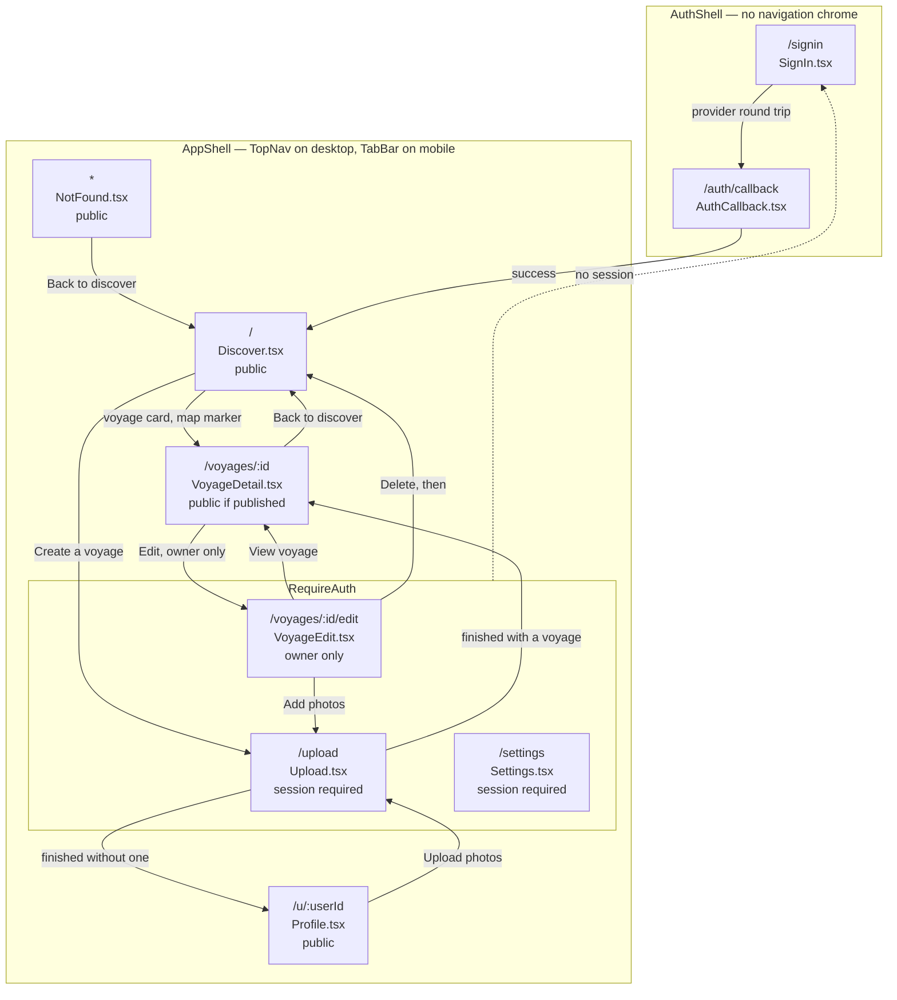
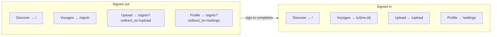
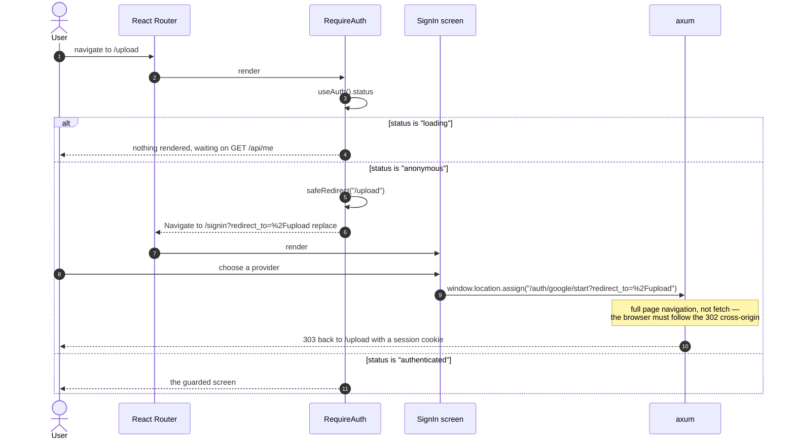
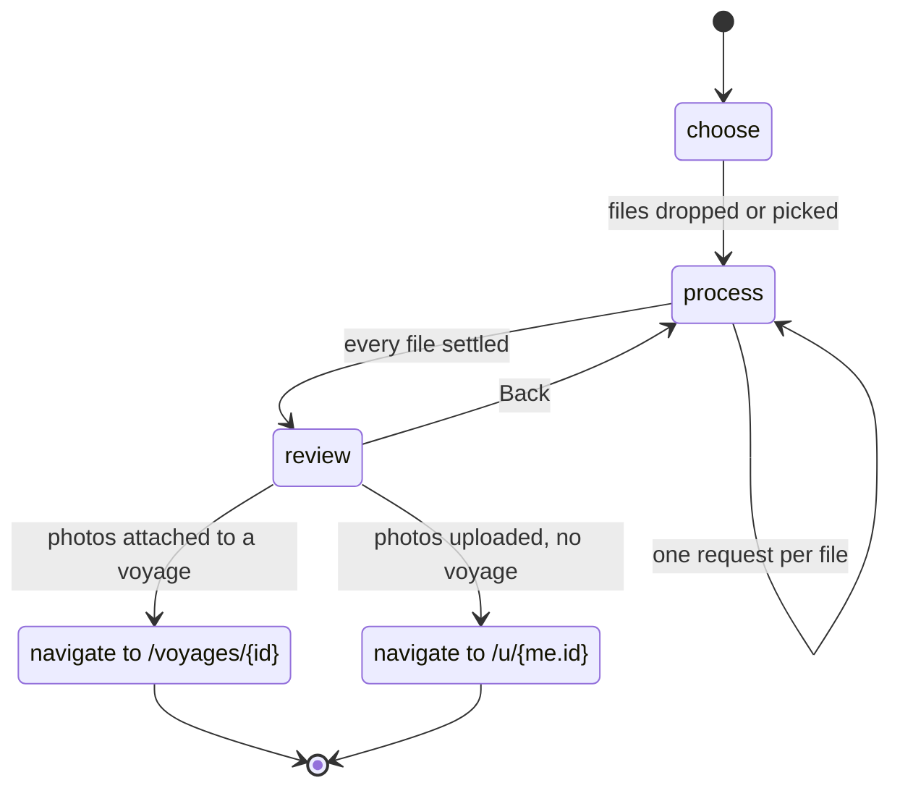
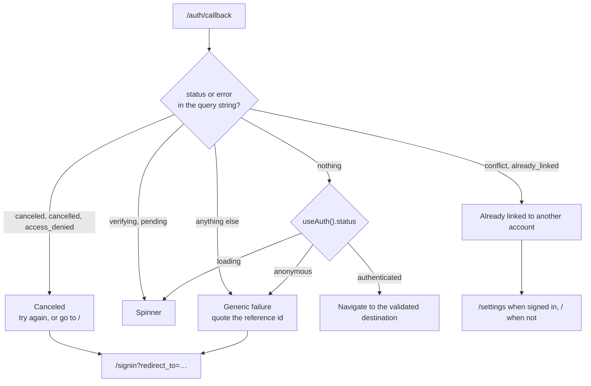

# User navigation

## The route table

Routes come from `web/src/App.tsx:66-85`. Three layout routes wrap them:
`AppShell` (top bar, plus a tab bar below the `md` breakpoint), `RequireAuth`
(redirects to sign-in), and `AuthShell` (brand only, no navigation).

`RequireAuth` is a routing convenience, not access control
(`web/src/auth/RequireAuth.tsx:49`). The server owns access control, and
`/voyages/:id/edit` is owner-only in a way the client cannot check — it only
knows there is *a* session, not whose voyage it is.

## What the shell offers, signed in and signed out

Below the `md` breakpoint the shell draws four tabs; above it, a top bar with
links and an avatar menu. `web/src/shell/destinations.ts` decides where each
points.

Two things in that table are worth naming.

The "Voyages" tab carries no `redirect_to`, because the destination is
`/u/{userId}` and the user id is exactly what is not known yet. The server's
allowlist refuses `/u` anyway (`web/src/auth/redirect.ts:27`).

"Profile" points at `/settings`, not at the user's profile page. The account
screen has no other route into it from a phone — the desktop equivalent is the
avatar menu, and a phone has no avatar menu. The cost is that on your own
profile the Voyages tab lights up rather than the Profile tab, which differs
from `design/screens/profile.html`.

The desktop bar drops "My voyages" when signed out, because there is nothing
behind it (`web/src/shell/destinations.ts:82-95`).

## Being sent to sign in and back again

The destination is validated on the client in `safeRedirect`
(`web/src/auth/redirect.ts:43`) and again on the server in
`http::auth::safe_redirect`. The server makes the security decision. The client
checks the same destination so it does not send a value the server would drop
and leave the user at `/` without an explanation.

The allowlist is `/`, `/discover`, `/settings`, `/upload`, `/voyages`, matching
a prefix only at a `/` boundary — so `/settings-evil.example` does not pass on
the strength of `/settings`.

## The upload wizard

`/upload` is one route with three internal steps
(`web/src/screens/Upload.tsx`). The step is component state, not a URL, so the
back button leaves the screen rather than stepping back through it.

One request per file is deliberate. `uploadPhotos` accepts many, but a rejected
file fails the request that carried it — so a single request for six files
turns one bad file into six unknown outcomes.

## Auth callback outcomes

`/auth/callback` is the failure surface, not the success path. On success the
API answers 303 straight to the destination and the browser never renders this
route.

Every failure gets one screen and one sentence. A rejected `state`, a replayed
callback, an expired attempt, a bad signature and a nonce mismatch are
indistinguishable to the user, because distinguishing them for the user
distinguishes them for someone probing the endpoint. The real cause goes to the
server log against the request id.

The API drives this screen. `to_browser` (`crates/api/src/http/auth.rs:335-394`)
maps the failure to one of the three names, builds
`/auth/callback?status={status}&provider={provider}&ref={request_id}`, and
answers 303. The `ref` is the `x-request-id` header filtered to ASCII
alphanumerics and hyphens and truncated to 64 characters — that header is
attacker-supplied, since the request-id layer forwards a client's value, and
interpolating it unfiltered into a `Location` header is how response splitting
happens.

`AppError::NotFound` is the one failure that stays a 404 rather than becoming a
redirect. It means the provider is not configured, which is a URL that does not
exist here rather than a sign-in that failed.

The doc comment at `web/src/auth/AuthCallback.tsx:32-37` says the API does not
redirect here and that the screen is exercised only by tests. That comment is
stale — `to_browser` builds exactly the redirect it asks for.
