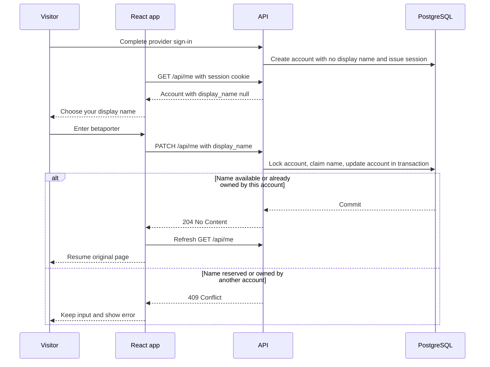
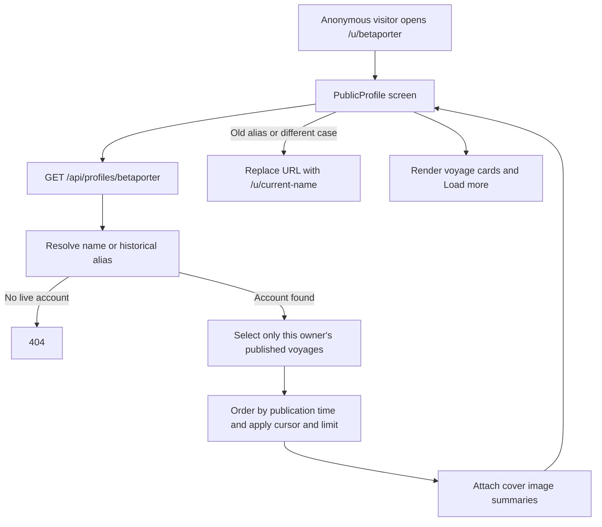

# Display names and voyage profiles

Profiles live beneath `/u/`. An account can be visited at `/u/:userId` or
`/u/:displayName`: `betaporter` gives the account `/u/betaporter`.
There is no `/:displayName` route and no redirect from the former root-level URLs;
`/betaporter` now shows the not-found screen. Top-level system routes cannot
conflict with display names.

## Sign-in and settings

The first successful provider sign-in creates an account and session, without claiming
the provider's name. `crates/api/src/http/auth.rs::callback` and
`crates/api/src/auth/dev.rs::login` create the user with `display_name = NULL`.

`web/src/auth/AuthProvider.tsx::AuthProvider` shows
`web/src/auth/ChooseDisplayName.tsx::ChooseDisplayName` whenever an authenticated
user has no display name. The form explains the format and previews the public
URL. Saving refreshes the session's user data and resumes the original page.
This also covers migrated accounts that need to choose a replacement name.

`web/src/screens/Settings.tsx::Settings` saves through the same typed
`web/src/api/client.ts::updateDisplayName` function through `PATCH /api/me`. Settings
shows a link to the current profile and offers provider linking.

## Name rules and uniqueness

`crates/api/src/http/profiles.rs::normalized_name` trims outer whitespace and
normalizes ASCII letters to lowercase. Names must contain 3–30 ASCII letters,
digits, or hyphens, start with a letter, and end with a letter or digit. Spaces,
slashes, dots, underscores, and non-ASCII letters are rejected. `BetaPorter` and
`betaporter` identify the same name.

The authenticated `profiles::update` handler returns:

| Request | Response |
| --- | --- |
| Valid available name, including the account's current name or old alias | 204 |
| No valid session | 401 |
| Invalid name format | 400 |
| Name reserved or owned by another account | 409 |
| JSON missing a string `display_name` | 422 |

`crates/api/migrations/20261010000001_unique_display_names.sql` creates the
`profile_names` registry with a unique lowercase primary key, and a second
case-insensitive unique index on `users.display_name`. The handler locks the user row
before claiming a name. Concurrent claims by different accounts are resolved by the
database uniqueness constraints. Any failed update rolls back its registry claim.

Changing a name retains every old name as an alias owned by the same account.
Another account cannot take those aliases. Public visits to an alias redirect
in the app to the account's current name. Deleting an account sets the registry
owner to NULL, preserving its reservations; its public names then return 404.

## Reserved names

The existing registry reservations remain unavailable as display names. These include
`api`, `auth`, `u`, `voyages`, `upload`, `settings`, `signin`, `admin`, `assets`,
`users`, `login`, `help`, `terms`, and `privacy`; the migration contains the complete
list. This is a retained name policy, not a requirement for routing safety. Adding a
top-level system route no longer requires reserving its name. Files with dots such as
`robots.txt` and names containing underscores cannot be handles under the format rules.

## Profiles by account ID or name

`web/src/App.tsx::App` registers `/u/:identifier` outside `RequireAuth`.
`web/src/screens/Profile.tsx::Profile` waits for the session and shows `OwnerVoyages`
when the identifier matches the signed-in account's ID or current display name
(case-insensitively). The owner sees published voyages, drafts with badges, and
creation controls. `web/src/screens/OwnerVoyages.tsx::OwnerVoyages` shares this
view between direct owner matches and resolved profiles. `useVoyages({ mine: true })` requests the authenticated owner feed.

For anonymous visitors and other accounts, `PublicProfile` uses the unauthenticated
`GET /api/profiles/{identifier}` endpoint. `crates/api/src/http/profiles.rs::show`
parses UUIDs and resolves them through `users::find_by_id`; other identifiers resolve
case-insensitively through `users::find_by_profile_name`, including historical aliases.
After resolution, `PublicProfile` also compares the returned account ID with the
session, so an owner still sees drafts when their name changed in another session.
UUIDs and valid display names are unambiguous because UUID strings exceed the
30-character display-name limit. Accounts without a display name can be visited by ID.

`crates/api/src/db/repo/voyages.rs::list_published_for_owner` filters by the
resolved owner **before** pagination and returns only published voyages with a
publication timestamp. This public endpoint excludes drafts even for the owner;
the app uses the authenticated owner feed to show drafts. The response never exposes
linked identities. Unknown IDs/names, reserved names, and deleted accounts return 404.

Visits by canonical account ID keep their URL. When `PublicProfile` resolves a
historical alias or differently cased name, it redirects within `/u/` to the
current lowercase name. Direct owner matches keep their URL. An owner's alias
therefore reaches the owner workspace. Other viewers see only published voyages,
with no draft counts or creation controls. Individual voyage cards still link to
`/voyages/:id`, where the API enforces draft ownership.

The response contains `user`, `voyages`, and `next_before`; the corresponding type is
`web/src/api/types.ts::PublicProfilePage`. `limit` defaults to 24 and is constrained to
1–100. `before` is an opaque `RFC3339 timestamp|voyage UUID` cursor; an invalid cursor
returns 400. The app offers Load more until the cursor is absent. Voyage cards use the
API cover summaries; `usePublicProfile` polls while loaded voyages contain photos still
being processed.

## Existing accounts and migration

The migration normalizes existing labels and keeps those that are valid, unique,
and not reserved. It clears invalid or reserved labels and clears **all** accounts
in each duplicate group, requiring each to choose a name. It preserves account
IDs, sessions, identities, avatars, voyages, and photo ownership. Startup runs
the migration automatically. The migration test exercises normalization,
duplicates, reserved paths, and invalid provider labels.

## Implementation tests

`crates/api/tests/display_names.rs` checks validation, atomic claims, aliases,
reservations, migrations, and public-profile visibility by ID, name, and alias for
anonymous callers, owners, and other accounts. Frontend coverage lives
in `auth/__tests__/DisplayNameRoutes.test.tsx`, `screens/__tests__/PublicProfile.test.tsx`,
`screens/__tests__/Profile.test.tsx`, and the Settings/API client suites under
`web/src/`. Route tests cover both identifier forms, owner drafts, alias resolution,
other viewers, and removal of root-level profiles. See [testing](testing.md).
