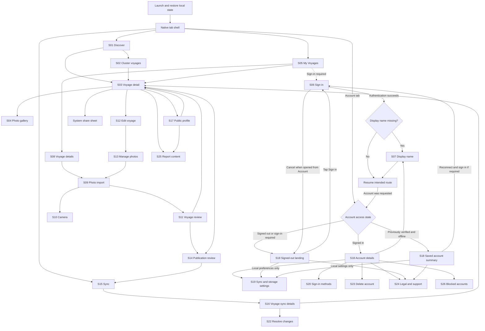
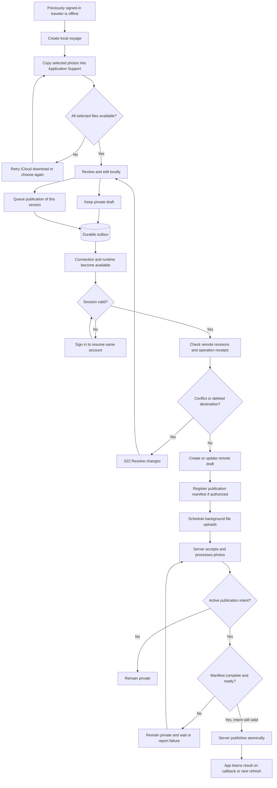
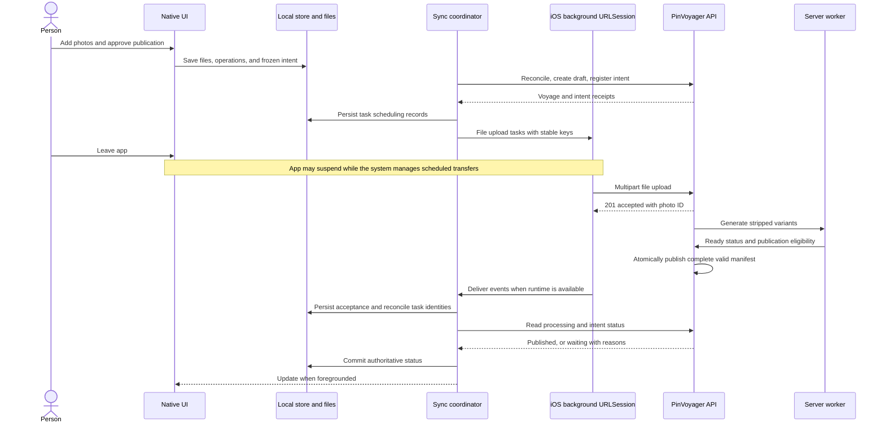
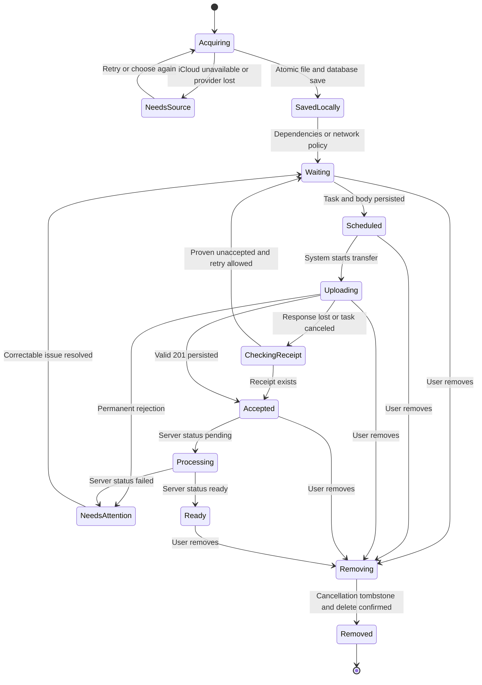
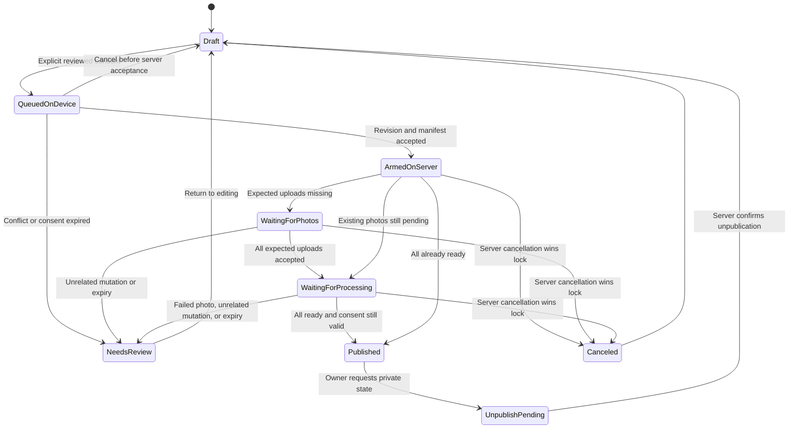
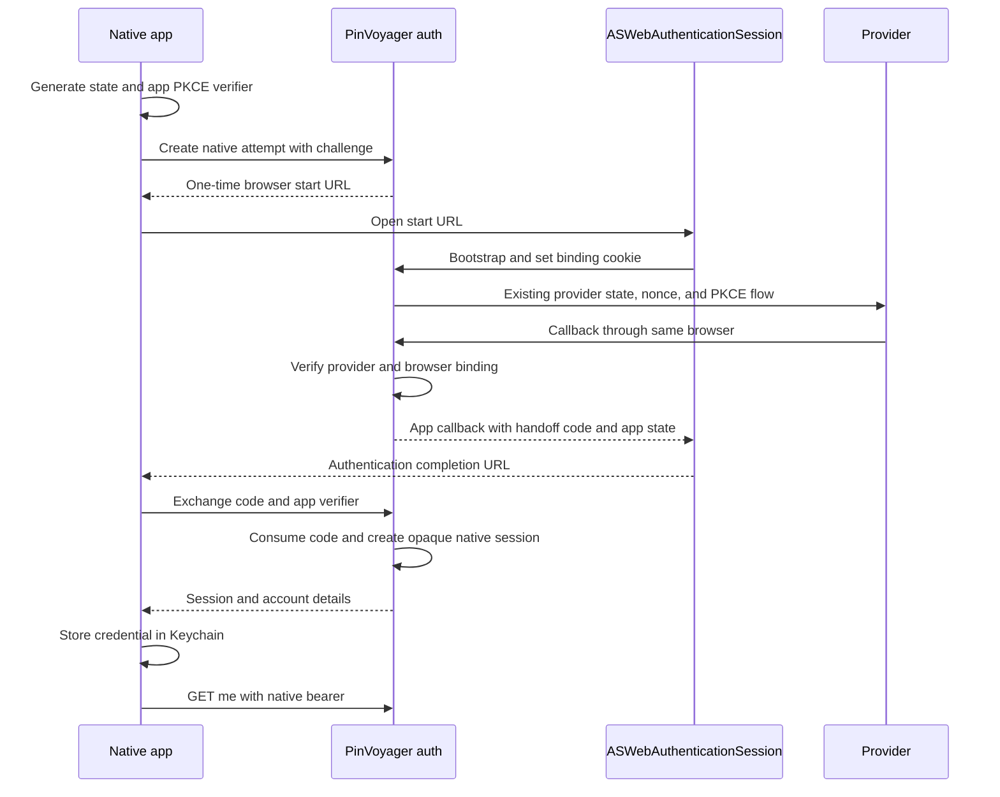
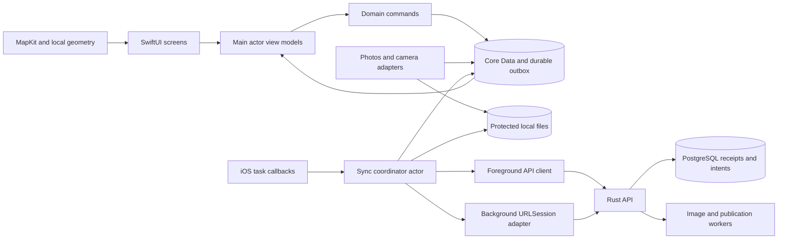

# Native iOS application design and implementation plan

Status: implementation target reviewed for the native client. Native implementation
is in progress; core native authentication, receipt and publication API extensions
are implemented locally. Account lifecycle and moderation remain in progress. See
[implementation status](ios-implementation.md) and [iOS setup](ios-running.md)
for delivered behavior, verification, and remaining work. Design baseline:
repository commit `f50fcf8`, reviewed October 24, 2026.

Build PinVoyager as a native SwiftUI application with MapKit, a durable local
workspace, and file uploads managed by iOS. The website and app use the same
accounts, voyages, publication rules, and server image pipeline. A traveler can
prepare a voyage and its photos without connectivity, leave the app, and resume
without losing saved work. Publication remains an explicit decision.

The central product promise is **save locally first, synchronize when possible,
and report publication only after the server confirms it**. Background transfers
improve reliability; they do not promise a deadline. A server-side publication
request lets an explicitly approved draft become public after all of its chosen
photos arrive and finish processing, even when the app is no longer running.

## Contents

- [Scope and design decisions](#scope-and-design-decisions)
- [Existing system and required changes](#existing-system-and-required-changes)
- [Navigation and visual design](#navigation-and-visual-design)
- [Screen specifications](#screen-specifications)
- [Step by step user journeys](#step-by-step-user-journeys)
- [Offline behavior and local storage](#offline-behavior-and-local-storage)
- [Synchronization and background execution](#synchronization-and-background-execution)
- [Proposed API contracts](#proposed-api-contracts)
- [Native application structure](#native-application-structure)
- [Implementation sequence](#implementation-sequence)
- [Acceptance scenarios and verification](#acceptance-scenarios-and-verification)
- [Review decisions and release dependencies](#review-decisions-and-release-dependencies)
- [Platform references](#platform-references)

## Scope and design decisions

These defaults form one implementable design. Change them during design review,
before beginning the dependent implementation steps.

| Area                    | Proposed decision                                                                                                                                                                                                                           |
| ----------------------- | ------------------------------------------------------------------------------------------------------------------------------------------------------------------------------------------------------------------------------------------- |
| Platform                | iOS 18 minimum; build with a supported stable Xcode and Swift toolchain. Availability-check iOS 26 continued processing. iPhone is the primary layout; support iPad with native split navigation.                                           |
| Native UI               | SwiftUI screens, system navigation, sheets, alerts, Photos picker, camera integration, system authentication presentation, and share sheet. No React Native, Capacitor, or website embedded as the main UI.                                 |
| Maps                    | MapKit with standard flat maps, visible Apple attribution, and native annotations. Keep the existing server rounding and discovery contract. No dependency on the website's OSM development tile server.                                    |
| Persistence             | Core Data backed by SQLite, explicitly versioned migrations, and separate files in Application Support. Use one serialized writer for local mutations and the outbox. No CloudKit synchronization.                                          |
| Identity                | Existing providers through `ASWebAuthenticationSession`; add a secure app session handoff. The app holds an opaque PinVoyager session in Keychain, never provider refresh tokens.                                                           |
| Creation                | A previously authenticated account can create and edit offline. First sign-in and claiming a display name require connectivity. Guest browsing is available without sign-in.                                                                |
| Photo import            | Selected photos only. Copy each selected file into app storage before claiming it is saved. Support HEIC, JPEG, PNG, and WebP; Live Photos contribute their still image only.                                                               |
| Photo capture           | Native still-photo capture, optional location while using the camera, no background location tracking. Save into the voyage, not automatically into the Photos library.                                                                     |
| Synchronization         | Durable operations, stable IDs, idempotent retries, revision checks, and foreground reconciliation. Use background `URLSession` file uploads and opportunistic `BGProcessingTask`.                                                          |
| Publication             | Separate review and confirmation. A queued publication covers a frozen photo list and chosen precision. The server waits for all included variants to become ready.                                                                         |
| Existing public voyages | Edits can affect the public site as they synchronize. Explain this before saving or adding photos. Offer confirmed unpublication first if the owner wants to work privately. No hidden staging branch of a published voyage in version one. |
| Offline viewing         | Local owner content and explicitly downloaded owner copies work offline. Public browsing requires revalidation; do not bypass current authorization cache rules. Offline basemaps are not promised.                                         |
| App Store scope         | Include account deletion, reporting, blocking, and an operational moderation path before public distribution. These need backend work beyond existing website capabilities.                                                                 |
| Deferred                | Video, RAW editing, manual photo coordinates, geocoding/search for places, collaborative voyages, comments/likes/following, automatic whole-library backup, widgets, share extension, push notifications, and native administrator tools.   |

An administrator may use an **Open administration website** action in Account.
It launches the system browser and may require a separate browser sign-in. This
does not transfer the app session into a URL. Legal and support pages may also
open in a system browser; all travelogue workflows remain native.

## Existing system and required changes

### Reuse the product and server behavior

| Observed behavior                                                                                                                     | Source and implication for iOS                                                                                                                                                                |
| ------------------------------------------------------------------------------------------------------------------------------------- | --------------------------------------------------------------------------------------------------------------------------------------------------------------------------------------------- |
| Drafts are owner-only; published voyages are public. Public detail coordinates are rounded even for an owner.                         | `crates/api/src/http/voyages.rs::{visible,place_pair,VoyageResponse::build}` and [constraints](architecture/constraints.md), D6. Use owner photo metadata only in private editing and review. |
| Every photo belongs to one voyage. Creation defaults to `km1`.                                                                        | `http/voyages.rs::create`, `db/repo/voyages.rs::create`, and [photo ownership](voyage-owned-photos.md). Create the remote draft before sending photo bytes.                                   |
| Upload accepts one or more multipart files; retry keys identify a file ordinal within a voyage.                                       | `http/photos.rs::{upload,ingest_part}` and [photo pipeline](photo-pipeline.md). Send one photo per request, with a persistent UUID key and immutable bytes.                                   |
| HTTP 201 acknowledges acceptance, not image readiness. Workers produce metadata-stripped WebP variants.                               | `photos/worker.rs::{spawn,generate}`, `http/photos.rs::image`. Separate transfer, acceptance, and processing states. Never fetch originals.                                                   |
| Current image responses use `private, no-cache, must-revalidate`.                                                                     | `http/photos.rs::image_headers`. An offline owner download needs an explicit new contract; ordinary public image caching does not authorize offline reuse.                                    |
| Voyage and photo mutations enforce ownership and active accounts inside transactions.                                                 | `http/voyages.rs::lock_owned`, `http/photos.rs::ingest_part`, `db/repo/users.rs::require_active`. Retain account-before-voyage-before-content lock ordering.                                  |
| Public feeds and profiles have opaque cursors; owner lists use their own cursor scheme.                                               | `http/voyages.rs::list`, `http/profiles.rs::show`, `web/src/api/types.ts`. Never infer deletion from an item missing from one page.                                                           |
| Public maps group rounded positions on the server; voyage maps group loaded detail photos in the client.                              | `http/voyages/discovery.rs::discover_map`, `web/src/map/geo.ts::clusterPins`, [map flow](architecture/map-data-flow.md). Port behavior and geometry fixtures, not JavaScript UI.              |
| Identities match provider and subject. Browser authentication uses state, nonce, PKCE, a browser-binding cookie, and opaque sessions. | `http/auth.rs::{begin,complete,link}`, `auth/sign_in.rs::sign_in`, `auth/extract.rs::resolve`. Do not assume Safari cookies are app credentials or match accounts by email.                   |
| Name changes retain aliases; public profiles never include drafts.                                                                    | `http/profiles.rs::{normalized_name,show,update}`, [display names](display-names.md). Resolve by account ID and use the owner feed for My Voyages.                                            |
| The website supports discovery, profile, edit, share, upload, settings, and administration.                                           | `web/src/App.tsx::App` and [navigation](architecture/navigation.md). The native navigation below reorganizes these workflows for a phone.                                                     |

### Gaps to address before reliable mobile delivery

1. `web/src/screens/upload/useUploadBatch.ts::useUploadBatch` keeps its queue in
   component memory and cancels on unmount. The app needs independent durable
   storage and recovery after process termination.
2. `http/voyages.rs::{create,update,destroy,reorder}` do not currently provide the
   native operation receipts or revision preconditions specified below. A lost
   create response can otherwise create a duplicate voyage; an offline edit can
   overwrite a later website edit.
3. Current upload retry keys live on photo rows. Deleting a row also removes the
   record needed to reject an old replay. Durable upload receipts and cancellation
   tombstones are needed to prevent deleted photos from returning.
4. `auth/extract.rs::resolve` reads session cookies only. Native session exchange,
   bearer extraction, native linking, and native revocation do not exist.
5. Current publication is an immediate `PATCH` and may include pending or failed
   photos. A durable publication manifest and worker completion check do not exist.
6. `config.toml` and `http/middleware.rs::apply` apply a default 30-second request
   timeout, including uploads. That is unsuitable for a 25 MiB transfer on a slow
   cellular connection. Background scheduling cannot fix a server timeout.
7. There is no self-service account deletion, content-reporting endpoint, or user
   block list. Existing administrator actions are useful building blocks, not a
   complete consumer flow. See [site administration](site-administration.md).
8. Existing legal pages are drafts. Mobile storage, optional location, background
   upload, deletion, and moderation disclosures need finalized operator details.
   See [legal policies](legal-policies.md).

These are proposed extensions, not claims that the current API already supports
the app. Keep current functional references describing implemented behavior until
each extension ships.

## Navigation and visual design

### Main navigation

Use four persistent tabs: **Discover**, **My Voyages**, **Sync**, and **Account**.
Each has its own `NavigationStack` and restores its last route. Creation is a
toolbar plus action in My Voyages and Discover, not a tab with no destination.
The Sync badge counts items needing attention, not every actively uploading photo.
While work is progressing, show a small progress indicator in the Sync tab and a
compact status row on affected voyages.



Sheet IDs and screen IDs are stable references for implementation tasks and UI
tests. System surfaces such as Photos picker and share sheet do not require custom
replicas. Confirmation dialogs are specified alongside their owning screens.

### Layout and interaction rules

- Use the Horizon Pin artwork from `design/logos/horizon-pin.svg` as a native
  vector asset and app icon source. Use SF Symbols for actions, with text labels
  or accessibility names. Do not invent a separate visual identity.
- Translate semantic colors in `design/tokens.css` into light/dark asset colors:
  teal for actions, amber-orange for map pins, warm neutral surfaces. Use system
  typography with Dynamic Type instead of copying web pixel sizes.
- Give primary content 16-point horizontal margins and use 8/16/24-point spacing.
  Use system grouped forms for settings and editors, and 12-point corner radii
  for photo cards. Touch targets are at least 44 by 44 points.
- Every screen has one clear primary action. Sticky bottom actions respect the
  keyboard and safe area. Back, Close, and Cancel are distinct: Back navigates,
  Close leaves a saved workspace, Cancel abandons a pending dialog or import.
- A screen may render local content immediately. Show **Saved on this iPhone**
  only after the database transaction and required file writes succeed. A spinner
  must not be the only evidence that a save failed.
- Connectivity appears in one compact status banner: **Offline — changes stay on
  this iPhone**, **Waiting for Wi-Fi**, or **Sign in to resume syncing**. Tapping
  it opens Sync. Do not show a new alert every time the network changes.
- Public visibility and synchronization are separate labels. A voyage can be
  **Public · Changes waiting to sync** or **Draft · Uploaded**. Never display
  **Published** for an unacknowledged local action.
- Support VoiceOver labels for pins and photos, ordered reading, larger text,
  increased contrast, Reduce Motion, hardware keyboard navigation, and accessible
  alternatives to dragging. Status never depends on color alone.
- At accessibility text sizes, cards become single-column and toolbars collapse
  secondary actions into a labeled More menu. All map content is also reachable
  through a list or grid; no task requires interpreting a map.
- On iPad, use `NavigationSplitView` with the four destinations in a sidebar;
  show voyage list and detail side by side when space permits. One synchronization
  coordinator owns work across windows. Background callbacks never navigate UI.

### Route restoration and links

Support universal links for `https://pinvoyager.com/voyages/{id}` and
`https://pinvoyager.com/u/{identifier}` with Associated Domains and an HTTPS
`apple-app-site-association` file. The production origin must come from trusted
build configuration. Do not use an API response's arbitrary host as a share URL.

Public links open directly in Discover's navigation stack. An owned voyage link
may open My Voyages after identity resolution. A draft link returning 404 shows
the same unavailable message as any inaccessible voyage; it does not disclose
the owner. Offer Sign in without promising that it will reveal the voyage.

`/upload` opens creation after authentication; `/upload?voyage={id}` opens Add
Photos only after owner verification. `/voyages/{id}/edit` requires the same
check. `/settings` maps to Account. Unsupported admin and legal web destinations
open in the browser. Reject malformed IDs, unknown callback paths, and arbitrary
return URLs. A local-only voyage has no universal link.

Persist the intended typed route before sign-in, restore it after display-name
setup, and clear it on explicit cancellation. Restore local voyage routes by
local ID even before a server ID exists. If a deep link arrives during an edit,
save the working copy before switching; if saving fails, keep the edit visible
and retain the link for retry. Dismissing a photo sheet restores the invoking
thumbnail's focus and scroll position.

## Screen specifications

Every list supports loading, empty, partial-data, and error states. An initial
network failure shows Retry; a pagination failure keeps existing rows and offers
Retry loading more. Pull to refresh never discards unsynchronized local edits.

### S00 Launch and recovery

**Presentation:** launch artwork briefly, then the last tab. No network-dependent
splash screen or forced tutorial. First launch defaults to Discover.

**Sequence:** open/migrate the local store; establish the active account namespace;
recreate background sessions; reconcile stored task records; render saved state;
then refresh account and remote data when possible. Session verification is
independent of displaying saved owner work.

**Controls:** if migration or storage opening fails, show **Try again**, **Export
recoverable local files**, and **Help**. Never silently delete and recreate a
store containing drafts. If the device has not been unlocked since restart, defer
protected-file access and resume after protected data becomes available.

### S01 Discover

**Layout:** large title, plus button, **Recent / Map** segmented control, content
area, tab bar. Recent shows vertically scrolling voyage cards with ready cover,
title, description excerpt, and owner link. Avoid invented photo counts when the
summary response has none. Resolve owner names through public profile data with
deduplicated requests; use **View traveler** until resolved.

**Controls and outcomes:**

| Control                     | Result                                                                            |
| --------------------------- | --------------------------------------------------------------------------------- |
| Voyage card                 | Push S03 with the voyage ID.                                                      |
| Owner link                  | Push S17; do not trigger the card simultaneously.                                 |
| Plus                        | S08, or S06 followed by S08.                                                      |
| Recent / Map                | Preserve each mode's scroll/camera state. Recent is the default.                  |
| Pull to refresh / Load more | Fetch cursor pages without replacing local owner edits. Deduplicate by voyage ID. |
| Map pan, pinch, compass     | Move camera; query after a 300 ms settle interval and cancel obsolete requests.   |
| Single-photo pin            | Open its voyage.                                                                  |
| Cluster pin                 | Zoom two equivalent zoom levels; at maximum zoom open S02.                        |
| Retry map                   | Repeat the current viewport request.                                              |
| Visible voyages list        | Accessible list of the distinct voyages in the returned map clusters.             |

Keep `truncated` messaging visible: **Zoom in to see more photographs**. No global
text search or place search is implied. Public feed/map content is not an offline
download feature. On connectivity loss, show an offline placeholder for content
that needs revalidation and a **Go to My Voyages** action. Do not substitute exact
owner coordinates into discovery.

### S02 Voyages at this location

Native medium/large sheet titled **Voyages at this location**. List distinct
voyage titles from the selected discovery cluster; each row opens S03 and closes
the sheet. Include **Close** and **Zoom in** when further zoom is possible.
Preserve the originating map camera. If a voyage has become inaccessible, S03
handles its 404. The sheet does not claim to represent results omitted by the
server's truncation limit.

### S03 Voyage detail

**Layout:** navigation title/back; Share and More toolbar actions; title,
description with **More/Less**, owner link, photo/place counts; visibility and
sync status for the owner; **Map / Photos** control. Default to Map when located
photos exist, Photos otherwise. A map uses most of the viewport. Opening a photo
from either mode presents S04 at the full size of the current app window.
Photos mode is a lazy grid with
two or three columns according to available width.

**Shared controls:** tap a marker to open S04 for that marker's photos in voyage
order; tap a grid thumbnail to open S04 for all photos at that index; tap the
tray's **Without location** row to filter to unplaced photos. **Fit voyage** fits
the shortest longitude arc. Compass resets north. The owner link opens S17.
Share presents the system share sheet only for a currently confirmed public
voyage; draft owners go to S14. More includes **Open on website** for remote IDs,
**Report** and **Block traveler** for other owners, and owner actions below.

**Owner actions:** **Edit details** → S12; **Add photos** → S09; **Manage photos**
→ S13; **Review and publish** → S14 for drafts; **Sync details** → S16; **Download
for offline use** → owner-download confirmation; **Unpublish** and **Delete
voyage** → S21 confirmations. Download shows size estimate and available space,
then records progress. The owner can remove a download without deleting a voyage.

Use rounded server coordinates in this viewer. For local drafts, apply the same
rounding algorithm locally. Exact coordinates appear only in the explicitly
private review/metadata surfaces. Local previews have **On this iPhone** badges;
they must not look like publicly available server variants.

**States:** no photos shows Add photos for an owner; processing photos show neutral
placeholders; failed photos show **Could not process** and an owner-only recovery
link; an unavailable variant gets one authorized metadata refresh before showing
an error. A 404 on the voyage replaces the remote view, but retains unsynced owner
work in S22. An offline remote voyage without an owner download says **Not available
offline** and offers Back. Share is disabled offline until publication can be
revalidated; existing links already shared elsewhere remain ordinary web URLs.

### S04 Photo gallery and information

Full-screen native presentation with a dark background, Close, photo position
such as **3 of 12**, swipe paging, zoom/pan, double-tap zoom reset, Previous/Next
accessible actions, and a horizontally scrolling thumbnail strip. Paging is
disabled while an image is zoomed and being panned. The current photo ID, not its
array index, anchors selection across a data refresh.

**Info** opens a sheet showing capture date if present, dimensions, and
**Approximate location**, **Exact location**, or **No recorded location** according
to the actual coordinate source. Public information uses rounded data only.
Owner **Private metadata** explicitly labels exact coordinates and upload state.
Do not manufacture a capture timezone when the source does not supply one.
**Show on map** closes the gallery and selects the located photo in S03; hide it
for unplaced photos. **Report photo** is available for another owner's photo.
Owner More includes **Remove from voyage**, routed through S21.

Use display variants for normal viewing and load full variants only on zoom,
with authorization. Use imported local files only in owner context. Do not offer
sharing of original files from this viewer; voyage URL sharing is the public
sharing feature. Missing offline display files show a placeholder and **Download
when online**. A location gallery keeps its membership fixed while open; on
deletion advance to the next surviving member, or close if none remain.

### S05 My Voyages

Title **My Voyages**, plus button, local search field, **All / Drafts / Public**
filter, and a list of owned voyages. Each row shows thumbnail, title, last local
edit time, visibility, and a separate synchronization summary. Local-only drafts
appear first, then remaining voyages by recent local activity; remote paging
still follows the API cursor, not that display order.

Tap a row for S03. Swipe/context actions are **Edit**, **Sync details**, and
**Delete** with confirmation. The empty state has **Create a voyage**. Search
matches downloaded/local titles only and says **Search saved voyages**; it must
not imply server-wide search. **Load more** is online-only. On first sign-out,
show **Sign in to see your voyages**, preserving the tab as the return destination.

Previously authenticated offline users see their retained workspace. An expired
session banner offers sign-in without blocking local work. Fetch every owner page
during full reconciliation; refresh known active voyage details separately, since
an old voyage may have changed without moving to the first list page.

### S06 Sign in and authentication result

Native sheet with logo, **Continue with Apple**, **Continue with Google**,
**Continue with Microsoft**, Terms, Privacy, and Cancel. Display only configured
providers from the capability response; keep a meaningful retry state if none
are available. Buttons launch `ASWebAuthenticationSession`, not an embedded
`WKWebView`. A small **Use another account** option requests ephemeral browsing.

During exchange, disable duplicate starts and show **Finishing sign-in**. Provider
cancellation returns to the sheet without an alarming error. Network or provider
errors offer Retry and preserve the intended route. A callback is handled only
for the pending attempt and correct state. A successful account without a name
goes to S07; otherwise dismiss and resume the intended route.

Offline sign-in shows **Connect to sign in**. If a recovered session belongs to a
different account from the queued work, keep that work locked to its original
account and explain **These drafts belong to another account**. Never reassign
uploads by matching an email or display name.

### S07 Choose or change display name

Grouped form: name field, format help, canonical profile URL preview, inline
validation, Save, and Cancel/Back. Initial setup uses **Choose your display name**
and **Continue**; Cancel returns to browsing while owner upload/publication remains
paused until setup finishes. Existing local files remain safe.

Normalize ASCII case and trim surrounding spaces. Accept 3–30 ASCII letters,
digits, or hyphens; start with a letter and end with a letter/digit, matching
`http/profiles.rs::normalized_name`. Availability is determined by Save, not a
fabricated availability endpoint. On 409, retain input and show **That name is
unavailable**. On 204, fetch `/api/me` and resume. Changes are online-only; an
offline user can edit the field but cannot reserve or claim a name. Explain that
previous names continue to resolve to the same profile.

### S08 New voyage details

Full-screen creation flow with Close, **New voyage**, Voyage name field,
multiline Description, and a Location precision row opening S08a. Default to
approximately 1 km. Require trimmed nonempty name and description for new
voyages, matching the website's creation experience. Enforce 200 and 8,000 Unicode
scalar limits respectively to match Rust character counting, rather than Swift
grapheme count. Show a counter near the limit and a specific field error.

**Add photos** saves a local voyage and advances to S09. **Save draft and close**
returns to My Voyages. A new scratch form is persisted as the user types, with a
short debounce and a flush on navigation; once any meaningful text exists, Close
offers **Keep draft**, **Discard draft**, and **Continue editing**. Empty scratch
forms can close without a prompt. Backgrounding never discards input.

When online, local save schedules draft creation independently of navigation.
When offline, show **Saved on this iPhone. Uploads will begin when a connection is
available**. Do not wait for a server ID to let the user select photos.

### S08a Location precision

Sheet with four radio rows: **Exact**, **Approximately 1 km**, **Approximately
10 km**, **Approximately 50 km**; a map preview; explanation; Done and Cancel.
Use a fixed sample location for a new voyage, or the selected private photo for
an existing one. The preview labels itself as an example. Coarse choices draw
the approximate area using the cell diagonal; Exact draws a pin.

Copy: **This controls locations shown publicly. Original photo locations remain
available to you. Photos can reveal places through their content too.** Selecting
Exact displays **Exact recorded locations will be public** inline. Done changes
the working copy; Cancel keeps the previous value. No geocoding or location
permission is necessary. If basemap tiles are unavailable, retain the choice
rows and a schematic scale illustration, without claiming a real map is loaded.

### S09 Add photos and import progress

Header names the destination voyage. Controls: **Choose photos**, **Take photo**,
**Review voyage**, Close, and, while importing, **Stop importing remaining photos**.
For a public voyage, first show **New photos will become public as they upload**
with **Continue adding publicly**, **Unpublish first**, and Cancel. Unpublish first
must be acknowledged by the server before bytes are scheduled. Offline users can
save their selection locally but must confirm the public upload choice before
it is scheduled, or wait for confirmed unpublication.

Present the system Photos picker filtered to images with ordered selection. Set
a batch limit of 100; users can add more batches. Display file preparation
separately from upload: **Saving 8 of 20 on this iPhone**, then **20 saved · 6
uploaded · 14 waiting**. Rows show local thumbnail, filename or **Photo 8**, size,
state, and contextual Retry/Remove. Do not decode full-size images in the grid.

Copy selected file representations immediately out of temporary picker storage.
Request the current supported representation, not a generic `UIImage` conversion
that loses EXIF. An iCloud-only photo that cannot be fetched is **Needs download
from iCloud** with Retry/Choose again/Remove; it is not counted as saved. Picker
references alone are not a durable copy. If killed during picker acquisition,
restore the incomplete row and ask to choose the missing file again if its
provider reference cannot be used.

Preserve metadata actually supplied by the picker; do not assume every selected
representation includes GPS. Show **No recorded location** when it does not.
Verify HEIC/JPEG, edited assets, limited-library selections, and location-sharing
choices on physical devices before finalizing the importer. The picker flow does
not request blanket library access merely to recover metadata that was withheld.

Unsupported RAW/GIF/video items receive an explanation and Remove/Choose another.
For an oversized image, offer **Create smaller upload copy** with an explicit
quality/size explanation; preserve orientation, capture date, and valid GPS in
that copy so server ingestion still works. A changed copy gets a new upload key.
Never silently resize or strip the location before the user reviews it. Validate
actual multipart size, including framing, against server capabilities.

Close returns to the voyage and leaves already saved work queued. Canceling the
Photos picker imports nothing new. Removing an uncertain upload uses the durable
cancellation protocol; canceling a URLSession task alone does not delete a photo.

### S10 Camera and capture review

Use an AVFoundation still-photo capture view with shutter, front/back camera
switch, flash selection where supported, Close, and an optional **Add location**
toggle. Request camera permission only after Take photo. If denied, show **Open
Settings** and **Choose photos instead**. Request no microphone permission.

Location defaults off until explicitly enabled. Ask for When In Use access only
when Add location is enabled; accept reduced accuracy. At shutter time use a
location sample no older than 30 seconds and with reported accuracy at most 1 km;
otherwise save an unplaced photo. Do not hold the shutter waiting for GPS. Encode
the accepted sample into the private upload's EXIF, with date/orientation. Stop
location updates when leaving the camera. Device location is never applied to
photos imported from another date.

Capture review shows the still image, **Retake**, **Use photo**, and **Location
included / No location**. Use photo commits a local file and photo row, then
returns to S09. If disk writing fails, keep the review image and offer Retry or
Retake; do not report a saved photograph. The app does not automatically add a
second copy to the system Photos library.

### S11 Voyage review

Show voyage name, description, precision row, photo counts, **Public preview /
Private locations** control, map, and ordered thumbnail strip. Default to Public
preview. Private locations is clearly owner-only; it uses exact local/server
metadata. Both modes include photos without location in a separate visible row.
Local rounding is a preview; server-rounded coordinates become authoritative
after acceptance.

Controls: **Edit details** → S12, **Manage photos** → S13, **Add photos** → S09,
**Keep draft** → S03, **Review publication** → S14. Publication review is disabled
until every selected photo has a durable local file or an existing remote ID;
show which imports need attention. A photo may still be waiting to upload.
No step publishes merely because the user taps Done or leaves the screen.

### S12 Edit voyage

Use the S08 fields with the saved publication badge and an explanation for public
voyages: **Saved changes will update the public voyage when synchronized**.
Controls: Cancel, **Save changes**, **Manage photos**, and **Location precision**.
Publication actions remain separate in S14/S21; keyboard submission only saves.

Keep an editing working copy distinct from the committed local voyage. Persist
that working copy for crash recovery; Save commits it plus an outbox operation in
one transaction. Cancel with dirty fields offers **Discard edits** or **Keep
editing**. A navigation interruption offers **Save changes**, **Discard edits**,
and **Keep editing**. An existing blank description remains editable; do not
retroactively block valid old server data. A new publication still requires the
review requirements below.

If the website changes the voyage while editing, preserve the working copy and
show S22 when Save encounters a conflicting revision. Never silently reseed dirty
fields from a refresh. Editing an armed publication requires acknowledged
cancellation first; offline users may save a separate working copy, but the UI
states that the earlier confirmed version may still publish.

### S13 Manage photos

Ordered thumbnail list/grid with **Select**, selection count, **Remove selected**,
**Add photos**, **Reorder**, and Done. Reorder mode presents a native ordered list
with drag handles and accessible **Move earlier / Move later** actions. Save
order commits a complete desired order locally; Cancel restores the previous
order. It uses stable local IDs until server IDs exist.

Removal confirmation names the count and says that removing a server photo
deletes it from this voyage and the website when synchronized. Local pending
removals offer Undo until their server request is submitted. A removed photo that
already committed remotely still needs a server delete. Removing the last photo
does not delete the voyage; it prevents a new queued publication from completing.

For a public voyage, clearly label pending deletions and order changes as public
changes. While uploads are active, append arrivals to the local list without
changing the user's intended order. The server currently accepts at most 500 IDs
in one reorder request; the new native order endpoint must support complete
orders beyond that limit as specified below, without imposing a 500-photo voyage
limit on existing web content.

### S14 Publication review and sharing

Sheet/full-screen form with voyage title, description, photo count, unplaced
count, public precision preview, upload/processing status, and the statement
**Anyone with the link can view this voyage. It can also appear in Discover and
your public profile**. Show Exact precision prominently if selected.

Require a nonblank title/description and at least one included photo for this
native flow. Failed photos require explicit removal/replacement before continuing;
never silently publish a subset. Controls: **Back to review**, **Keep draft**, and
one primary button:

| Condition                                                                                    | Primary action and result                                                                                                             |
| -------------------------------------------------------------------------------------------- | ------------------------------------------------------------------------------------------------------------------------------------- |
| All included photos ready and online                                                         | **Publish voyage** creates the publication request and waits for confirmation.                                                        |
| Files saved but upload/processing remains                                                    | **Publish when ready** records consent for the displayed snapshot; explain that the server will publish after those photos are ready. |
| Offline                                                                                      | **Queue publication** saves the same intent locally and states that it has not reached the website.                                   |
| Missing local files, unresolved conflict, failed processing, missing name, or invalid fields | Disabled, with a link to the specific repair step.                                                                                    |

Consent expires after seven days if publication has not completed. Display its
expiry date. Local changes to the snapshot require a fresh review. After server
acceptance, show **Publication scheduled** with **View sync details** and **Cancel
publication**. Only a server `published` result shows **Published** and **Share
voyage**. Sharing uses the canonical HTTPS voyage URL in `UIActivityViewController`
or an equivalent native share presentation, with Copy Link and standard targets.
No auth token, coordinates, or local ID is put into that URL.

Canceling an offline local-only intent is immediate. Canceling an intent already
accepted by the server requires connectivity. If offline, say **Cancellation is
waiting for a connection. This voyage may still publish**, and offer to queue the
cancellation. If publication wins the race, present **Unpublish now** online;
never describe an already published voyage as a canceled private draft.

### S15 Sync

Summary: **All changes synced**, **Waiting for connection**, or the count needing
attention. Group voyage rows under **Needs attention**, **In progress**, **Waiting**,
and **Completed**. Completed entries expire from this activity view after seven
days, not from the underlying correctness records.

Controls: **Sync now**, **Pause uploads / Resume uploads**, **Retry eligible
failures**, **Settings**, and each voyage row → S16. Sync now reconciles and
schedules eligible work; it does not override Wi-Fi-only settings or promise iOS
will start immediately. A cellular prompt offers **Use cellular for this batch**
with its remaining byte estimate, **Change setting**, and Cancel.

Pausing stops scheduling and cancels outstanding upload tasks, persisting their
uncertain outcomes for lookup. Already accepted photos keep processing on the
server. Pausing does not cancel an armed publication request; display that fact
and its separate Cancel publication action. Do not offer a destructive global
**Clear queue** shortcut.

### S16 Voyage sync details

Header: voyage name, current public/draft state, last server check. Show milestones
**Saved on device → Draft on website → Photos accepted → Photos processed →
Published**, with publication omitted for ordinary drafts. A list shows each
photo's state, byte progress only while transferring, retries, and error text.
Show metadata/order/delete operations as separate rows.

Controls: **Open voyage**, **Retry**, **Pause/Resume uploads for voyage**, **Remove
photo**, **Sign in**, **Resolve changes**, **Cancel publication**, and **Copy error
reference**, only when relevant. A failed conversion offers Remove or **Choose a
replacement**; replaying accepted bytes is not a conversion-retry API. A local
file missing from disk offers Choose again. A destination deleted on the website
opens S22 and never automatically recreates the old voyage.

Errors include the server request ID where available. Diagnostics omit tokens,
filenames, coordinates, and image data. Distinguish **Waiting for iOS to allow
background work** from **Uploading**, and **Checking whether upload completed**
from **Failed** when the response was lost.

### S17 Public profile

Avatar or initials, display name, Share profile, More, and paginated published
voyage cards. Cards open S03. Share uses the canonical `/u/{current-name}` URL
after resolution, or account UUID when there is no name. Historical aliases
resolve without creating duplicate profile records.

When this is the signed-in owner's profile, keep this screen a **Public profile**
preview and provide **My Voyages** to switch to the owner workspace. Never mix
draft cards into a shareable public preview. Other profiles offer **Report
traveler** and **Block traveler**. Empty means **No public voyages**. Offline
profiles are unavailable unless they are the local account summary, which is
explicitly labeled as saved data.

### S18 Account

Selecting the Account tab evaluates account access before displaying details.
The tab itself is available to everyone; account details are not. S18 has these
explicit presentation states:

| Access state                                                      | Content and sign-in behavior                                                                                                                                                                                                                                                                           |
| ----------------------------------------------------------------- | ------------------------------------------------------------------------------------------------------------------------------------------------------------------------------------------------------------------------------------------------------------------------------------------------------ |
| No account, explicitly signed out, or server rejected the session | Show **Sign in to your account**, a primary **Sign in** button, local sync preferences, Terms, Privacy, and Help. Hide account details and account-specific actions.                                                                                                                                   |
| Verifying a restored session online                               | Show a loading state for account details. Keep legal/help and local preferences available. A transport failure is not a sign-out; use the saved state if a previously verified account remains locally accessible.                                                                                     |
| Valid signed-in session                                           | Show the account details and actions below.                                                                                                                                                                                                                                                            |
| Offline with a previously verified, locally accessible account    | Show only the retained account summary with **Saved on this iPhone**, last verification time, local settings, and legal/help. Disable account changes with **Connect to verify your account**. An explicitly signed-out or server-rejected session cannot use this fallback to reveal account details. |

Tapping Sign in opens S06 and records Account as the intended return destination.
Successful authentication returns to S18, after S07 if a display name is missing.
Cancel returns to the signed-out landing. Do not automatically present sign-in
every time the person selects Account; the visible button is the explicit trigger.
If verification rejects the session while Account is open, replace the details
with the sign-in prompt while preserving that account's local drafts under the
existing recovery rules.

Signed-in header: avatar/initials, display name, **View public profile**, and
**Change display name**. Rows: **Sign-in methods** (S20), **Sync and storage**
(S19), **Blocked accounts** (S26), **Privacy**, **Terms**, **Help** (S24), optional
**Administration website**, **Sign out**, and **Delete account** (S23). Show app
version/build and last successful account verification.

Do not expose another account's retained drafts, private metadata, or queue.
Provider avatars are optional; a broken URL falls back to initials. There is no
custom avatar upload or provider unlink feature in this release.

### S19 Sync and storage settings

Grouped native form with:

- **Photo uploads: Wi-Fi only / Wi-Fi and cellular**, default Wi-Fi only. A
  per-batch cellular exception expires when that batch finishes or is canceled.
- **Use Low Data Mode connections**, default off. Network policy applies to
  new tasks and re-created outstanding tasks, not merely to UI labels.
- **Allow scheduled background preparation**, default on; explain that iOS
  controls availability and timing. Show system Background App Refresh status
  and **Open Settings** when restricted.
- **Notify when publication completes**, default off. Ask notification permission
  only on enable. Version one uses local notifications after the app learns the
  result; server completion while the app cannot run may not notify until later.
- Storage breakdown: **Unsynced photos**, **Kept originals**, **Offline voyages**,
  and **Temporary image cache**. Show **Manage downloads**, per-voyage **Remove
  download**, **Clear temporary cache**, and **Remove uploaded originals**.
- **Keep uploaded originals on this device**, default on. Turning it off offers
  an explicit cleanup confirmation and removes eligible originals only after a
  ready server variant and a local owner copy are verified. Pending, failed, and
  uncertain files are never eligible. Explain that the server does not provide
  original downloads.
- **Export local draft** opens a voyage picker, previews the included local
  files and metadata, then uses the system file exporter. Explain that exact
  photo locations may be included. Missing originals are listed, not invented.

Owner offline downloads include all metadata and thumbnails, plus display images
for ready photos. Full-resolution variants are on demand. Interrupted downloads
show partial counts and Resume/Remove. Temporary ordinary image cache defaults
to 250 MiB with least-recently-used eviction; explicit downloads and unsynced
files are never silently evicted. No fixed draft quota is imposed by the app;
disk capacity and server upload limits still apply.

### S20 Sign-in methods

Rows for Apple, Google, Microsoft show Linked and linked date, or **Link**. Linking
requires connectivity and a verified native session; it starts a server-bound
link attempt, then opens system authentication. Return to this screen and refresh
identities only after successful completion. Conflict explains **This sign-in
method belongs to another account** and suggests signing in to that account.
No identity merge by email and no unlink button.

### S21 Destructive confirmations and sign out

| Action                          | Confirmation and completion                                                                                                                                                                                                     |
| ------------------------------- | ------------------------------------------------------------------------------------------------------------------------------------------------------------------------------------------------------------------------------- |
| Delete local-only voyage        | Name the voyage and unsynced photo count. **Delete from this iPhone** removes its local files after queue cancellation; Cancel keeps it. If remote creation might have committed, treat it as remote/uncertain, not local-only. |
| Delete remote voyage            | **Delete voyage and its photos**; explain website deletion. Offline confirmation records a tombstone and says deletion is pending. Allow Undo before submission, never after confirmed server deletion.                         |
| Remove photos                   | Show selected count and whether website deletion will occur. Keep source files until uncertain uploads and deletes have been reconciled.                                                                                        |
| Unpublish                       | **Make voyage private**; explain that the site remains public until confirmed. Offline action queues a high-priority mutation but retains **Public · Unpublish waiting**.                                                       |
| Sign out with pending work      | Offer **Keep drafts on this device and sign out**, **Delete local drafts and sign out**, and Cancel. Explain that kept drafts are locked until the same account signs in again.                                                 |
| Sign out with armed publication | Warn that a server-accepted publication may proceed. Online offer **Cancel publication and sign out** or **Leave publication scheduled and sign out**; offline explain cancellation cannot yet be confirmed.                    |

Sign out first stops new work, increments the account session generation, and
cancels tasks. Then revoke the native session online and remove its usable
credential. Offline sign-out locks the workspace immediately and records a
revocation-only obligation for the old token in Keychain. That token may only be
used to revoke itself on reconnect; it must never resume uploads. Delete local
private previews from the UI immediately. Never claim offline sign-out revoked
the server session. An explicit keep-scheduled choice permits an already armed
server publication to finish independently of the signed-out phone.

### S22 Resolve changes

Show the voyage title and **This voyage changed on the website**. Compare
**Your saved version** and **Website version** per field, with **Use mine / Use
website** selectors, a rounded precision preview, and final **Save resolution**.
Nonconflicting fields may be preselected by three-way comparison, but conflicting
fields require a choice. Never use device wall-clock time to select a winner.

For photo membership/order conflicts, show both ordered lists, locally added
items, and server-deleted items. Choices are **Use website order and append my
new photos**, **Arrange combined photos**, and **Keep website version**. A photo
deleted on the website is not resurrected by Keep mine; explicitly **Add again
as a new photo** requires a retained source and a new upload key.

For a deleted destination, show **Keep as a new private voyage**, **Export local
work**, and **Discard local work**. The new voyage gets a new local/server identity
and requires a fresh publication review. Recover only available source or owner
download files; the server cannot supply originals. For a revoked/suspended
account, offer export of retained local material and sign-in/help, not automatic
recreation on another account. A 401 alone must not be labeled suspension.

Conflict resolution requires connectivity to submit a revision-checked result.
Offline users can save a resolution working copy. Another conflict during submit
refreshes the website side and preserves their choices for a new review.

### S23 Delete account

Online-only screen explaining deletion of account, voyages, photos, sessions,
and linked identities, plus permanent reservation of former public names under
existing policy. Distinguish immediate loss of access/public visibility from
asynchronous file cleanup. Include **Export local work**, Cancel, and **Continue
to delete account**. Require a recent provider reauthentication tied to the same
account, then a final destructive **Delete account** confirmation.

Before that final confirmation, prepare a deletion request and persist its
separate status capability locally. Confirming this prepared request triggers
deletion; preparing it does not. This lets the app check the outcome even if the
final response is lost and the server has already revoked ordinary sessions.

Pause queued mutations before submitting. On confirmed deletion, cancel tasks,
purge local account files and credentials, and return to anonymous Discover. On
an uncertain response, keep the workspace locked and check the deletion receipt;
do not interpret any arbitrary 401 as proof of deletion. An expired deletion
receipt can be recovered by the defined reauthentication/status flow. Account
deletion is never placed in a general offline outbox.

### S24 Legal and support

Native list with Terms, Privacy, Contact support, and **Copy diagnostic reference**.
Bundle readable versioned legal text for offline access; display its effective
date and link to the canonical website revision. Online refresh may show a newer
version. Support opens a mail composer if configured, otherwise the published
contact page. Copy diagnostics includes only version, operation category, and
request IDs. No message is sent without the person's action.

### S25 Report content

Sheet identifying the public voyage/photo/traveler; reason picker, optional
details up to 2,000 Unicode scalars, **Also block traveler** option, Submit, Cancel.
Reasons: harassment, sexual content, violence, privacy concern, spam, other.
The server stores the target and report; the app does not upload a screenshot or
original as evidence. Signed-in reports use an idempotent receipt. Offline reports
can be saved as **Waiting to send**, and must not display **Report received**
until acknowledged. Guests can sign in to submit or open the published contact
route. Report confirmation offers Done and Block traveler.

### S26 Blocked accounts

List blocked display names with Unblock and a confirmation. Profile/voyage More
menus use **Block traveler** with an explanation that their content will be
hidden from the signed-in account's discovery and profiles. Apply the local hide
immediately offline and queue the account-scoped block; show pending status.
Unblock restores visibility only after success online. Blocks are personal
filtering, not an assertion that public content becomes private or inaccessible
to anonymous visitors. Direct links to blocked authors show **Traveler blocked**
with Back and Unblock. Do not allow self-blocking.

## Step by step user journeys

### First use and first voyage

1. Launch into Discover without requiring an account or permissions.
2. Tap plus. Save the create destination and show S06.
3. Complete provider authentication and native session exchange; claim a display
   name in S07 if necessary.
4. Enter voyage name and description in S08; review the default 1 km precision.
5. Tap Add photos. Persist a local voyage before presenting the Photos picker.
6. Select photos. Each item becomes saved only after its local file is durable;
   start creating the remote draft if the network is available.
7. Continue to S11 while uploads run. Review rounded positions and unplaced photos;
   reorder or remove items in S13.
8. Keep draft, or open S14 and explicitly authorize publication of the displayed
   version. Closing the app at any earlier point never publishes.
9. Show Sync progress. After the server confirms publication, offer Share voyage.
10. Opening the shared URL on the website shows the same public photo order and
    rounded locations. The website remains usable without installing the app.

### Travel without connectivity



Network availability alone does not imply that iOS has granted app execution.
Already scheduled file transfers can proceed while app code is suspended; remote
draft creation and unscheduled preparation wait for runtime.

### Add photos to an existing public voyage

1. Open the owner voyage and tap Add photos.
2. Choose Continue adding publicly, or Unpublish first. If offline, record the
   desired private workflow but wait for server confirmation before upload.
3. Save chosen files locally. Public-add consent belongs to this batch and voyage.
4. Revalidate visibility and revision before scheduling. If another device has
   changed publication state, pause for review instead of restoring an old state.
   Each native upload also carries the consented visibility, which the server
   rechecks under the voyage lock before accepting it. A draft published from the
   website during transfer must not expose that unapproved incoming photo.
5. Accepted photos join the existing voyage and become visible according to
   current server publication and readiness. This is not an atomic replacement
   of the entire public voyage.
6. If the owner chose private editing, review and authorize a new publication
   after editing finishes. Preserve the existing `published_at` ordering behavior.

### Website edit while the phone is offline

1. Phone has revision 12 and edits the description locally.
2. Website changes the title and precision; server becomes revision 13.
3. Phone reconnects and requests current state before submitting its operation.
4. If only disjoint ordinary text fields changed, propose a three-way merge.
   Precision, publication, deletion, and photo membership changes require review.
5. S22 displays the saved/base/server values and preserves all local files.
6. Submit the resolved version against revision 13. A concurrent revision 14
   produces another conflict, never a blind overwrite.
7. Any previous pending publication intent becomes invalid and needs fresh consent.

### Background upload and relaunch



## Offline behavior and local storage

### Capability matrix

| Action                              | Online                                                 | Offline                                                                     |
| ----------------------------------- | ------------------------------------------------------ | --------------------------------------------------------------------------- |
| First sign-in, linking, name claim  | Supported                                              | Explain connection requirement; preserve entered text.                      |
| Create/edit owned draft             | Commit locally and synchronize                         | Commit locally for previously verified account.                             |
| Select local Photos asset           | Copy and queue                                         | Copy and queue.                                                             |
| Select iCloud-only asset            | Acquire before queueing upload                         | Mark missing; retry or choose again.                                        |
| Camera                              | Save locally, then queue                               | Save locally, then queue. Location is optional.                             |
| Reorder/remove local photos         | Commit order/removal                                   | Commit order/removal; no network required.                                  |
| Edit/delete remote voyage or photo  | Conditional mutation                                   | Queue with saved base revision and pending label.                           |
| Review public precision             | Server data plus local preview                         | Deterministic local preview; no guaranteed basemap.                         |
| Publish                             | Explicit server request and confirmation               | Save intent; remain visibly unpublished until confirmed.                    |
| Unpublish/cancel server publication | Acknowledge before changing public-state label         | Queue request and warn existing public/server state may continue.           |
| View own imported content           | Local source/preview                                   | Available while account workspace remains locally unlocked.                 |
| View own web-uploaded photos        | Authorized variants or explicit owner download         | Only verified explicit owner downloads already on device.                   |
| Browse another owner's content      | Revalidated public API and images                      | Unavailable; no stale image authorization bypass.                           |
| Share a voyage                      | Confirm public status, share canonical URL             | Require revalidation; no sharing a local-only draft.                        |
| Account deletion                    | Recent reauthentication and deletion receipt           | Disabled; keep export/help available.                                       |
| Sign out                            | Cancel tasks, revoke session, lock/purge local account | Cancel tasks, lock/purge, queue revocation only.                            |
| Report/block                        | Acknowledged server state                              | Queue report/block and label pending; local block takes effect immediately. |

### Durable records

Store each account in its own namespace keyed by immutable server user ID. A
local UUID is stable before and after a server UUID is assigned. Never use a
title, display name, Photos asset identifier, or content hash as the logical ID.

| Entity                          | Required persisted fields                                                                                                                                                                                                              |
| ------------------------------- | -------------------------------------------------------------------------------------------------------------------------------------------------------------------------------------------------------------------------------------- |
| `LocalAccount`                  | Server user ID, last verified profile, credential reference, account generation, local access state, last successful reconciliation.                                                                                                   |
| `LocalVoyage`                   | Local ID, optional server ID, owner ID, committed local fields, last server snapshot/revision, local change sequence, confirmed publication state, desired publication action, timestamps, deletion tombstone.                         |
| `VoyageWorkingCopy`             | Voyage ID, base snapshot/revision, edited fields, dirty fields, updated local sequence; never sent until Save.                                                                                                                         |
| `LocalPhoto`                    | Local ID, voyage ID, optional server ID, upload key, source path/hash/size/type, local preview paths, optional asset reference, selected ordinal, desired order, EXIF/capture metadata, transfer state, variant state, deletion state. |
| `OutboxOperation`               | UUID, account/generation, entity, kind, immutable request body/hash, expected revision, dependencies, state, retry count, next eligible attempt, receipt, last safe error/request ID.                                                  |
| `BackgroundTransfer`            | Stable session identifier, task identifier, operation/photo ID, generation, immutable body path and length/hash, scheduling state, sent bytes, response buffer path/status, completion state.                                          |
| `PublicationIntent`             | Local/server intent IDs, frozen metadata digest, expected revision, ordered photo references, consent time/expiry, server status, pending cancellation.                                                                                |
| `OwnerDownload`                 | Voyage/revision, owner authorization receipt, manifest, per-file expected hash/size and completion, download time, invalidation state.                                                                                                 |
| `RemoteSnapshot`                | Endpoint/query/account scope, response and validators, last authorized fetch; public HTTP cache policy remains enforced.                                                                                                               |
| `BlockRecord` and `ReportDraft` | Target account/content ID, pending operation, confirmed state or report receipt.                                                                                                                                                       |

Store binary data outside SQLite. Core Data relationships and uniqueness
constraints preserve IDs; migrations must preserve all pending operations.
Outbox state is persistent application state, not a background task in memory.

### Atomic saves and recovery

For a selected photo:

1. Create a preparation record and a private staging filename.
2. Stream-copy bytes, validate size/format, calculate a hash, and generate a
   downsampled preview off the main actor. Check available disk capacity for both
   the source and multipart body plus a 100 MiB working reserve.
3. Flush and atomically rename the complete file into its durable path.
4. In one database transaction, mark the photo saved, insert its upload operation,
   and attach it to the voyage's desired order.
5. Only then update the UI to Saved. A crash between file rename and database
   commit leaves an identifiable orphan, not a record pointing at nonexistent
   data. A recovery sweep reattaches a matching staged file or removes an orphan
   only after checking every operation and URLSession task.

On database failure, preserve the source and expose recovery. On disk-full errors,
stop new preparation, keep already saved work, and offer storage management. Never
delete unsynced content automatically to make room. Body files remain until the
system task is finished and the receipt or cancellation is durable.

### Protection and owner offline downloads

Use iOS file protection `completeUntilFirstUserAuthentication` for the queue,
database/WAL files, upload bodies, and owner downloads so scheduled work can run
after the first device unlock. Store native session credentials as
`AfterFirstUnlockThisDeviceOnly` Keychain items. This deliberately allows locked
device background access after first unlock; it is not a biometric-per-request
vault. Device passcode protection and account separation are the baseline.

Exclude originals, generated multipart files, private database content, and
owner downloads from automatic device cloud backup in version one. Explain in
Help that unsynced work can be lost if the app is deleted or the device is lost.
Offer explicit export; do not suggest that background upload is a device backup.

Local imported photos are the owner's retained files. Images fetched through
the existing ordinary variant endpoints retain their revalidation requirement.
Add separate owner-only download manifest/file endpoints that explicitly permit
retention as an offline owner copy. They still return only stripped variants.
Downloads include a receipt bound to owner, voyage, revision, and file hashes;
the receipt is local provenance, not a bearer URL granting public access.

When connectivity returns, validate owner access before refreshing downloads. A
definitive deletion/revocation removes downloaded server copies and their cached
metadata; retain independently imported unsynced originals for recovery. A network
failure or a 401 does not prove deletion: lock server downloads pending successful
same-account authentication as appropriate. Public clients never receive the
offline-download permission. Unpublication cannot erase copies already downloaded
by the owner while their phone is disconnected; make this explicit in the future
privacy documentation. Do not change current D7 cache semantics silently.

## Synchronization and background execution

### State model

Keep transfer state and server conversion state independent. Byte progress is
not a durable acceptance receipt. A server-accepted photo can remain pending or
fail processing even after its local transfer is finished.



The display can summarize these states, but persistence must retain the reason
for Waiting: no remote voyage, offline, Wi-Fi restriction, constrained network,
expired session, paused, retry delay, or iOS scheduling. Processing failures
require replacement/removal or a future explicit server retry capability; they
must not transition to Waiting just because Retry uploads was tapped.

### Coordinator algorithm

Run one `SyncCoordinator` actor per app process with a durable claim for each
operation. Serialize metadata/order/visibility mutations per voyage. Target two
concurrent foreground preparations and set the background session's per-host
connection limit to two. Schedule a bounded prepared batch of up to 100 tasks in
one background session; iOS and the HTTP transport control actual task
concurrency, so the connection setting is not a strict two-request guarantee.
The server rate limiter remains authoritative. A task scheduled with the system
does not consume an app thread. Fairly alternate voyages when preparing batches.

Whenever the app starts, becomes active, receives a background callback, gets an
eligible network change, or is given a background processing task:

1. Load the account generation, policy, store state, and all system tasks.
   Reconcile task descriptions against operation IDs before scheduling more.
2. Process pending credential revocations and high-priority publication
   cancellations/unpublication/deletion before new content uploads.
3. Verify usable session state when a request can run. Treat `NWPathMonitor` as
   a scheduling hint; DNS, TLS, captive portals, and server failures still come
   from actual requests. Do not log out on a transport error.
4. Fetch receipts for uncertain operations. Fetch current revisions for dirty
   known voyages. Reconcile owner pages and active voyage details without deleting
   records merely absent from a page.
5. Create remote drafts idempotently and atomically persist local/server mappings.
   Stop dependent uploads until this mapping is durable.
6. Apply committed metadata operations against their base revisions. Stop the
   affected voyage on conflicts; other voyages may continue.
7. If there is publication consent, register the immutable manifest before
   scheduling its remaining uploads. If the phone cannot register it, uploads may
   still save the private draft, but publication remains only a local intent.
8. Prepare immutable multipart body files, persist scheduling records, create
   tasks in suspended state, set `taskDescription` to operation ID and generation,
   persist their identifiers, then resume them. Reconcile the crash window between
   task creation and identifier persistence through `getAllTasks`.
9. Persist callbacks before notifying UI. On ambiguous completion, query receipt
   status; repeat the same bytes/key only after reconciliation says it is safe.
10. Once all prerequisite uploads settle, send the final desired photo order for
    ordinary drafts. A publication manifest owns its final order atomically at
    publication instead. Poll relevant processing/intent status while runtime
    permits, then checkpoint and finish background execution promptly.

When arming a manifest, supersede only never-submitted ordinary order operations
covered by its final order. Reconcile any already-submitted order operation first.
After parallel uploads, refresh the revision and compare membership with expected
upload receipts before applying an ordinary order; a revision change caused by
this batch's known uploads is not by itself a user conflict. Unexpected changes
still require reconciliation and review.

Do not let a SwiftUI `.task` cancellation stop the global sync coordinator. View
tasks observe persisted state; they do not own uploads.

### Platform mechanisms

| Mechanism                                             | Role and limits                                                                                                                                                                                                                                                         |
| ----------------------------------------------------- | ----------------------------------------------------------------------------------------------------------------------------------------------------------------------------------------------------------------------------------------------------------------------- |
| Background `URLSession`                               | Primary transport for immutable multipart files. Uses a stable account-scoped session identifier, delegate events, `sessionSendsLaunchEvents`, and task enumeration on launch. File-backed uploads can proceed separately from the app process.                         |
| `BGProcessingTaskRequest`                             | Opportunistically prepare queued files, reconcile receipts, schedule remaining transfers, and clean confirmed temporary files. Set network requirements only for tasks that need the server; do not require external power for ordinary small sync.                     |
| `BGAppRefreshTask`                                    | Optional small status refresh; never the only path to completing a publication.                                                                                                                                                                                         |
| `beginBackgroundTask`                                 | A short opportunity to finish a local transaction/checkpoint when leaving the foreground. It is not a long-running upload engine.                                                                                                                                       |
| `BGContinuedProcessingTask` on supported iOS versions | Optional continuation of a user-started large preparation batch with visible progress/cancellation. On refusal/expiration, preserve progress and fall back to later preparation. Uploads still use URLSession.                                                          |
| PhotoKit background resource upload extension         | Defer. It targets library-backed cloud upload and adds authorization/extension/version complexity. The app must also support captured files, edited copies, and current multipart semantics. Evaluate separately if automatic library backup becomes a product feature. |

Apple documents file-backed background uploads and delegate-based recovery;
background sessions automatically follow redirects, so upload endpoints must
return direct API responses on the canonical HTTPS host, never redirect to a
sign-in page or another origin. Use one session per active account/policy
generation, with no shared browser cookies. See [background transfers][apple-transfers].

If iOS terminates the app, recreate its session with the same identifier. If the
person force-quits it, iOS cancels background transfers and does not relaunch it
to continue; resume after the person opens it again. Explain this in Sync Help,
without nagging users to keep the screen awake. See [background session
behavior][apple-background-session].

Background scheduling has no deadline: `earliestBeginDate` is only the earliest
permitted start. Expiration handlers must checkpoint, stop new work, cancel local
preparation safely, and call completion exactly once. Do not busy-poll, abuse
audio/location modes, or use silent pushes as a reliability requirement. See
[scheduling][apple-scheduling] and [continued processing][apple-continued].

Use `isDiscretionary = false` for explicitly requested foreground batches, while
respecting system scheduling; background-created tasks can still be deferred.
Set `allowsCellularAccess`, constrained/expensive-network policy, and resource
timeouts explicitly. Default resource lifetime is seven days, matching pending
publication consent; app retries are subject to the current policy. In
`handleEventsForBackgroundURLSession`, reconnect the correct session and retain
the completion handler; call it on the main thread after delegate events and
their database writes finish. Never signal completion before durable state.

### Retries and response classification

Persist attempt count and next eligible retry. Use full-jitter exponential
backoff starting at 2 seconds and capped at 15 minutes, plus server `Retry-After`
when later. Respect both delta-seconds and HTTP-date forms. After eight
consecutive transient failures, show Needs attention and wait for explicit Retry
or a new foreground/network recovery check. Time spent offline or waiting for
iOS does not consume attempts. Never auto-retry an unreviewed conflict.

| Result                                                     | Action                                                                                                                                         |
| ---------------------------------------------------------- | ---------------------------------------------------------------------------------------------------------------------------------------------- |
| DNS/TLS/connectivity loss, timeout, missing final response | Query operation/upload receipt, then retry safely. TLS trust failures require attention; never disable certificate validation.                 |
| 408, 429, 500–599                                          | Reconcile uncertain acceptance, honor retry delay, and back off. Queue saturation is not an invalid photo.                                     |
| 401                                                        | Pause this account's new remote work, keep local files, and offer sign-in. Rebuild tasks with the new session after same-account verification. |
| 403                                                        | Stop the operation and explain returned restriction. Do not loop. Suspension is named only if the response contract establishes it.            |
| 404 on owner destination                                   | Fetch/reconcile as allowed; preserve local edits and offer S22. Do not recreate automatically.                                                 |
| 409 idempotency mismatch                                   | Stop; request bytes do not match the saved operation. Retain both evidence and source; no new key without explicit replacement.                |
| 409 processing pending on variant GET                      | Respect Retry-After and use pending UI; it is not an edit conflict.                                                                            |
| 412 revision mismatch                                      | Fetch current state, perform three-way comparison, and show S22.                                                                               |
| 400/422 field validation                                   | Keep working copy, show field error, require correction.                                                                                       |
| 413/415/422 upload rejection                               | Keep local source; offer smaller supported copy, replacement, or removal.                                                                      |
| Malformed success response or unexpected HTML              | Treat acceptance as uncertain, retain body/task evidence, and resolve by receipt. Never call it uploaded from HTTP status alone.               |

Poll pending processing on a visible screen at 2 seconds initially, then 5, 15,
and at most 30 seconds; reset on meaningful status changes. Stop polling when
background runtime ends, the session is unavailable, or no pending items remain.
The server worker and periodic recovery, not phone polling, drive publication.

### Concurrency, cancellation, and deletion

Use a monotonically increasing server voyage revision for metadata, photo
membership/order, publication, and deletion intent. Conversion status changes
do not increment the content revision. The revision is not a timestamp and is
not the HTTP image ETag. Every writer, including website and administrator
actions, participates in revision invalidation.

Outbox requests are immutable after first submission. Coalesce only requests
that have never been submitted; otherwise create a successor with a new operation
ID. Retrying the old operation returns its receipt before revision checking,
so an acknowledged edit is not reapplied against a newer revision.

Canceling/removing a photo marks local desired deletion first, prevents new task
scheduling, and cancels existing tasks. Then submit cancellation by upload key.
The server records a tombstone even if the photo is not yet visible. Upload commit
checks that tombstone under the voyage lock; cancellation deletes an already
accepted row if needed. This serializes the race and prevents a late replay from
recreating a removed photograph. Physical file cleanup retains existing server
content-reference checks.

Callbacks carry account generation and operation ID. Old-generation callbacks
after sign-out may update a quarantined receipt for cleanup but cannot render
private content, start new work, or attach a photo to the new account. Deleting
a voyage cancels its publication request and makes later upload receipts report
destination deletion. Keep enough local tombstone state to ignore late callbacks.

### Publication state and consent



A manifest contains exact intended membership/order using existing photo IDs or
future upload keys plus expected content hashes. Register it only for a draft and
under the account/voyage locks. Validate existing membership and metadata against
the supplied revision. Expected uploads may arrive in any order and advance the
intent's tracked revision; any unrelated mutation invalidates the intent in the
same transaction. Replays do not advance revisions.

When all manifest photos are ready, the server locks the account and voyage,
checks active account, consent expiry, cancellation, metadata digest, complete
membership, and tracked revision, applies the manifest order, and publishes in
one transaction. Never omit failed photos automatically or include a later
unreviewed addition. Unexpected web uploads invalidate the request. Existing
website direct publication may remain available, but it must invalidate any
armed request so an old request cannot republish after unpublication.

Persist intents in PostgreSQL, not only in the in-memory conversion queue.
Check readiness after relevant upload/conversion commits and with periodic
maintenance after server restart. An active-account authorization at consent time
does not bypass later suspension/deletion checks. Session expiry alone does not
revoke an explicitly armed publication request; its cancellation/expiry policy
controls it. The maximum seven-day consent is based on the earlier of the user's
recorded expiry and server acceptance plus seven days; the server rejects already
expired consent.

## Proposed API contracts

All routes in this section are new or extended contracts. Implement contract
fixtures before native feature code. Keep existing browser cookie behavior and
response fields backward-compatible; add fields deliberately and update
`web/src/api/types.ts`, fixtures, and readers that enforce exact shapes.

### Capabilities and native authentication

| Endpoint                               | Proposed contract                                                                                                                                                                                                                                                                                   |
| -------------------------------------- | --------------------------------------------------------------------------------------------------------------------------------------------------------------------------------------------------------------------------------------------------------------------------------------------------- |
| `GET /api/client-capabilities`         | Public versioned response: enabled providers, native protocol versions, formats, `max_upload_bytes` including framing, pixel limit, upload timeout, maximum order/manifest entries, canonical web origin, supported offline downloads. Do not expose provider secrets.                              |
| `POST /auth/native/attempts`           | Provider, mode `sign_in` or `link`, app-generated state and S256 challenge, allowlisted callback identifier. Link mode requires native session and binds its user ID. Returns short-lived attempt ID and browser start URL.                                                                         |
| `GET /auth/native/attempts/{id}/start` | One-time browser bootstrap: establish the browser-binding cookie and start the existing provider flow. No app session credential appears in the URL.                                                                                                                                                |
| Existing provider callbacks            | Retain provider nonce/PKCE/state/browser binding. A native attempt returns a one-time handoff code and app state through the allowlisted app callback, instead of relying on browser session cookie transfer.                                                                                       |
| `POST /auth/native/exchange`           | Redeem handoff code with app PKCE verifier and attempt ID. Atomically consume it; return opaque app session, user/identities, idle/absolute deadlines. Use `Cache-Control: no-store`; never log codes/tokens. A lost exchange response requires a fresh authentication attempt, not reusable codes. |
| `POST /auth/native/logout`             | Revoke the presented app session; idempotent, including an already revoked token. No browser session side effect.                                                                                                                                                                                   |
| Existing authenticated routes          | Accept `Authorization: Bearer <opaque PinVoyager session>` in addition to existing browser cookies. Store only hashes server-side. Reject requests presenting conflicting credential mechanisms; do not fall back from an invalid bearer to a cookie.                                               |

Use a 10-minute native attempt lifetime and a 60-second, single-use handoff code.
Bind code, verifier challenge, mode, callback, and account. The app callback uses
an allowlisted app scheme for system authentication compatibility; intercepted
codes remain unusable without the verifier. Content universal links remain HTTPS.
Validate state and host/path on receipt; keep credentials out of deep-link logs.



Refactor shared verification/sign-in policy rather than cloning it. Keep provider
tokens transient. Version one continues Apple's existing web provider/service
identity path; adding direct native Sign in with Apple later requires explicit
audience/subject grouping and migration tests so existing users do not get a
second account. Native linking must carry the authenticated account through its
server attempt and never rely on which account happens to be signed into Safari.

### Operation receipts and revisions

Use UUID `Idempotency-Key` for native mutations. Receipt scope is account plus
operation kind/target/key. Save the canonical request hash, resulting resource
identity/revision, and outcome atomically with the mutation. Duplicate identical
requests return the recorded outcome; different bodies with the same key return
HTTP 409. Current state can be fetched separately; a receipt is historical evidence,
not proof that the resource still exists or remains published.

| Endpoint                                                                | Extension or new behavior                                                                                                                                                                                                                                                                                                                                     |
| ----------------------------------------------------------------------- | ------------------------------------------------------------------------------------------------------------------------------------------------------------------------------------------------------------------------------------------------------------------------------------------------------------------------------------------------------------- |
| `POST /api/voyages`                                                     | Add durable idempotent creation. Return the same voyage ID for a replay. After deletion, return a deleted receipt instead of recreating.                                                                                                                                                                                                                      |
| `GET /api/voyages/{id}`                                                 | Add owner-visible content revision. Keep coordinate privacy unchanged.                                                                                                                                                                                                                                                                                        |
| `PATCH/DELETE /api/voyages/{id}`                                        | Native requests require `If-Match` with the content revision plus operation key. Stale revision returns 412 with an owner-safe conflict code, not raw private fields in generic errors.                                                                                                                                                                       |
| `DELETE /api/photos/{id}` and `DELETE /api/voyages/{id}/photos/{photo}` | Native deletions carry the containing voyage revision and operation key. Increment that revision and retain upload tombstones through deletion. Uncertain not-yet-mapped uploads use cancellation by upload key instead.                                                                                                                                      |
| `GET /api/sync/operations/{operation_id}`                               | Owner-only receipt lookup: `not_seen`, `in_progress`, `applied`, `rejected`, or `deleted`, plus stable target IDs, result revision, and safe error. Treat temporary lookup failure as unknown.                                                                                                                                                                |
| `GET /api/voyages/{id}/uploads/{key}`                                   | Owner-only lookup with `not_seen`, `accepted`, `canceled`, or `deleted`; accepted includes photo metadata/ID. Key refers to one file, ordinal zero.                                                                                                                                                                                                           |
| `DELETE /api/voyages/{id}/uploads/{key}`                                | Record durable cancellation and delete accepted row if present, atomically with revision update and cleanup records. Serialize against upload commit.                                                                                                                                                                                                         |
| `POST /api/voyages/{id}/photos`                                         | Keep multipart and `Idempotency-Key`; add persistent receipt/tombstone checks, optional publication-intent binding, and required native `X-PinVoyager-Upload-Visibility: draft` or `public` reflecting batch consent. Recheck visibility under the voyage lock; a mismatch returns 412 before commitment. Every committed new photo updates content revision. |
| `PUT /api/voyages/{id}/photo-order`                                     | New native endpoint for a complete ordered list, up to 10,000 IDs, with revision and operation key. Reject duplicates, omissions, foreign IDs, and unknown IDs. Return updated revision. Keep existing partial reorder API for web compatibility.                                                                                                             |

Ten thousand is a proposed native order/publication-manifest bound, not an
existing voyage limit. Above it, reading/paging remains available; ordering and
new publication review require a server capability increase or splitting a new
draft with explicit user action. Never silently truncate a voyage. The current
detail response contains all photos; add photo pagination before increasing this
bound or supporting substantially larger native editing workloads.

Retain compact create/upload/cancellation receipts for the lifetime of the
account, including after target deletion; do not expire them while an old
offline client can replay a key. Account deletion removes their personal payloads.
Rejected operation details can be compacted, but preserve key/hash/outcome so a
later retry cannot become an unintended new mutation. Database uniqueness and
row locking enforce this across API processes.

For upload receipt lookup, translate the external UUID to the existing internal
UUID-plus-ordinal representation with ordinal zero. A replay returns its recorded
acceptance even if visibility later changed; it never inserts another photo.
For a new native upload, compare the visibility precondition immediately before
insertion. Public is an explicit batch choice, not a value inferred from a later
server refresh. Website uploads retain their existing consent flow and must still
participate in revision and publication-intent invalidation.

Native sessions require revisions for changes that can overwrite/remove existing
content. Website writers initially may omit preconditions for compatibility, but
must still increment revisions and invalidate armed intents. Update the website
to use conditional edits as part of delivery, including a minimal conflict/reload
experience, so paired use does not routinely overwrite changes in either direction.

Encode revisions as decimal strings in JSON and send their strong precondition
form as `If-Match: "v:17"`, for example. Keep representation/cache ETags separate
from this owner mutation precondition. Use UTC RFC3339 timestamps and opaque UUID
strings; persist optional JSON fields distinctly from explicit `null`. An omitted
description leaves it unchanged, whereas `"description": null` clears it.

Define the metadata digest as SHA-256 over a UTF-8 JSON array containing exactly
the normalized title, description (string or null), and precision spelling, in
that order, with no insignificant whitespace. Publish cross-language byte/digest
fixtures for Unicode and escaping before implementing Swift hashing. Operation
hashes include method, normalized route, precondition, and canonical payload;
photo hashes cover the immutable image bytes, not the multipart boundary.

### Publication requests

| Endpoint                                                | Contract                                                                                                                                                                                                                                              |
| ------------------------------------------------------- | ----------------------------------------------------------------------------------------------------------------------------------------------------------------------------------------------------------------------------------------------------- |
| `POST /api/voyages/{id}/publication-intents`            | Idempotency key, expected revision, metadata digest, consent expiry, and ordered references `{photo_id}` or `{upload_key, content_hash}`. Validate current membership plus expected future additions. Return intent ID, status, expiry, and revision. |
| `GET /api/voyages/{id}/publication-intents/{intent}`    | Owner-only status: waiting for uploads, processing, published, canceled, expired, needs review, or failed; counts and actionable reasons.                                                                                                             |
| `DELETE /api/voyages/{id}/publication-intents/{intent}` | Idempotent cancellation under the voyage lock. Return canceled or already published; never silently unpublish as a side effect.                                                                                                                       |

Only one active intent per voyage. Manifest membership is immutable. Replacing it
requires cancellation and a newly reviewed intent. Every expected future key has
one content hash; an unrelated key or mismatched file cannot satisfy it. A future
key already accepted before registration is resolved through its receipt, making
registration safe during concurrent uploads. The server requires a nonblank title
and description, at least one photo, and all included photos ready before this
publication path commits.

### Owner downloads, account lifecycle, and moderation

| Endpoint                                                 | Contract                                                                                                                                                                                                                                                                                        |
| -------------------------------------------------------- | ----------------------------------------------------------------------------------------------------------------------------------------------------------------------------------------------------------------------------------------------------------------------------------------------- |
| `GET /api/voyages/{id}/offline-manifest`                 | Owner-only snapshot with revision, ordered photo metadata, stripped variant sizes/hashes, and explicit offline-retention permission. No downloadable original URL.                                                                                                                              |
| `GET /api/photos/{id}/offline/{variant}`                 | Owner-authorized download of the same stripped variant bytes. Explicit owner-download policy distinct from ordinary revalidating images; validates ownership on every transfer. Interrupted downloads can restart; use verified hashes before marking complete.                                 |
| `POST /auth/native/reauth-attempts`                      | Start same-account provider reauthentication with purpose-bound, short-lived proof for deletion. Do not store a new provider refresh token.                                                                                                                                                     |
| `POST /api/me/deletion-requests`                         | Recent proof plus idempotency key prepares a request expiring in 10 minutes; no account data changes yet. Return receipt and status-only capability for the app to persist before confirmation.                                                                                                 |
| `POST /api/me/deletion-requests/{receipt}/confirm`       | Valid same-account session and unexpired prepared request, with idempotent confirmation. Atomically remove public access, cancel intents, revoke sessions, and record durable deletion work. A lost response is recoverable using the previously persisted status capability.                   |
| `GET /api/account-deletions/{receipt}`                   | Use the separate unguessable deletion-status capability after sessions are revoked. Returns only deletion progress, no account content. Retain a minimal result for 30 days; a purpose-bound reauthentication recovery flow can report account absence without exposing it to anonymous probes. |
| `POST /api/reports`                                      | Authenticated, rate-limited, idempotent target/reason/details submission. Report content is visible only to authorized moderators.                                                                                                                                                              |
| `GET /api/me/blocks`, `PUT/DELETE /api/me/blocks/{user}` | Account block list and idempotent changes. Apply to authenticated discovery/profile results and filter before pagination/clustering.                                                                                                                                                            |
| Administrator report routes                              | Add paged report queue, report detail, and resolution action to the existing web administration area. Native administrator UI remains deferred.                                                                                                                                                 |

Account deletion uses the existing durable file cleanup mechanism and preserves
reserved profile names. Apple authorization revocation must be included for linked
Apple identities. Because D1 forbids long-lived provider tokens, use a fresh
purpose-bound provider exchange and immediate revocation, or change D1 explicitly
through architecture review if a different approach is required. Prove revocation
for accounts linked to Apple even when another provider is used for reauthentication;
do not mark account deletion complete while the provider lifecycle is unresolved.
This is a required integration decision in the release dependencies below.

App Store guidance calls for in-app account deletion and user-generated-content
reporting, blocking, filtering, and reachable support. Implement a moderation
policy and a server publication eligibility check for content held for review;
existing published web content must follow the same policy. A report form alone
is insufficient. Finalize the filtering/review service and operator response
process before public distribution. See [account deletion][apple-deletion] and
[review guidelines][apple-review].

### Slow cellular upload handling

Keep the current whole-file multipart protocol for version one. It is retryable
from the beginning with a stable key; it is **not byte-resumable**. Do not claim
that `URLSession` can resume an arbitrary interrupted multipart POST at a byte
offset without server protocol support.

Split upload timeout configuration from the current global 30-second middleware:
propose a 15-minute upload request deadline, 90-second incoming-body inactivity
limit, and a bounded 10-second wait for conversion queue reservation before a 503
with Retry-After. Preserve ordinary API timeouts and size/pixel/rate limits. Match
reverse-proxy limits and test slow streaming through the deployed proxy. The
inactivity timer applies to receiving bytes, not CPU-heavy validation or normal
server conversion after acceptance.

A file still unable to complete gets Retry, Wi-Fi advice, or an explicitly chosen
smaller copy. After measuring real failures, a later resumable protocol could
upload authenticated chunks into a durable upload session and finalize once into
the existing ingestion pipeline. Do not add incomplete chunk support or presigned
public original URLs as an implementation shortcut.

## Native application structure

Create `ios/` only when implementation begins. Proposed ownership:

| Module or directory                                         | Responsibility                                                                                                                                            |
| ----------------------------------------------------------- | --------------------------------------------------------------------------------------------------------------------------------------------------------- |
| `ios/PinVoyager/App/`                                       | App entry, tab/router state, scene restoration, app delegate bridge, background registration, universal links.                                            |
| `Features/Discover`, `Voyages`, `Photos`, `Sync`, `Account` | Screen composition and feature-specific view models. Views observe repository snapshots and issue domain commands.                                        |
| `Domain/`                                                   | Value types, validation, public rounding, ordered photo references, conflict comparison, publication snapshot rules. No UIKit or networking dependencies. |
| `Persistence/`                                              | Core Data model/migrations, repositories, transactional outbox, account namespaces, download manifests, recovery.                                         |
| `Networking/`                                               | Codable DTOs, foreground API client, opaque session transport, capability versioning, structured and fallback errors.                                     |
| `Synchronization/`                                          | Coordinator actor, dependency scheduling, receipt reconciliation, retries, URLSession delegates, background task adapters.                                |
| `Media/`                                                    | Photos picker file import, ImageIO metadata/downsampling, camera adapter, multipart file creation, variant loader.                                        |
| `Maps/`                                                     | MapKit adapter, geometry/clustering, precision overlays, accessible lists.                                                                                |
| `DesignSystem/`                                             | Native semantic colors, reusable voyage card, status row, error view, photo cell, primary button, empty state.                                            |
| `Tests/`, `UITests/`, `Fixtures/`                           | Domain, store, protocol/contract, sync state, navigation, and device test fixtures.                                                                       |



Use Swift concurrency with explicit actor boundaries. Image probing, hashing,
multipart generation, and decoding run off the main actor. Core Data managed
objects never cross queue/actor boundaries; pass immutable snapshots and IDs.
Use injected clock, randomness, filesystem, credential store, reachability,
transport, and task-scheduler interfaces to test failure ordering deterministically.

Implement versioned Codable fixtures from actual Rust responses. UUIDs, nullable
fields, RFC3339 dates, unknown enum values, and opaque cursors must have deliberate
handling. Unknown privacy precision fails closed to the coarsest supported preview
and blocks publication until refreshed; do not interpret it as Exact. Unknown
operation states display Needs update and preserve local data. API endpoints
must remain on trusted configured origins; never attach credentials to arbitrary
image/avatar URLs.

### Native maps and images

MapKit supplies native map rendering; use a small `MKMapView` adapter where
SwiftUI APIs do not expose consistent camera/point conversion. Disable pitch and
rotation beyond north-up for discovery's initial implementation so viewport and
zoom calculations are predictable. Keep attribution unobscured by the photo tray.
See [MapKit][apple-mapkit].

Compute discovery's equivalent zoom from visible Mercator world fraction and
map viewport width in logical points: `log2(width / (512 * visibleWorldFraction))`,
clamped to the server's supported range and rounded like the web client. Test
against `web/src/map/__tests__/projectionBoundary.test.ts` fixtures. Normalize
cross-antimeridian bounds, full-world views, and polar limits. Display server
discovery clusters directly; do not let MapKit regroup already grouped markers.

For voyage maps, port `geo.ts::clusterPins` behavior using screen positions and
wrapped longitude. Preserve voyage order in each marker gallery. Use the public
rounded coordinate before clustering; precision overlays use
`sqrt(2) * precision_m` as an approximate radius. Fit shortest-arc bounds and
respect precision-based zoom limits. Port `Granularity::apply` for local previews
with golden fixtures from Rust, including negative coordinates and ±180/±85°.
No reverse geocoding or new location labels are needed.

Do not download/cache Apple map tiles yourself or promise offline maps. When
basemap content is unavailable, show the photo list and a clear **Map unavailable
offline** state; saved coordinates and precision choices remain editable. Testing
must include MapKit rendering and metadata-stripped WebP decoding on real devices.
The image loader caches downsampled display surfaces, deduplicates requests, and
limits full-image loads to the visible gallery item and at most one neighbor.

## Implementation sequence

For GPT-6-Sol, implement one numbered work package at a time. Begin each package
with tests that fail for the specified missing behavior, record the red result,
then implement and record the green result. Do not replace a missing backend
contract with a client-only assumption. Do not start native UI uploads against a
server that cannot safely reconcile retries.

| Step | Work package and concrete output                                                                                                                                                               | Tests to write and run before implementation                                                                                                                                                                                            |
| ---- | ---------------------------------------------------------------------------------------------------------------------------------------------------------------------------------------------- | --------------------------------------------------------------------------------------------------------------------------------------------------------------------------------------------------------------------------------------- |
| 1    | Confirm review decisions; record native protocol schema, fixtures, ownership, receipt lifetimes, and publication invariants. Establish supported Xcode/iOS versions and physical test devices. | Contract expectations for new fields and missing endpoints fail with expected unsupported/404 responses. Do not alter current public privacy fixtures.                                                                                  |
| 2    | Backend capability discovery and native authentication handoff, shared identity pipeline, bearer sessions, linking, logout.                                                                    | Code replay/expiry/state/challenge/binding mismatch, cookie behavior unchanged, same provider subject resolves same account, linked identity conflict, native logout isolation, invalid bearer rejection.                               |
| 3    | Backend voyage revisions, idempotent operation receipts, upload cancellation tombstones, upload lookup, complete ordering. Migrations and `.sqlx/` metadata.                                   | Lost create response yields one voyage; lost upload yields one photo; deletion/replay never recreates; cancellation/upload races; stale revisions return 412; unrelated users get 404; legacy web mutations increment revisions.        |
| 4    | Backend publication manifests and durable finalization; separate slow-upload timeout and queue admission limits.                                                                               | No publication before complete ready manifest, out-of-order uploads, changed precision invalidation, web unpublish cannot be undone, canceled/expired intents, worker restart, account suspension, slow body timeout, queue saturation. |
| 5    | Owner offline download endpoints and access policy; native account deletion/reauth; reporting, blocking, and web moderation integration.                                                       | Owner-only stripped files; public cannot obtain offline grants; block filtering before cursor/cluster; report deduplication; deletion receipt survives session revocation; shared storage cleanup; Apple revocation integration.        |
| 6    | Native project, modules, semantic assets, router, Core Data schema/migrations, test harness, empty four-tab shell.                                                                             | Store round trip and migration with pending operations; account isolation; route restore and deep-link validation; no network needed to render saved owner state.                                                                       |
| 7    | Native authentication/account screens S06–S07, S18–S20, S23–S26 and app session state.                                                                                                         | Sign-in return route, missing-name setup, expired/offline session, account switch with retained drafts, link conflicts, sign-out/task generation race.                                                                                  |
| 8    | Native local authoring S05, S08–S13, camera/import, durable files, previews, working copies, export. No dependence on successful networking.                                                   | Kill/relaunch after each import/save boundary; iCloud asset unavailable; disk full; limits; EXIF retained; permission denial; missing GPS; accessibility reorder; Save versus Cancel.                                                   |
| 9    | Foreground coordinator with injected transport and receipts, dependency scheduling, conflicts S22, deletion, retries, S15–S16.                                                                 | Deterministic operation replay, backoff, malformed 201, revision conflicts, missing remote destination, photo removal during ambiguous commit, fair progress across voyages.                                                            |
| 10   | Background URLSession adapter, task recovery, BGProcessingTask and optional continued processing, policy settings S19.                                                                         | Task enumeration and duplicate callback handling; crash before/after task persistence; expiration checkpoint; stale generation callbacks; pause/resume; Wi-Fi/cellular transition. Repeat on physical devices without debugger.         |
| 11   | Native discovery, MapKit, public profiles, voyage detail/gallery S01–S04/S17 and owner offline downloads.                                                                                      | Rounded coordinate parity, unplaced photos, antimeridian, discovery truncation, no public offline bypass, partial owner download, WebP decoding, gallery ordering/focus.                                                                |
| 12   | Publication review S14, server intent integration, canonical sharing/universal links, conflict and cancellation wording.                                                                       | Offline intent plus background uploads publishes exactly the reviewed snapshot; failure leaves draft; expired consent needs review; cancellation versus publication race; share only after confirmation.                                |
| 13   | Website pairing: conditional-edit UX, intent visibility/cancellation in owner detail, synced field/type fixtures, administration reports, legal changes, deployment settings.                  | Web edit invalidates mobile intent; web and phone changes cannot silently overwrite; old browser upload remains compatible; owner sees scheduled publication on website.                                                                |
| 14   | Accessibility/performance/device acceptance, full coverage, migration/rollback rehearsal, App Store preparation and operational documentation.                                                 | Complete acceptance matrix below and retain measured results. No claim of release readiness from simulator tests alone.                                                                                                                 |

Steps 2–5 establish the API before durable mobile synchronization. Read-only
native UI can be developed after step 6 with fixtures, but it must not imply the
unimplemented synchronization contracts work. Each package should end with code
references, tested behaviors, failures/blockers, and updated functional docs.

Update these existing references as implementation lands: `docs/architecture.md`,
`docs/architecture/constraints.md` for the explicit owner offline policy,
`docs/architecture/auth-flow.md`, `docs/architecture/navigation.md`,
`docs/architecture/data-flow.md`, `docs/architecture/map-data-flow.md`,
`docs/photo-pipeline.md`, `docs/voyage-owned-photos.md`, `docs/voyage-sharing.md`,
`docs/site-administration.md`, `docs/legal-policies.md`, `docs/running.md`,
`docs/deployment.md`, and `docs/testing.md`. Add `docs/ios-running.md` for Xcode,
signing, test accounts, background-task configuration, physical-device tests,
and native release steps. Retain this document as the reviewed design and record
approved deviations rather than silently changing its requirements.

## Acceptance scenarios and verification

### Observable acceptance scenarios

| Scenario                                                          | Required result                                                                                                                               |
| ----------------------------------------------------------------- | --------------------------------------------------------------------------------------------------------------------------------------------- |
| Create a voyage in airplane mode with 20 locally available photos | Name, description, precision, order, and all saved photos survive a process restart; website remains unchanged until connectivity/runtime.    |
| Select 20 photos but 3 exist only in iCloud                       | Exactly 17 are reported saved; 3 show acquisition problems. Publication cannot silently omit them.                                            |
| Close creation or switch tabs during upload                       | Saved work continues independently of the view; reopening shows durable state.                                                                |
| Server commits upload but response disappears                     | Receipt lookup/retry maps to the same photo ID and only one photo exists.                                                                     |
| Server commits voyage create but phone crashes                    | Replaying its operation yields the same voyage ID, even after other voyages are created.                                                      |
| Upload accepted, phone is suspended, server converts later        | Processing can finish and an armed valid publication can complete without another foreground visit.                                           |
| Phone loses connection before remote draft or intent creation     | Local work persists; sync waits for a runtime opportunity. UI never claims that unscheduled work is already running in the background.        |
| User force-quits during transfer                                  | Queue remains recoverable; relaunch reconciles canceled/system tasks and server receipts before resending. No promised automatic relaunch.    |
| Reboot and do not unlock                                          | Protected work waits safely; first unlock permits recovery without corrupting files.                                                          |
| Background task expires mid-preparation                           | Completed files remain saved; partial file is never uploaded; task completion is called once.                                                 |
| Low Power Mode, Low Data Mode, Background App Refresh disabled    | No data loss or indefinite foreground spinner; visible waiting reason; manual foreground sync remains available subject to network policy.    |
| Wi-Fi switches to cellular during Wi-Fi-only upload               | Policy is respected; uncertain completion is reconciled. No silent full-batch cellular override.                                              |
| Upload 25 MiB multipart request over a slow link                  | Route-specific deadline permits expected transfer; over-limit framing returns 413; stalled body cancels within configured inactivity timeout. |
| Queue is saturated                                                | Retryable 503/Retry-After before commitment, with no DB connection held waiting for queue capacity.                                           |
| Remove a photo while server may be committing it                  | Cancellation tombstone ensures no surviving photo or later resurrection, regardless of which operation obtains the lock first.                |
| Delete voyage on website during offline edits                     | Phone offers recovery/export; it does not recreate or publish the deleted voyage automatically.                                               |
| Edit title on web and description on phone                        | Three-way comparison retains both where safe; concurrent precision/publication/membership changes require explicit review.                    |
| Change precision or add unreviewed photo after arming publication | Server invalidates the old intent; it cannot publish the changed snapshot under old consent.                                                  |
| One of 50 photos fails server processing                          | Draft remains private; owner can replace/remove it and review a new manifest.                                                                 |
| Consent expires after seven days                                  | No publication; next UI requires review and fresh consent.                                                                                    |
| Cancellation races with final ready photo                         | Exactly one lock-ordered outcome: canceled private draft or already published with Unpublish action.                                          |
| User unpublishes on website after direct publication              | Old mobile intent cannot republish it.                                                                                                        |
| Sign out and sign into a different account during callbacks       | No old private photo is displayed or uploaded under the new account. Retained drafts remain locked to the original account.                   |
| Session expires after weeks offline                               | Local edits remain; sign-in as same account resumes safely. No stored provider refresh token is required.                                     |
| Suspension arrives after request authentication                   | Mutation transaction rejects it; publication worker independently checks active account.                                                      |
| View coarse voyage as owner/public/anonymous                      | Public viewer, discovery, share URLs, and public profile never expose exact private coordinates.                                              |
| View unplaced images and antimeridian voyage                      | All images remain accessible; map fits shortest arc; pin gallery uses stable voyage order.                                                    |
| Unpublish another user's voyage after image caching               | App does not display unauthorized stale public images offline; ordinary 304 still requires authorization.                                     |
| Download owned voyage, then disconnect                            | Verified local owner copy displays with last sync date; missing files show placeholders; basemap is not guaranteed.                           |
| Delete account after deletion response is lost                    | App checks deletion receipt with limited capability, keeps workspace locked, and never resumes old uploads.                                   |
| Report and block another traveler                                 | Report is acknowledged only after durable receipt; blocked content is excluded before signed-in feed pagination and map clustering.           |
| VoiceOver and largest Dynamic Type                                | Every action is labeled and reachable; lists replace map-only navigation; no clipped primary controls.                                        |
| 1,000-photo draft and 100-photo import batch                      | Lazy thumbnails and bounded decoding keep UI responsive; queue survives memory pressure; complete order works above current 500-ID limit.     |

### Automated tests and coverage

Use Swift Testing/XCTest for domain, persistence, networking, and state machines;
XCUITest for navigation and control behavior. Include real temporary SQLite stores
and on-disk staging files, not only mocks. Test every crash boundary in the local
save/task/receipt sequence. Verify all meaningful conditional outcomes, especially
cancellation, authorization, and conflict handling.

Use an injected background-transfer adapter for deterministic automated tests;
URLProtocol stubs are not proof of behavior in iOS's separate background transfer
process. Run device scenarios against a test deployment with controllable dropped
responses, delayed bodies, conversion failures, and concurrent website edits.
Keep production fault injection disabled.

Preserve repository requirements for **95% frontend statements, lines, functions,
and branches**, and **95% backend lines, functions, and regions**, on stable
toolchains. Native target: at least **95% executable line coverage** across
production Swift using stable Xcode coverage, plus explicit state-transition and
UI scenarios where line coverage cannot prove behavior. Do not mislabel Xcode line
coverage as Rust regions or JavaScript branches. Do not exclude production native
adapters to reach the percentage; document any technically unavoidable tool
limitation in `docs/` and report it as unfinished verification.

Existing full verification commands are in [testing](testing.md). Relevant final
commands after implementation include:

```sh
cargo fmt --check
cargo clippy --all-targets -- -D warnings
cargo test
cargo coverage -- --test-threads=1
npm --prefix web run format:check
npm --prefix web run typecheck
npm --prefix web run lint
npm --prefix web run test -- --coverage
npm --prefix web run build
```

The future native project should provide a shared `PinVoyager` scheme. Run
`xcodebuild test` with that scheme, `-enableCodeCoverage YES`, a checked-in test
plan, and a simulator UDID obtained from `xcrun simctl list devices available`.
Write an `.xcresult` bundle and use `xcrun xccov view --report --json` to enforce
the native line threshold. The exact project path/CI invocation belongs in
`docs/ios-running.md` once the project exists; do not claim these commands ran for
this design-only change.

Before release, perform physical-device tests without a debugger attached:
background, lock, system termination, explicit force-quit, reboot, restricted
background settings, cellular handoff, large HEIC imports, real provider callbacks,
universal links, and Apple account revocation. Retain red/green test results,
coverage reports, device/OS versions, and unresolved failures in each handoff.

### Deployment and rollout

1. Deploy additive schema, receipts, revision increments, and native endpoints
   before distributing a native build. Preserve cookie-authenticated website
   clients and image privacy behavior.
2. Deploy web changes that expose scheduled publication and cancel it, conditional
   edit behavior, reporting/moderation support, and updated legal policies.
3. Configure upload-specific proxy/server limits, callback allowlists, associated
   domains/AASA, provider credentials, canonical URLs, and production capability
   version. Development builds use a separate backend and app/session identifiers.
4. Exercise API/native/web contract fixtures against the same deployment. Add
   metrics for receipt replays, conflicts, oldest queued operation, upload
   acceptance, conversion failures, and invalidated publication intents without
   recording private photo/location data.
5. Distribute a limited TestFlight build; complete the physical-device matrix and
   confirm moderation support works. Measure actual throughput before considering
   chunked uploads or automatic whole-library features.
6. Release with a minimum supported native protocol version and an in-app
   update-required state that still permits viewing/exporting local drafts. A
   server rollback must stop unsupported mutations, not discard the phone's queue.
   Retain receipts/tombstones across rollback and prohibit destructive database
   downgrade while clients may still replay operations.

## Review decisions and release dependencies

The proposed defaults are ready for design review; these decisions have material
product or operational consequences:

| Decision                       | Proposed position and consequence                                                                                                                                                                  |
| ------------------------------ | -------------------------------------------------------------------------------------------------------------------------------------------------------------------------------------------------- |
| Supported devices              | iOS 18 minimum, iPhone-first, adaptive iPad. Older OS support changes API availability/testing costs; continued processing remains optional.                                                       |
| First offline use              | Require one successful account sign-in before creating voyages. Anonymous offline authoring would need a separate guest ownership/claiming flow and is deferred.                                   |
| Owner offline copies           | Permit explicit private owner downloads under a new contract. This needs an explicit D7/documentation change; ordinary public caches continue to revalidate.                                       |
| Publication                    | Wait for all reviewed photos and expire consent after seven days. This is intentionally stricter than current immediate web publication; both paths must respect revision/intent invalidation.     |
| Published editing              | Synchronize live edits with explicit public-change wording. Atomic replacement of a published voyage would require server-side revision drafts and is deferred.                                    |
| Data use and storage           | Default uploads to Wi-Fi only and retain imported originals until explicit cleanup. This prioritizes recoverability over immediate cellular transfer and minimal disk use.                         |
| Slow networks                  | Extend upload timeouts and retry complete files first. Byte-resumable uploads are a later protocol, not an assumed platform capability.                                                            |
| Apple account revocation       | Prove a fresh authorization/revocation flow for linked Apple identities without persistent provider tokens; resolve provider configuration and D1 implications before public release.              |
| Moderation and legal operation | Select publication filtering/review approach, report response ownership, support address, finalized policies, and retention rules. These are deployment dependencies, not UI placeholders to ship. |
| Native coverage                | Add a 95% executable-line threshold with stable Xcode; preserve current web/backend thresholds and report device-test limits separately.                                                           |

No implementation is authorized by this document itself. Approval can change the
defaults above; the implementation sequence should then be updated before code
work begins.

## Platform references

Apple documentation reviewed for this design on October 24, 2026. Confirm API
availability against the selected stable SDK when implementing; newer PhotoKit
documentation includes version-specific protocols that are not the baseline here.

- [Background file transfers][apple-transfers]: file-backed uploads, delegates,
  system transfer process, redirects, and efficient scheduling.
- [Background session lifecycle][apple-background-session]: reconnection after
  system termination and different behavior after user force-quit.
- [Background task scheduling][apple-scheduling]: earliest start is not a promise
  to execute at a particular time.
- [Background processing tasks][apple-processing]: interruptible processing and
  expiration handling.
- [Continued processing][apple-continued]: user-started work continuing after
  backgrounding on supported iOS versions.
- [PhotoKit resource uploads][apple-photo-background]: separate library upload
  extension, authorization, physical-device testing, and version-specific APIs.
- [System web authentication][apple-auth]: native authentication presentation and
  callback handling.
- [Photos selection][apple-picker]: system-selected assets without requiring
  blanket photo-library access for the picker flow.
- [MapKit][apple-mapkit]: native maps and annotations.
- [In-app account deletion][apple-deletion] and [App Review Guidelines][apple-review]:
  account lifecycle and user-generated-content requirements for distribution.

[apple-transfers]: https://developer.apple.com/documentation/foundation/downloading-files-in-the-background
[apple-background-session]: https://developer.apple.com/documentation/foundation/urlsessionconfiguration/background(withidentifier:)
[apple-scheduling]: https://developer.apple.com/documentation/backgroundtasks/bgtaskrequest/earliestbegindate
[apple-processing]: https://developer.apple.com/documentation/backgroundtasks/bgprocessingtask
[apple-continued]: https://developer.apple.com/videos/play/wwdc2025/227/
[apple-photo-background]: https://developer.apple.com/documentation/photokit/uploading-asset-resources-in-the-background
[apple-auth]: https://developer.apple.com/documentation/authenticationservices/authenticating-a-user-through-a-web-service
[apple-picker]: https://developer.apple.com/documentation/photokit/selecting-photos-and-videos-in-ios
[apple-mapkit]: https://developer.apple.com/documentation/mapkit
[apple-deletion]: https://developer.apple.com/help/app-review/guideline-reference/5-1-1-account-deletion/
[apple-review]: https://developer.apple.com/app-store/review/guidelines/
