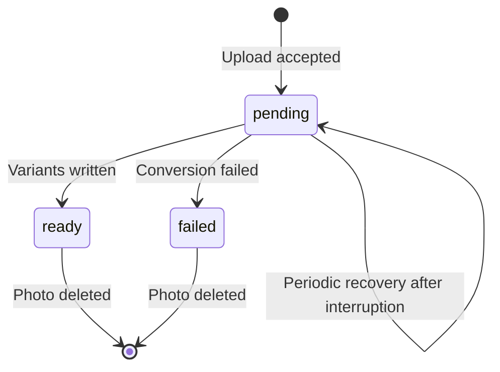

# Photo pipeline

Photos belong to one voyage and its owner. Uploading into a draft does not
publish it. A successful upload returns 201 after validation, original storage,
photo-row commit, and queue acceptance. Image conversion finishes asynchronously.

Rust paths below are relative to `crates/api/src/` unless otherwise specified. Frontend
paths are relative to `web/src/`.

## Browser workflow

`web/src/screens/Upload.tsx` collects a voyage name, description, and explicit
precision, creates the draft, and replaces the URL query with `voyage=<id>`.
Refreshing that address resumes upload into the existing draft.
`upload/useUploadBatch.ts` owns per-file state, progress, cancellation, and retry.
It sends files sequentially, one per request. Each item has a UUID reused as its
`Idempotency-Key` on retry. Unmount aborts active requests and stops remaining
files from starting. Canceling a request cannot undo a server commit; retrying
with the same key resolves an uncertain result without creating another photo.

XHR reports transfer progress. After transfer, the row says it is reading
location data until the response arrives. Accepted rows include exact owner
metadata and become available for review, including photos without GPS. The
review map does not wait for variants. Voyage detail and list queries poll while
photos remain pending. Creation, upload, deletion, and publication mutations
invalidate affected voyage, discovery, and public-profile queries.

## Upload validation and acceptance

`crates/api/src/http/photos.rs::upload` and `ingest_part` implement the sequence:

```mermaid
sequenceDiagram
    participant UI as Browser
    participant API as Upload handler
    participant DB as PostgreSQL
    participant FS as Storage
    participant Q as Worker queue
    UI->>API: Multipart upload with stable UUID key
    API->>API: Authenticate, check voyage ownership and user quota
    API->>FS: Stream multipart field to temporary file
    API->>API: Check bytes, format, dimensions, hash, and EXIF
    API->>Q: Reserve a queue slot
    API->>DB: Begin; lock owned voyage
    API->>DB: Look up key plus file ordinal
    alt Existing key with matching content
        API-->>UI: 201 with existing photo
    else New upload
        API->>DB: Lock content hash
        API->>FS: Commit original by content hash
        API->>DB: Insert pending photo and key; commit
        API->>Q: Send reserved job without waiting
        API-->>UI: 201 with accepted photo
    end
```

Axum's multipart extractor handles boundaries and field streaming. The body limit counts
multipart overhead; a file exactly at the configured request limit can exceed it once
framing is included. File type comes from magic bytes, not the filename or submitted
MIME type. Dimensions are probed before full decoding. Dimension checks, hashing, and
EXIF reads run on the blocking pool. Multipart part headers exceeding 4,096 bytes return
400; `check_part_headers` counts header names, values, and separators. The handler
removes a rejected part's temporary file.

| Default | Value |
| --- | --- |
| Formats | JPEG, PNG, WebP, HEIC |
| Request size limit | 26,214,400 bytes (25 MiB), including multipart framing |
| Maximum pixel count | 100 megapixels |
| Upload rate | 60 requests/minute/user, per API process |
| Queue depth / active conversions | 256 / 4 |
| WebP quality | 82 |

The upload limiter belongs to `AppState`. `UploadLimiter::take_at` receives an
explicit monotonic time, refills a token bucket, returns a Retry-After interval,
and periodically removes idle entries. Independent application states have
independent quotas; the quota is not shared across API processes.

An optional `Idempotency-Key` must be a UUID. The stored key combines that UUID
with the file ordinal and is unique within the voyage. Replaying the same bytes
returns the existing photo; using that key for different bytes returns 409.
Clients sending multiple files must retain their order on retry. Without a key,
identical uploads share physical content but create distinct photo records.
A batch is not one transaction: earlier accepted files remain if a later file
fails. A closed worker returns 503 before a new row is committed. A full worker
queue delays acceptance without holding a database connection.

| Condition | Response |
| --- | --- |
| Missing session | 401 |
| Missing/foreign voyage | 404 |
| Request size limit exceeded | 413 |
| Unrecognized image format | 415 |
| Pixel count limit exceeded or undecodable image | 422 |
| Quota exhausted | 429 with Retry-After |
| Invalid retry key | 400 |
| Retry key reused for different bytes | 409 |
| Worker unavailable | 503 |
| Valid accepted upload/replay | 201 |

`photos/exif.rs` treats malformed or absent EXIF as missing metadata. GPS needs
both coordinates and valid axis references: N/S for latitude, E/W for longitude.
An incomplete pair is unplaced. Exact coordinates stay in owner metadata;
public voyage and discovery responses use `Granularity::apply`.

## Conversion and recovery

`photos/worker.rs::spawn` owns the dispatcher, maintenance, and conversion tasks. The
dispatcher takes a concurrency permit before receiving another job, so waiting work
stays in the queue, which holds at most 256 jobs by default. A job carries OpenTelemetry
context without retaining the original request span.

`generate` loads the photo, skips deleted/ready rows, and performs decode,
orientation, resize, and encode without a database connection. JPEG/PNG/WebP use
`image`; HEIC uses libheif. Lossy WebP uses libwebp. The original is decoded once
and reused for each size. Re-encoding copies no original metadata.

| Variant | Maximum longest edge | Voyage field |
| --- | --- | --- |
| `thumb` | 400 pixels | `thumbnail_url` |
| `display` | 1,200 pixels | `display_url` |
| `full` | 2,560 pixels | `full_url` |

Images are never enlarged. Finalization locks content and rechecks the photo
before writing. Each output uses a unique sibling temporary file and atomic
rename. The blocking write owns the database transaction so cancellation cannot
release the content lock while writes continue. After all variants exist, the
photo becomes ready. A processing error attempts to mark it failed and logs its
cause.



Maintenance runs at startup and every 60 seconds. It traverses every pending photo in ID
pages of 1,000, removes expired sessions/authorization attempts, and retries queued file
cleanup. A database scan failure is retried on a later pass. Failed conversions are not
automatically retried. Duplicate jobs can encode the same bytes concurrently, especially
across processes; final writes serialize under the content lock. During shutdown,
`VariantQueue::shutdown` stops maintenance, closes the queue to new jobs, and waits for
accepted jobs to finish. If `server.shutdown_timeout_secs` expires (30 seconds by
default), it aborts the worker task. Maintenance retries remaining pending rows after
restart. See [shutdown order](architecture.md#startup-request-handling-and-shutdown).

## Storage and deletion

```text
storage_root/
  tmp/{uuid}.part
  originals/{hash[0..2]}/{hash[2..4]}/{hash}
  variants/{hash[0..2]}/{hash[2..4]}/{hash}.{thumb|display|full}.webp
```

`ContentHash` validates exactly 64 lowercase hexadecimal characters. Paths use
validated hashes and variant enums, never upload filenames. Multiple photo rows
can reference the same original and variants.

Photo/voyage deletion locks the voyage and content hashes, deletes rows, and
records cleanup in the database transaction. Files are removed only after that
transaction commits. `photos/cleanup.rs::clean` reacquires the content lock and
rechecks references before removal; a concurrent upload that adopted the content
keeps its files. The blocking removal owns the transaction until it stops.
Failed removals remain in `photo_cleanup` for maintenance retry.

The filesystem and PostgreSQL do not form one transaction. A crash around an
original write can leave unreferenced bytes, and canceled uploads can leave
temporary files. Automatic cleanup handles recorded deletions, not a complete
scan of every orphaned file. Storage needs persistent capacity and operational
monitoring. The API container configures `/data`; Compose mounts its `uploads`
volume there.

## Authorized delivery

`http/photos.rs::image` checks the photo and voyage visibility before opening a
variant. Owner-only metadata keeps exact coordinates; public image access
requires publication. Originals have no serving route.

| Condition | Response |
| --- | --- |
| Unknown variant, missing/foreign draft, failed/unavailable variant | 404 |
| Pending conversion | 409 with Retry-After |
| Matching authorized conditional request | 304 without reading the body |
| Available authorized variant | Streamed WebP body |

Responses set `Content-Type: image/webp`, `X-Content-Type-Options: nosniff`, a
controlled inline filename, ETag, Last-Modified when available, and
`Cache-Control: private, no-cache, must-revalidate`. Authorization also runs for
conditional requests, so cached responses must revalidate after unpublishing.
The handler opens the file and reads metadata before deciding whether to stream
it; a 304 does not buffer the image.

## Verification

`http/photos_tests.rs` checks streaming multipart boundaries, upload retry keys,
closed-worker acceptance, incomplete GPS, native HEIC conversion, failed delete commits,
authorization, and validators. `photos/worker_tests.rs` checks queue capacity, recovery
beyond 1,000 rows, and shutdown. `photos/cleanup_tests.rs` checks retry after filesystem
failure and adoption of shared content. Integration suites include `photo_ownership.rs`,
`photos_public_access.rs`, `photos_recovery.rs`, and `image_tracing.rs`. Frontend
batch/map tests cover cancellation, retries, review, readiness polling, and real
MapLibre geometry. See [testing](testing.md), [tracing](tracing.md), and [photo
performance](photo-performance.md).
