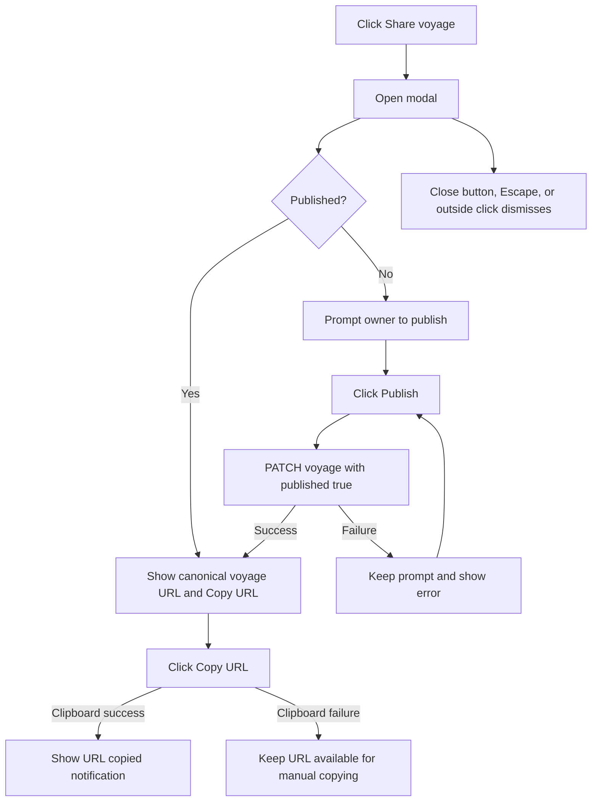

# Sharing a voyage

The voyage view offers **Share voyage** on desktop and mobile. It opens a native modal
dialog. Published voyages show their public URL; drafts prompt the owner to publish
first.

## Published voyages

The dialog displays a read-only **Voyage URL** field containing the current site
origin and `/voyages/{id}`. Visitors do not need to sign in to open the dialog
or view a published voyage. The URL does not contain account credentials,
sessions, photo coordinates, or a new sharing token.

**Copy URL** calls `navigator.clipboard.writeText` from the user's button click.
It disables the button while the operation is pending and shows the **URL copied**
success notification only after it succeeds. If copying fails or the Clipboard
API is unavailable, an error asks the user to copy the URL manually from the
field. Retrying clears the previous feedback and attempts copying again.

## Draft voyages

The owner sees “Publish this voyage to enable sharing. Published voyages are visible to
everyone.” The dialog does not expose a Voyage URL or Copy URL action until publication
succeeds. **Publish** sends `{ published: true }` through the authenticated `PATCH
/api/voyages/{id}` endpoint. While pending, Publish is disabled. A failure keeps the
prompt visible and shows the server error, allowing retry. Success switches the same
open dialog to the URL and copy action; the user does not need to close and reopen it or
wait for a refetch.

The view has no unsaved editor fields; this action only changes publication.
The editor continues to include current edits in its combined save-and-publish
request. The API retains owner-only access to drafts and rejects unauthorized
publication. The dialog additionally shows Publish only to the voyage owner.

## Dismissal and focus

The dialog has an X button labeled **Close share dialog**. Native `showModal`
provides modal focus, background isolation, and Escape dismissal.
`closedby="any"` enables native outside dismissal. A pointer-based fallback
supports browsers without that behavior. It requires both the initial press
and the final click to occur outside the dialog, so clicking inside, right
clicking, selecting the URL, or dragging from inside to outside does not dismiss.
Closing returns focus to the Share button. StrictMode cleanup and queued native
close events after reopening do not dismiss a newly mounted dialog.

## Implementation and verification

- `web/src/screens/voyage/VoyageChrome.tsx::ShareVoyage` owns opening, owner detection,
  and focus restoration; both voyage layouts use it.
- `web/src/components/VoyageShareDialog.tsx::VoyageShareDialog` handles publication, clipboard actions,
  and notifications. `web/src/components/useModalDialog.ts::useModalDialog`
  handles native opening, closing, and clicks outside the dialog.
- `web/src/api/hooks.ts::useUpdateVoyage` calls the update endpoint and
  saves the response in the voyage detail cache after publication.
- `.pv-share-dialog` in `web/src/styles/index.css` uses shared design tokens for
  the width, spacing, border, background, shadow, and backdrop.

The component tests in `web/src/components/__tests__/VoyageShareDialog.test.tsx`
cover copying, publication, owner restrictions, pending/error states, dismissal,
and lifecycle handling. `VoyageDetail.test.tsx` covers both layouts and focus
restoration. See [testing](testing.md) for the browser behavior these tests model.
